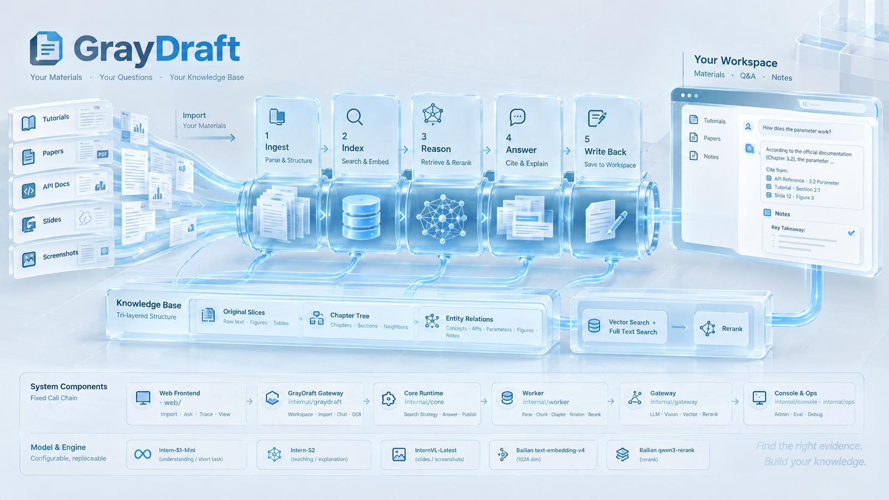

# GrayDraft



GrayDraft 是一个资料工作台。人把教程、论文、接口说明、课件和截图放进自己的工作区，就着这些材料提问。它把散落的页面读成可以检索的结构，按问题去查找，给出能指回原文的讲解，并把值得留下的结论写回同一套资料。

当前工作区按教育材料来组织，分成教程、论文和笔记。产品是这套工作台本身：材料、问题和结论都留在使用者自己的空间里。

## 它解决什么

一份材料很少只活在一个文件里。定义在教程里，参数在接口说明里，图在课件页上，上次讨论的结论在聊天记录里。人要自己翻，问助手又常常得到一段说得通、但材料里根本没有的步骤。

GrayDraft 把这件事收成一条可以重复使用的路径：材料进得来，问题查得着出处，没有依据时会说没有，讨论过的结论还能在下一次被找到。

## 它怎么做

**出处先于措辞。** 讲解引用的是原文切片。材料里没有的数值、参数和步骤，就说明没有，不用常识把缺口补上。证据不够时，它会换一种查法；仍然不够，就停下来说明范围。

**材料按阅读方式保存。** 每一段保留原文，同时记下它在哪一章、前一节和后一节是什么，以及概念、接口、参数、图和笔记之间的关系。提问时按需要取用，而不是把整份材料打成互不相干的碎片。

**查法跟着问题走。** 专名、参数和错误码用词法查找。换一种说法的概念用语义查找。步骤被切到相邻段落时，读这一段和它前后的章节。定义、图和笔记不在同一处时，沿着它们的关系找到原文再讲。同一种查法不会拿同一个问题反复做。

**结论回到工作区。** 一次讲解可以收成笔记草稿。确认之后，笔记走和原始材料相同的入库过程，并连回来源。下一次提问可以检索到它。

**工作区彼此独立。** 检索、记忆和笔记都限制在被授权的资料里。未确认的笔记不会变成已发布材料。

查找由五个动作完成：`knowledge.lexical`、`knowledge.semantic`、`knowledge.read`、`knowledge.expand`、`note.draft`。一次提问最多走 8 步。默认助手是 `edu-tutor`。

## 系统怎么组成

人在工作台里完成导入、提问和笔记。后面几层各管一件事，调用关系是固定的：工作台不直接查库，查找和作答不直接调用模型厂商。

| 部分 | 路径 | 负责 |
| --- | --- | --- |
| 工作台 | `web/` | 导入材料、提问、查看查找过程和讲解 |
| 接入层 | `internal/graydraft` | 工作区、导入、对话和页面识别 |
| 运行时 | `internal/core` | 决定怎么查、何时作答、笔记是否可发布 |
| 入库 | `internal/worker` | 解析、分块、章节、关系、重排 |
| 模型接入 | `internal/gateway` | 理解、看图、向量、重排 |
| 运维 | `internal/console`、`internal/ops` | 管理后台，以及评估与缺陷定位 |

材料进库后分成三层：原文切片、章节树、实体关系。向量和全文检索负责找到候选，重排负责把更相关的段落放在前面。作答只使用原文，不使用摘要或关系本身代替引用。

理解和短任务用书生 `intern-s1-mini`，讲解用书生 `intern-s2`，课件页和截图用书生 `internvl-latest`。向量用百炼 `text-embedding-v4`（1024 维），重排用百炼 `qwen3-rerank`。模型可以更换，工作区、出处和笔记的规则不变。配置见 [模型说明](docs/api/models.md)。

## 文档

| 文档 | 说明 |
| --- | --- |
| [系统逻辑总览](docs/architecture/系统逻辑总览.md) | 入库、检索、对话、导入和多模态怎么串起来 |
| [Agent 实现说明](docs/architecture/Agent流程技术实现方案.md) | 查找、作答、记忆和笔记 |
| [文档中心](docs/README.md) | 架构、功能、接口和部署 |
| [本地开发](docs/development.md) | 启动与调试 |

## 目录

```
GrayDraft/
├── web/               # 工作台
├── internal/          # 接入层、运行时、入库、模型接入、运维
├── pkg/               # Go / Python 共享库
├── protos/            # gRPC 契约
├── deploy/            # Docker、Nginx、环境变量、监控
├── tests/             # 集成与回归
├── docs/              # 架构与接口文档
└── scripts/           # 项目级脚本
```

## 快速开始

配置已随仓库提交（`deploy/config/dev/`）。换机 `git pull` 后可直接启动。更换模型 Key 时，编辑 `deploy/config/dev/.env.gateway` 与 `.env.core`。

```bash
make dev-up   # 端口见 deploy/config/dev/.env.ports

curl http://localhost:8443/api/health
```

## 开发端口（dev）

| 组件 | 宿主机端口 |
| --- | --- |
| Nginx HTTP | 8443 |
| 工作台 | 8080 |
| 接入层 | 8787 |
| 运行时 HTTP / gRPC | 18080 / 19090 |
| 入库 | 18001 |
| 模型接入 | 18002 |
| 管理后台 | 13000 |
| 评估 | 18003 |
| PostgreSQL | 25432 |
| Redis | 26379 |

## 常用命令

```bash
make help          # 所有 Make 目标
make proto-gen     # 生成 gRPC 代码
make lint          # 代码检查
make dev-up-gpu    # 含本地推理
```

## License

See [LICENSE](LICENSE).
