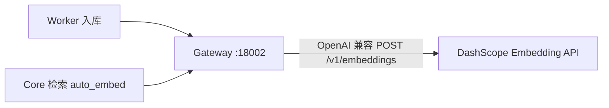

# Embedding（O-13 · 百炼 DashScope / Qwen）

GrayDraft 的向量检索与入库 embedding **统一经 Model Gateway** `POST /v1/embeddings` 调用远程 API（默认 **阿里云百炼 DashScope**），Worker / Core 不直连厂商。



官方文档：[通用文本向量同步接口](https://help.aliyun.com/zh/model-studio/developer-reference/text-embedding-api)（百炼控制台 API 文档同源）。

## 百炼文本向量模型

| 模型 | 向量维度（可选） | 默认维度 | 适用场景 |
|------|------------------|----------|----------|
| **text-embedding-v4** | 2048、1536、**1024**、768、512… | **1024** | 多语种 RAG、语义检索（**GrayDraft 默认**） |
| text-embedding-v3 | 1024、768、512… | 1024 | 上一代通用向量 |
| text-embedding-v2 | 1536（固定） | 1536 | 需改 PG `vector(1536)` 才可用 |
| text-embedding-v1 | — | — | 旧版，不推荐 |

> OpenAI 兼容 `base_url`：`https://dashscope.aliyuncs.com/compatible-mode`（Gateway 内部拼 `/v1/embeddings`）。  
> v4 / v3 可通过请求体 `dimensions` 指定维度；未指定时默认 **1024**，与现网 schema 一致。

### 与数据库维度对齐

当前 PostgreSQL 定义为 `embedding vector(1024)`（见 `deploy/migrations/000001_init.up.sql`）。

| 选型 | 是否需要改库 |
|------|----------------|
| **text-embedding-v4（1024 默认）** | 否 |
| text-embedding-v2（1536） | 是，需迁移 `vector(1536)` |
| v4 指定 dimensions=768 等 | 是 |

**切换 embedding 模型或维度后，必须对历史 chunk 重新向量化**（重新入库或批量 re-embed），否则检索质量无效。

## 配置

### Gateway

`internal/gateway/config/config.dev.yaml` / `config.prod.yaml`：

```yaml
models:
  embedding:
    provider: dashscope          # 别名：qwen / bailian
    model: text-embedding-v4

embedding:
  dim: 1024
  fallback_local: false          # 生产：API 失败即报错

providers:
  dashscope:
    enabled: true
    base_url: https://dashscope.aliyuncs.com/compatible-mode
```

`deploy/config/dev/.env.gateway`（或 prod）：

```bash
DASHSCOPE_API_KEY=sk-...
DASHSCOPE_BASE_URL=https://dashscope.aliyuncs.com/compatible-mode
EMBEDDING_PROVIDER=dashscope
EMBEDDING_MODEL=text-embedding-v4
EMBEDDING_DIM=1024

# LLM / Rerank 仍可用 DeepSeek
DEEPSEEK_API_KEY=sk-...
```

### Core / Worker

与 Gateway 使用**同一 model 名**（经 Gateway 转发，不直连百炼）：

| 组件 | 配置 |
|------|------|
| Core | `model_gateway.embedding_model`、`embedding_dim: 1024` |
| Worker | `embedding.model`、`model_gateway_url` → Gateway |

环境变量：`EMBEDDING_MODEL=text-embedding-v4`（`.env.core` / `.env.worker`）。

## API 调用方式

### 经 GrayDraft Gateway（业务链路）

```bash
curl -X POST http://localhost:18002/v1/embeddings \
  -H 'Content-Type: application/json' \
  -d '{"texts":["个人知识库语义检索测试"],"model":"text-embedding-v4"}'
```

响应（节选）：

```json
{
  "vectors": [[0.01, ...]],
  "model": "text-embedding-v4",
  "dimension": 1024
}
```

### 直连百炼（OpenAI 兼容，与 Gateway 内部一致）

```bash
curl -X POST https://dashscope.aliyuncs.com/compatible-mode/v1/embeddings \
  -H "Authorization: Bearer $DASHSCOPE_API_KEY" \
  -H 'Content-Type: application/json' \
  -d '{"model":"text-embedding-v4","input":["个人知识库语义检索测试"]}'
```

可选指定维度（v3/v4）：

```json
{
  "model": "text-embedding-v4",
  "input": ["文本1"],
  "dimensions": 1024,
  "encoding_format": "float"
}
```

## 开发环境 fallback

`embedding.fallback_local: true` 时，在 **未配置 `DASHSCOPE_API_KEY` 或 API 调用失败** 时回退 **pseudo 向量**（确定性 hash，仅 smoke test）。

启用真实百炼 Embedding 时：

1. 配置 `DASHSCOPE_API_KEY`
2. 设置 `EMBEDDING_PROVIDER=dashscope`、`EMBEDDING_MODEL=text-embedding-v4`、`EMBEDDING_DIM=1024`
3. 建议 `fallback_local: false`，避免静默使用 pseudo

## RAG 搭配建议

- **Retriever**：百炼 `text-embedding-v4`（入库 chunk + 检索 query 同一 model）
- **Generator**：DeepSeek 对话模型（如 `deepseek-v4-pro` / flash），经 Gateway `POST /v1/chat/completions`

检索-生成分工，降低幻觉。

## 与其他方案

| 方案 | 说明 |
|------|------|
| **百炼 DashScope API（当前 O-13）** | 免运维，OpenAI 兼容，**默认 v4 @ 1024**，中英文混合表现好 |
| DeepSeek Embedding API | 公开 API 暂无 `/v1/embeddings` 端点 |
| BGE / TEI 自部署 | 可选替代；切换模型须 re-embed |

## 相关

- [`models.md`](models.md) — 全模型绑定
- [`gateway.md`](gateway.md) — Gateway 端点
- [`retrieval.md`](retrieval.md) — 检索与 `auto_embed`
- [`worker.md`](worker.md) — 入库流水线
