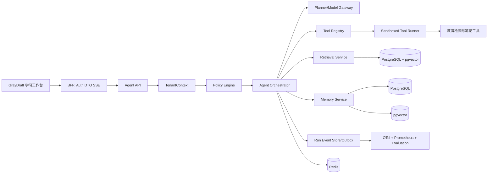

# Agent 实现说明

> 基线日期：2026-11-04。运行时行为以代码和 [系统逻辑总览](系统逻辑总览.md) 为准。
> 本文说明 GrayDraft 的 Agent Runtime：按工作区资料取证、作答和沉淀笔记。策略是 `edu_workspace_v1`。可观测、可回放，并按租户隔离。

## 1. 实施目标与边界

### 1.1 目标

1. 对话入口是有状态 `AgentRun`。`POST /api/v1/chat/stream` 不提供。
2. 以状态机驱动多轮 Loop，工具只做教育检索和笔记沉淀。
3. 实现会话短期记忆、用户长期记忆和可引用知识的分层存储。
4. 每一步都产生日志、指标、证据和成本信息，支持自动评估与回放。
5. 所有请求、记忆、缓存、工具和事件严格绑定 `TenantContext`。

### 1.2 非目标

- 不实现任意代码执行、开放互联网爬取，也不自动改写已发布资料。
- Agent 不直接访问 PostgreSQL、Redis、对象存储或模型 Provider，必须通过 Port。
- “记忆”不等于知识库；知识文档仍通过 Import/Index 流程治理。

## 2. 技术架构



### 2.1 服务与职责

| 服务 | 主要职责 | 技术实现 | 禁止事项 |
|---|---|---|---|
| `agent-api` | 创建 Run、SSE/事件查询、取消、审批 | Go HTTP/gRPC | 不做模型调用 |
| `agent-runtime` | 状态机、Loop、预算、并发、重试 | Go，单 Run Actor | 不直接操作数据库 |
| `planner` | 结构化决策、答案生成、意图识别 | Model Gateway + JSON Schema | 不生成未授权工具 |
| `retrieval` | QueryPlan、混合召回、重排、证据包 | FTS + pgvector + RRF | 不生成最终答案 |
| `memory` | 消息、摘要、长期记忆检索与写入 | PostgreSQL/Redis/pgvector | 不改变知识文档 |
| `tool-registry` | ToolSpec、版本、风险与授权 | PostgreSQL + 本地缓存 | 默认开放工具 |
| `tool-runner` | 超时、隔离、限流、审计、适配器执行 | Worker/Sandbox | 任意 Shell/SQL |
| `model-gateway` | LLM/Embedding/Rerank、Fallback、Token/费用 | Provider Adapter | 承载领域策略 |

依赖方向固定为：`api → app → domain + ports ← adapters`。`cmd/gateway/main.go` 只组装依赖，避免路由层拼 Prompt 或读工作区配置。

### 2.2 Agent Profile

工作台默认使用教育场景策略 `edu_workspace_v1`。Run 创建时记录 Agent 和策略版本，工具仍受授权范围约束。核心工具为 `knowledge.lexical`、`knowledge.semantic`、`knowledge.read`、`knowledge.expand` 和 `note.draft`。工作台默认最多 8 步，运行时预算和工具绑定以实际配置为准。

`0.62` 是 `answer_gate.go` 中的默认门禁阈值。接入方通过 [Run API](../api/agent-v2.md) 提交问题和可选运行配置，门禁阈值由 Core 决定。

### 2.3 证据与查法

资料入库后分成三层，查找时按问题取用：

| 层 | 保存什么 | 回答时怎么用 |
| --- | --- | --- |
| 原文 | 切片正文。待嵌入文本带上文档标题和章节路径，展示和引用仍用原文 | 讲解只能引用这一层 |
| 章节 | 父节、上一节、下一节、标题层级 | 步骤被切开时，读中心段和相邻节 |
| 关系 | 概念、接口、参数、模型、图表、笔记，以及「定义于」「参数属于」「图示」「笔记沉淀自」 | 最多走两跳，终点必须是原文切片 |

| 问题 | 查法 |
| --- | --- |
| 接口名、参数名、错误码 | `knowledge.lexical` |
| 换一种说法的概念 | `knowledge.semantic` |
| 只命中半段步骤 | `knowledge.read` |
| 定义、图、笔记不在同一处 | `knowledge.expand` |
| 材料里没有依据 | 把缺口写回下一步；步数用尽则说明范围，或请使用者补充要查的概念和文档 |

章节摘要和文档摘要可以用来判断主题，成文前仍要读到原文。关系本身不能当作引用。

## 3. 核心数据模型

### 3.1 Agent Run 与事件

```sql
agent_runs(
  run_id uuid primary key,
  tenant_id uuid not null,
  agent_id text not null,
  conversation_id uuid,
  actor_id uuid not null,
  status text not null,
  policy_version text not null,
  step_count int default 0,
  token_in bigint default 0,
  token_out bigint default 0,
  deadline_at timestamptz not null,
  idempotency_key text not null,
  created_at timestamptz not null,
  unique(tenant_id, idempotency_key)
)

agent_run_events(
  run_id uuid not null,
  seq bigint not null,
  event_id uuid not null,
  type text not null,
  schema_version int not null,
  payload jsonb not null,
  occurred_at timestamptz not null,
  primary key(run_id, seq),
  unique(event_id)
)
```

事件采用 append-only；状态表是投影，可由事件重建。写事件与状态更新在同一事务内完成，发布 Outbox 后由 SSE、指标和评估消费者异步处理。

### 3.2 消息、摘要与记忆

```sql
conversation_messages(
  message_id uuid primary key, tenant_id uuid, conversation_id uuid,
  role text, content text, citations jsonb, run_id uuid, created_at timestamptz
)

memory_items(
  memory_id uuid primary key, tenant_id uuid, actor_id uuid,
  kind text, subject text, value jsonb, source_message_ids uuid[],
  confidence real, sensitivity text, status text, expires_at timestamptz,
  embedding vector(1536), version int, created_at timestamptz, updated_at timestamptz
)
```

- Redis 保存最近 20 条消息、当前摘要和未完成 Run，TTL 24 小时。
- PostgreSQL 保存完整消息、摘要版本和关系属性，满足审计/删除/导出。
- pgvector 保存经同意的长期偏好、事实和任务经验；敏感信息默认不向量化。

### 3.3 工具模型

```json
{
  "name": "knowledge.lexical",
  "version": "1.0.0",
  "input_schema": {"type":"object","required":["query"]},
  "output_schema": {"type":"object"},
  "risk_level": "R0",
  "scopes": ["knowledge:read"],
  "timeout_ms": 1500,
  "idempotent": true,
  "approval": "none"
}
```

ToolSpec、租户授权、Schema 哈希和版本写入注册表；Run 事件记录 `tool_name/version/input_hash/output_hash/latency/status`，不记录密钥和完整隐私字段。

## 4. Agent 执行逻辑

### 4.1 Run 生命周期

```text
queued → loading_context → deciding
  ├─ final → validating_answer → completed
  ├─ tool_calls → validating_tools → (approval?) → executing → observing → deciding
  └─ error → retrying / failed / expired / cancelled
```

每个 Run 由单个有序 Actor 处理，事件序号保证顺序；工具执行在独立 Worker，可并行执行互不依赖的只读调用。

### 4.2 决策协议

Planner 只能返回严格 JSON：

```json
{
  "decision": "tool_calls | final | clarify",
  "thought_summary": "用于审计的短摘要，不保存隐式思维链",
  "tool_calls": [{"call_id":"c1","name":"knowledge.semantic","arguments":{}}],
  "answer": null,
  "confidence": 0.0
}
```

服务端使用 JSON Schema 校验；解析失败最多重试一次（更换修复 Prompt），仍失败则转为 `clarify` 或安全降级检索回答。

### 4.3 Loop 伪代码

```go
func (r *Runtime) Run(ctx context.Context, req StartRequest) error {
    tc := r.policy.ResolveTenantContext(ctx, req)
    run := r.runs.Create(tc, req.IdempotencyKey, req.AgentID)
    defer r.events.Flush(run.ID)

    state := StateLoadingContext
    for state.Terminal() == false {
        if r.budget.Exceeded(run) { return r.finish(run, "expired") }
        r.events.Append(run, state.EnterEvent())

        switch state {
        case StateLoadingContext:
            ctxPack := r.context.Build(tc, req)
            state = StateDeciding
        case StateDeciding:
            decision := r.planner.Decide(ctx, r.prompt.Build(ctxPack))
            state = r.transition(decision)
        case StateValidatingTools:
            calls := r.policy.ValidateTools(tc, decision.ToolCalls)
            state = r.nextToolState(calls)
        case StateExecuting:
            obs := r.tools.ExecuteParallel(ctx, calls, r.budget.ToolLimits(run))
            ctxPack = r.context.AddObservations(ctxPack, obs)
            state = StateDeciding
        case StateValidatingAnswer:
            answer := r.answer.Validate(decision.Answer, ctxPack.Evidence)
            return r.finish(run, answer)
        }
    }
    return nil
}
```

## 5. 核心算法

### 5.1 上下文组装与 Token 预算

令总预算为 `B`，系统 Prompt、用户问题、记忆、证据和工具结果分别为 `S,Q,M,E,O`：

```text
available_E = B - (S + Q + M + O + reserve_answer)
```

证据按 `utility = relevance × freshness × authority × version_match / token_cost` 降序加入；超过预算时先去除低分 Chunk，再压缩摘要，禁止截断引用边界。与当前资料版本不符的证据 `version_match=0`，除非用户明确要看历史版本。

### 5.2 混合检索与证据融合

并行得到全文排名 `R_f`、向量排名 `R_v`、结构化实体排名 `R_e`。采用加权 RRF：

```text
rrf(d) = wf/(60 + rank_f(d)) + wv/(60 + rank_v(d)) + we/(60 + rank_e(d))
score(d) = rrf(d) × freshness(d) × authority(d) × version_match(d)
```

若 `version_match=0`，默认剔除；若用户未提供版本，则优先当前 Active Version，再补充历史资料并标记来源。前 `N=30` 条进入 Rerank，最终生成 6–10 条 EvidenceBundle。

### 5.3 答案可信度与拒答

BFF 将问题与运行配置分开，Runtime 在成文前准备有界证据包。门禁独立复算实际收到的包摘要，并对照成文摘要。明确的同单位数量级矛盾可硬拒绝并独立复算。计数范围、参数名、统计量角色和结论强度通过规则标记歧义。详细规则和离线纠错状态见 [正确性架构与验收边界](correctness-architecture.md)。

### 5.4 记忆写入与检索

长期记忆候选由规则 + LLM 分类生成：`preference | stable_fact | task_state | feedback | sensitive`。写入得分：

```text
write_score = 0.35·explicitness + 0.25·repeat_count_norm
           + 0.20·confidence + 0.20·future_utility - sensitivity_penalty
```

`write_score ≥ 0.75` 且用户同意才写入；`sensitive` 永不自动写入。检索采用过滤后向量 TopK（K=20）+ 关系精确匹配 TopK（K=10），RRF 后取最多 5 条，并按时间衰减 `exp(-age/half_life)` 加权。冲突记忆保留两条并标记 `conflict`，交由澄清流程解决，不覆盖原记录。

### 5.5 Loop 防重复与进度检测

对每个工具调用规范化 `fingerprint = sha256(name + sorted(args) + resource_version)`。若连续重复次数超过 2，或两步之间：新证据数为 0、未减少缺失字段、答案置信度无提升，则判定无进展；触发一次替代策略（改写 Query/请求澄清），仍无进展即安全结束。

## 6. 工具调用安全实现

调用顺序固定：

```text
模型提出 → 名称/版本白名单 → Schema 校验 → Tenant Scope 校验
→ 风险与审批 → 参数脱敏/限额 → 沙箱执行 → 输出 Schema 校验
→ 结果裁剪 → 审计事件 → 回填 Observation
```

风险等级：

| 等级 | 示例 | 默认策略 |
|---|---|---|
| R0 | `knowledge.lexical`、`knowledge.semantic`、`knowledge.read`、`knowledge.expand` | 自动，只读 |
| R2 | `note.draft` | 审批通过后入库 |
| R3 | 删除资料、越权写入 | 拒绝 |

Runner 使用最小权限 Token、网络 Allowlist、CPU/内存/时间配额和熔断。工具输出限制为 32KB，超出后摘要化；密钥只引用 Secret Manager，不进入 Prompt、事件或日志。

## 7. API 与事件契约

### 7.1 API

```http
POST /api/v2/agent-runs
GET  /api/v2/agent-runs/{run_id}/events?after_seq=0
POST /api/v2/agent-runs/{run_id}/cancel
POST /api/v2/agent-runs/{run_id}/approvals/{call_id}
```

请求必须带 `Idempotency-Key`；响应返回 `run_id`、`policy_version`、`trace_id`。SSE 断线通过 `after_seq` 续传，事件至少包括 `run.started`、`step.started`、`retrieval.completed`、`tool.*`、`answer.delta`、`run.completed`。

### 7.2 错误与重试

| 错误 | 重试 | 降级 |
|---|---|---|
| Provider 429/5xx | 指数退避 2 次，带抖动 | 切换同等级模型 |
| Schema 无效 | 修复 Prompt 重试 1 次 | clarify |
| 检索超时 | 取消慢分支 | 使用已完成召回 |
| 工具超时 | 幂等工具重试 1 次 | 说明工具不可用 |
| 租户/权限失败 | 不重试 | 直接拒绝 |
| 预算超限 | 不重试 | 返回当前最佳答案并标记截断 |

## 8. 性能与可靠性

| 指标 | 目标 P95 |
|---|---:|
| 创建 Run | ≤300ms |
| 首次检索 | ≤500ms |
| Memory Retrieval | ≤100ms |
| 首 Token | ≤3s |
| Tool 策略校验 | ≤100ms |
| SSE 事件延迟 | ≤200ms |

实现措施：检索三路并行、Embedding/摘要异步微批、模型连接池、QueryPlan/证据缓存、租户级并发信号量、Run Actor 避免锁竞争、Outbox 保证事件可靠发布、断线续传、DLQ + 人工重放。缓存键必须包含 `tenant_id`、授权 KB 哈希、Active Version、Policy/Prompt/Model 版本；带个人记忆或写工具结果的回答不进入共享答案缓存。

## 9. 质量评估与可观测性

### 9.1 自动评估

黄金集按 `tutorial` / `paper` / `note` 分层，覆盖概念、专名、相邻步骤、跨文档、拒答和笔记写回。模型、Prompt 或检索配置变更时做离线回放。

核心指标：

- Retrieval Recall@10 ≥ 0.90、nDCG@10 ≥ 0.85。
- Citation Precision ≥ 0.95、Groundedness ≥ 0.95、No-answer F1 ≥ 0.90。
- Agent Task Success ≥ 0.90、Tool Success ≥ 0.98、越权拦截率 100%。
- Loop 平均步数 ≤ 4、无进展终止率、预算超限率、P95/Token/成本。

LLM Judge 仅作辅助；上线门禁以人工标注集、规则校验和可复现 Trace 为准。

### 9.2 Trace 字段

每个 Span 必须包含 `tenant_id、run_id、step_id、policy_version、model、prompt_hash、retrieval_run_id、tool_call_id、token_in/out、cost、latency、status`。禁止记录原始密钥、完整敏感记忆和未脱敏用户内容。

## 10. 当前基线

工作区材料分成 `tutorial`、`paper`、`note`。Runtime 用这一套策略服务这些资料。

1. `AgentRun`、事件投影、TenantContext、预算、取消和 SSE 断线续传在 `POST /api/v2/agent-runs`。
2. 工具是 `knowledge.lexical`、`knowledge.semantic`、`knowledge.read`、`knowledge.expand`、`note.draft`。
3. 带引用的笔记通过自动门禁后入库。未授权知识库拒绝访问。
4. 专名题应出现词法查找，相邻步骤题应出现读窗口，跨文档题应出现关系扩展，引用落在终点切片上。

## 11. 风险与回滚

| 风险 | 防护 | 回滚 |
|---|---|---|
| Loop 无限循环 | 步数/时间/重复指纹/无进展门禁 | 终止 Run 并返回可审计错误，不切回旧链路 |
| 版本混答 | Active Version + version_match 硬过滤 | 回退旧索引指针 |
| Provider 波动 | Gateway 熔断、Fallback、预算 | 切换模型策略 |
| 记忆污染 | 同意、置信度、冲突保留、删除 | 停止写入并重建向量 |
| 工具越权 | 白名单、Scope、R2 审批、R3 禁用 | 禁用 ToolSpec 版本 |
| 成本失控 | 租户/Agent/Run 预算和告警 | 降级模型、禁用非必要工具 |

## 12. 最终交付物

- `internal/core/app/agent`、`domain/conversation`、`domain/memory`、`domain/tools` 与对应 Port/Adapter。
- Agent Run/Event/Memory/Tool 的数据库迁移和事件 Schema。
- Agent Profile 与 Policy 管理 API、Console 配置页。
- 黄金集、回放工具、离线评估报告、Prometheus/Grafana 看板。
- 回放记录，以及故障时回退上一 `policy_version` 的说明。

北极星是：学员问题能引用原文讲清，并把当次结论写成可再检索的笔记。同时满足租户隔离、证据可追溯、工具可控和成本可预算。
