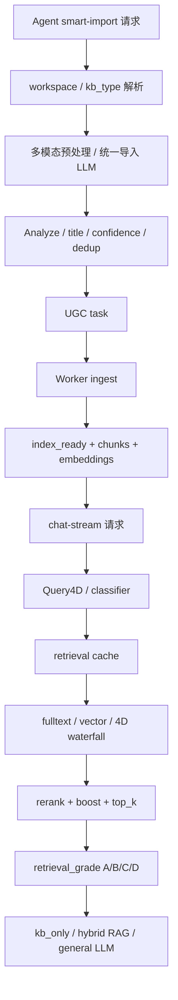

# Agent 导入与问答可靠性治理方案

> **基线日期**：2026-10-28

本文整理 GrayDraft Agent 导入、问答链路中「已导入 / 已检索 / 但问答无结果」的关键断点，并给出工程优化方案。

当前代码核对日期：2026-10-28。本文第七、八节按仓库当前实现更新，不再仅保留设计项。

## 一、问题定义

典型现象：

- smart-import 已返回任务，但问答提示「当前知识库未入录该知识点」。
- `retrieval total > 0`，但 `kb_only` meta 显示 `no useful kb hits`。
- 同一句 query 首次有答案，再问却无结果。
- SSE meta 中 `query_semantic_4d` 与当前 query 不一致。
- 文档更新后仍返回旧答案或旧候选。

这类问题通常不是单点错误，而是导入、索引、检索、缓存、门控、生成任一环节把结果拦掉。

## 二、端到端链路

## 三、关键断点

| 环节 | 典型信号 | 影响 | 排查点 |
|---|---|---|---|
| workspace 解析 | `kb_type` 不是目标 `gd_*` | 导入到别的库或搜错库 | `request_in.hint_kb_type` / resolved `kb_type` |
| 导入置信度 | HTTP 422 / `import_allowed=false` | preview 有内容但未入库 | `confidence`、`min_confidence_required` |
| dedup | `action=unchanged` | submit 被跳过 | `existing_doc_id`、`content_hash` |
| 异步索引 | task accepted 但搜不到 | 文档未 ready | `index_ready`、chunk 数、embedding 状态 |
| Query4D 幻觉 | domain 是一整段背景、entity 不是 query 子串 | 4D 过滤偏航 | `query_semantic_4d` |
| 4D waterfall | `_wf_soft` 才有结果 | 严格过滤过窄 | `retrieval_trace.waterfall_tier` |
| 缓存污染 | `cache_l3` 串不同 query | 旧候选/旧 q4d 复用 | `cache_hit`、query fingerprint |
| useful gate / 检索分级 | `total>0` 但 `chunks_used=0` 或 Grade D | 明明有候选但回未入录或走通用 LLM | `retrieval_grade`、`gate_score`、`gate_threshold`、`grade_reason` |
| Markdown 生成 | 表格压成一行 | 展示效果差 | `NormalizeKBMarkdown` |
| 缓存未清 | 更新后仍旧答案 | 用户误以为导入失败 | Redis purge / answer cache purge |

## 四、治理原则

1. **缓存不可跨 query 直接回放**：除 exact key 或明确语义相似命中外，不允许复用不同 query 的 retrieval response。
2. **Query4D 只能收敛不能扩散**：LLM 输出必须被 taxonomy 和 query 子串约束。
3. **有直接证据不应被低分误杀**：top chunk 内容命中 query 关键事实时，`kb_only` 应进入整理回答。
4. **导入成功不等于可问答**：必须区分 `task accepted`、`index_ready`、`chunks_ready`。
5. **所有 miss 都要可解释**：SSE 必须能说明是无 chunk、低分、分级 C/D、缓存、4D 过滤还是 LLM 失败；`retrieval_grade` + `thinking` 事件提供首屏反馈。

## 五、优化方案

### P0：止血

| 项 | 方案 | 预期 |
|---|---|---|
| 禁用 L3 预测回放 | 移除上一条不同 query 的缓存回放 | 避免 query/q4d/候选串线 |
| useful gate 可解释 | meta / retrieval_grade 输出 `gate_score` / `gate_threshold` / `grade_reason` / `retrieval_grade` | 快速定位 no useful 原因 |
| 直接证据放行 | 内容、表格、标题、anchors 命中 query 关键项时放行 | 减少 `total>0` 却未入录 |
| Query4D 收口 | domain 长文本回落，entities 必须是 query 子串 | 降低 4D 过滤误伤 |
| Markdown 表格修复 | prompt + 后处理修正粘连表格 | 改善 Agent 展示 |

### P1：稳定导入到问答

| 项 | 方案 | 预期 |
|---|---|---|
| 导入 ready barrier | submit 后提供 ready 状态，至少满足 `index_ready=true && chunk_count>0` | 避免刚导入就问失败 |
| 入库验收报告 | 每个 task 输出 title、kb_type、content_hash、chunk_count、embedding_ready | 让 Agent 明确成功/失败阶段 |
| 自动 purge | 文档创建/更新、Blueprint version bump 后清 retrieval + answer cache | 避免旧缓存 |
| 召回兜底 | 4D 到 `_wf_soft` 后仍保留全文/向量召回 | 避免 Query4D 偏航导致空结果 |
| 元数据补强 | 导入时强制生成 anchors、summary、semantic_tags_4d | 提升后续召回 |

### P2：诊断与回归

| 项 | 方案 | 预期 |
|---|---|---|
| 一键诊断接口 | 输入 query + kb_type，返回 Query4D、cache、waterfall、top chunks、gate | 快速复现线上问题 |
| 黄金用例集 | 固化常见失败用例，如「番茄周几吃，一次吃多少」 | 避免回归 |
| Agent 日志标准化 | smart-import/chat-stream 统一 trace 字段 | BFF/Core/Worker 日志可串联 |
| 质量看板 | 统计 no useful、cache hit、wf_soft、LLM empty、index lag | 发现系统性问题 |

## 六、建议验收标准

| 场景 | 必须满足 |
|---|---|
| 同 query 重复问 | 只命中 exact/semantic cache，不串旧 query |
| 不同 query 连续问 | 不复用上一条 query 的 retrieval response |
| `total > 0` 但无答案 | meta 必须返回 gate 原因 |
| 文档包含直接事实 | `kb_only` 能整理回答，不误回未入录 |
| 导入后立刻问 | 若未 ready，返回索引状态而非未入录 |
| 更新文档后问 | 不返回旧缓存答案 |
| 输出表格 | 标准 Markdown 表格，每行独占 |

## 七、已实现

- [x] 移除 L3 预测缓存回放，避免不同 query 串用 retrieval response。
- [x] useful gate 增加直接证据放行：标题、anchors、表格、内容关键词命中可通过。
- [x] SSE meta 增加 `gate_score`、`gate_threshold`、`gate_reason`。
- [x] Query4D 收口：domain 长文本回落；entities 必须来自 query 子串，否则回落规则实体。
- [x] Markdown 表格 prompt 与后处理修复，避免表格粘成一行。
- [x] 一键诊断接口：`POST /api/v1/retrieval/diagnose` 返回 Query4D/cache/waterfall/top chunks/gate。
- [x] smart-import submit 响应增加 `readiness`。
- [x] task polling 返回 `queryable/readiness/readiness_validation`，覆盖 doc/index/chunk/embedding 状态与阻塞原因。
- [x] task status 支持 `wait=true&timeout_ms=...` ready barrier，可阻塞等待 `queryable=true` 或终态。
- [x] task readiness SSE：`GET /api/v1/ugc/tasks/:task_id/events` 主动推送 `status/done/timeout/error`，减少前端轮询。
- [x] smart-import 成功提交后自动 purge retrieval cache 与 answer cache。
- [x] `/ugc/notify` 文档创建/更新入口接入 best-effort purge，避免非 smart-import 路径继续使用旧检索/旧答案缓存。
- [x] Worker UGC 完成入库后按 `kb_type` 二次 purge Redis retrieval/answer cache。
- [x] RagOps `demote` 等直接修改 chunk 的非 UGC 路径触发 retrieval/answer cache purge。
- [x] taxonomy Blueprint / shadow backfill 后触发 retrieval/answer cache purge。
- [x] chat-stream SSE v2：`retrieval_grade`、`thinking` 事件；`done` 含 `sentence_labels`、`warnings`、`answer_confidence`。
- [x] chat-stream Agent 日志补齐 cache、gate、Query4D、waterfall、answer_confidence 等关键字段。
- [x] Console BFF 统一透传/生成 `X-Trace-Id`、`X-Request-ID`，代理日志包含 task/doc/kb/readiness 关键字段。
- [x] Worker 日志补齐 trace_id、task_id、doc_id、kb_type、readiness、queryable、index_ready 字段。
- [x] 质量指标补齐 no-useful gate、waterfall tier、LLM empty、UGC index lag Prometheus counters。
- [x] Grafana RAG 看板展示 retrieval/cache、no-useful、waterfall、LLM empty、index lag。
- [x] 黄金用例集文档化，并覆盖缓存串线、Query4D 收口、direct evidence gate、Markdown、ready barrier、Worker purge。
- [x] 黄金用例接入 CI workflow：`.github/workflows/ci-core.yml` 与 `.github/workflows/ci-worker.yml`。
- [x] Redis Global Entity Pool 初版：热实体池 + DB DISTINCT 回落。
- [x] 导入双次 LLM 失败后禁止 `planSegmentsRules`，改为单段骨架入库。
- [x] NER 清洗去规则词表兜底，LLM 路径只做结构性过滤。

## 八、待实现

- [x] 离线脚本统一 purge：`deploy/scripts/backfill-search-text.sh`、`backfill-search-anchors.sh` 末尾增加 best-effort `curl` purge 调用，通过 `CORE_HOST` 环境变量指定 Core 地址；`internal/core/cmd/backfill-semantic4d` 增加 `-purge` 命令行标志，注入 `cache.Manager` 与 `answercache.Manager` 在回填完成后清除检索/答案缓存。
- [x] 批处理耗时指标：新增 `graydraft_backfill_operations_total` 与 `graydraft_backfill_duration_seconds` Prometheus 指标，在 admin `POST /api/v1/admin/global-index/refresh` 与 `main.go` 自动刷新 goroutine 中记录 `global_index_refresh` 的 ok/fail 及耗时；`backfill-semantic4d` 等独立命令通过结构化日志输出 ok/fail/skip 计数。
- [ ] Agent 前端接入 `GET /api/v1/ugc/tasks/:task_id/events`，在 `readiness.status=queued` 时展示索引中/ready/失败，而不是把未 ready 误报成未入录。（后端 SSE endpoint 已实现，前端接入待 Agent 侧配合。）
- [x] 质量看板补告警规则：`deploy/monitoring/prometheus/alerts.yml` 新增 `graydraft_quality` 告警组，覆盖 no-useful gate 比例 > 50%、wf_soft 回落比例 > 50%、LLM empty 速率异常、index lag P95 > 120s 四项。
