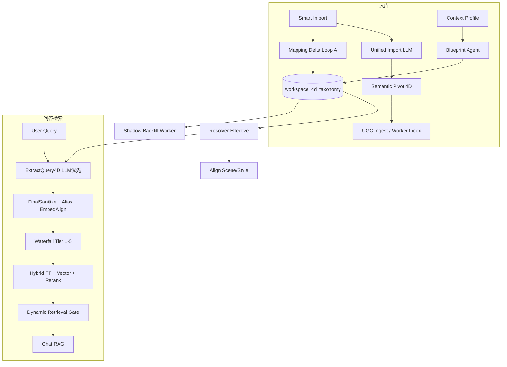

# GrayDraft 智能语义驱动检索 — 完整方案（已实现逻辑 + 待办）

> **文档类型：设计方案与计划。** 正文含设计目标或待办，实际交付以架构、接口文档和代码为准。 [当前文档入口](../README.md)

> 本文档汇总「从程序员规则到语义驱动」的**目标架构、已落地逻辑、残留项与运维**。  
> 精简对照与 Roadmap 勾选见：[semantic-driven-retrieval.md](./semantic-driven-retrieval.md)  
> 工作区 Blueprint 运维见：[../features/workspace-dynamic-taxonomy.md](../features/workspace-dynamic-taxonomy.md)

---

## 一、设计原则

| 原则 | 含义 |
|------|------|
| **蓝图定义边界** | 每个工作区 `gd_*` 分区以 `workspace_4d_taxonomy` Blueprint 为 4D 权威（domain / scenes / styles） |
| **向量处理模糊** | scene/style/专名对齐优先 embedding（≥ `embed_align_min`，默认 0.85），避免穷举同义词 |
| **瀑布守住底线** | 4D SQL 从严到宽五级退避，末级无 WHERE + `BoostSemantic4D` 软加分，避免「库里有搜不出」 |
| **进化无感增长** | 导入 delta → 候选晋升 → 可选 LLM 合并/裂变 → Blueprint 版本 bump → Worker 影子回填 |

---

## 二、架构总览



---

## 三、已实现方案逻辑（按链路）

### 3.1 工作区分区与入库（`gd_*`）

**目标**：知识按工作区分区隔离，教育语料使用 tutorial、paper、note。

**逻辑**：

1. GrayDraft / API 调用智能导入时必须带 `hint_kb_type`（`gd_<hash>`）。
2. `smartimport.ResolveKBType` 仅接受 `strings.HasPrefix(kb, "gd_")`，否则 `ErrWorkspaceKBTypeRequired`。
3. 分析、提交、分段预览一律使用该分区，**不再**用正文关键词推断 kb_type。

**代码**：`internal/core/service/smartimport/kb_type.go`、`service.go`；GrayDraft `pkg/nexus/client.go`。

---

### 3.2 工作区语义蓝图（Auto-Taxonomy）

**目标**：换行业不改 YAML，由工作区背景 + 文档样例自动建模 domain/scenes/styles。

**逻辑**：

1. **触发**（异步 `enqueueBlueprint`）  
   - 保存 `ContextProfile`（`handler/workspace_context.go`）  
   - 智能导入成功提交（`smartimport/service.go`）  
   - `Resolver.Effective` 尚无 `blueprint_status=ready`（`MaybeEnqueueBlueprint`）  
   - 无背景文案但已有近期文档摘要（`ListRecentDocSummaries` ≥1）

2. **生成**（`RunBlueprint`）  
   - LLM 读：工作区背景 + 近期文档标题/摘要 + YAML **仅作格式参考**  
   - 写入 `workspace_4d_taxonomy`：`domain`, `scenes[]`, `styles[]`, `blueprint_status=ready`, `version++`

3. **生效**（`Resolver.Effective` 优先级）  
   1. 内存缓存 `(kb_type, version)`  
   2. `BlueprintReady` → `model.BuildFromBlueprint`（`FromBlueprint=true`）  
   3. **Pending**：`workspaceDomainHint` → `WorkspacePendingTaxonomy`（不加载垂直行业 YAML seed）  
   4. 兜底：`taxonomy_config.yaml` + `BuildEffectiveTaxonomy`（无工作区线索时）

**代码**：`taxonomyevolve/blueprint.go`、`resolver.go`、`workspace_domain.go`；`model/taxonomy_blueprint.go`、`workspace_taxonomy_tax.go`  
**表**：`deploy/migrations/000001_init.up.sql` 中的 `workspace_4d_taxonomy`  
**配置**：`taxonomy_evolve.enabled`、`blueprint_enabled`、`blueprint_min_docs`

---

### 3.3 标签归一化（Scene / Style Aligner）

**目标**：「参数对照」「参数」等自由文本映射到 Blueprint 标准 label。

**逻辑**（`alignDimension`）：

| 步骤 | Blueprint 分区 | YAML 脚手架分区 |
|------|----------------|-----------------|
| 1 | 精确等于 label | 精确等于 label |
| 2 | **Embedding** 对全部 label（≥ `embed_align_min`） | `GenericNormalize` 关键词 `Contains` |
| 3 | 字符相似度 ≥ 0.72 | 字符相似度 ≥ 0.72 |
| 4 | 保留原文 | Embedding |

- 查询侧：`taxonomyevolve.AlignQuery4D` 在 `ExtractQuery4D` 之后调用。  
- 无法对齐的短语：`NoteUnaligned` → 候选池 → Loop A/B 或 `birthLabelLLM`。

**代码**：`taxonomyevolve/aligner.go`、`embedding_sim.go`

---

### 3.4 智能导入与 4D 写入（Unified Import）

**目标**：一次 LLM 完成标题、4D、拆段骨架；规则只做坐标护栏。

**逻辑**：

1. `Service.Run` → `preprocessRequest`（多模态）→ **`runUnifiedImportLLM`**（`use_llm=true` 时）。  
2. `RunUnifiedImportLLM`：并行 `ScanSkeleton` + 规则 kb/title 锁定 → 单次 LLM JSON（`unified_import_llm.go`）。  
   - 输出：`Pivot`（4D）、`MappingDelta`、`SplitPlan`（`logic_skeleton` / segments）  
   - 缓存：`import_llm_unified_ok`、`import_llm_split_plan_json`、`import_title_hint`  
3. **拆段优先级**（`PlanSegments`）：  
   1. `loadCachedSplitPlan`（统一导入缓存）  
   2. `unifiedImportCacheHit` → `splitPlanFromUnifiedLLM`（**不走**词频分类，走统一导入）  
   3. 仅无统一导入时：`planSegmentsRules`（骨架 `doc_type` / 分隔符 / h2）  
4. **多主题提示**：`contentLooksMixed(sk)` 只看骨架 `doc_type`（综合合集/分段文档/问答集）。  
5. 提交后：`EnqueueMappingDelta`、`EnqueueBlueprint`；扩展写入 `semantic_tags_4d`。

**代码**：`smartimport/unified_import_service.go`、`unified_import_llm.go`、`plan_segments.go`、`split_signals.go`、`semantic_pivot.go`

---

### 3.5 查询 4D 与实体（Query4D + NER 管线）

**目标**：LLM 原子实体 + 清洗 + 别名 +（Blueprint）embedding 专名对齐。

**逻辑**（`ExtractQuery4D`）：

1. `taxonomyevolve.Effective(kb_type, profile, workspaceContext)` 取当前 taxonomy。  
2. 若 `semantic_4d_llm_enabled`：LLM 抽 4D → `mergeQuery4DLlmFirst`（LLM 优先，规则填空）。  
3. `model.FinalSanitize(entities, query)`：前缀/后缀剥离、停用词、**短词博弈** `atomicLongShortDedup`。  
4. `NormalizeQuerySemantic4D` + `AlignQuery4D`（scene/style）。  
5. 工作区 domain 固定为 Blueprint domain（避免 query 误判成「教程资料」等 YAML 域）。

**检索入口额外步骤**（`hybrid.Search`）：

1. `LoadEntityAliasIndex` → `CanonicalizeEntities`（KB 文档标题/别名/`semantic_tags_4d.entities` 并集分组，**最短词**为 canonical）。  
2. 若 `tax.FromBlueprint`：`AlignEntitiesEmbedding`（专名对 `DetectKeywords` + label 语料做子串/向量对齐）。

**代码**：`retriever/query4d.go`、`model/entity_sanitize.go`、`classifier/alias.go`、`taxonomyevolve/entity_align.go`、`postgres/entity_alias_repo.go`

---

### 3.6 检索瀑布与软过滤

**目标**：4D 是「导航仪」不是「一票否决」。

**逻辑**（`searchWithSem4DWaterfall`）：

| Tier | 后缀 | SQL 4D 条件 |
|------|------|-------------|
| 1 | — | domain + entities + scene + style |
| 2 | `_wf_core` | domain + entities（去掉 scene/style） |
| 3 | `_wf_ent` | domain + **最短实体** |
| 4 | `_wf_dom` | 仅 domain |
| 5 | `_wf_soft` | **无** 4D WHERE；召回后 `BoostSemantic4D` |

- 实体条件：**双向 ILIKE**（query 含 doc 实体或 doc 实体含 query 子串）→ 覆盖「介绍一下InternVL」vs 库内「InternVL」。  
- `semantic_4d_entity_strict: false`（dev/prod）：避免高 tier 与瀑布冲突。  
- 工作区 domain 在 `hybrid` 内可固定，避免 Query4D 漂移到错误行业。

**代码**：`retriever/waterfall.go`、`postgres/semantic_filter.go`、`semantic_filter_entities.go`、`query4d.go` `BoostSemantic4D`

---

### 3.7 聊天门限与 Grounding

**目标**：有高质量命中时允许 RAG，不用「吃饭/行程」等领域 if-else。

**逻辑**：

- `RetrievalGateThresholdDynamic`：按 intent（fact/concept）基础阈值 + top chunk 质量/标题命中略放宽。  
- `passesHighQualityGrounding`：`QualityScore≥0.72` 且（`TitleMatched`/`EntityMatched` 或 高质量 + 查询词元在 chunk 文本中出现）。  
- **已移除**：旅游/美食/位置等硬编码关键词分支。

**代码**：`confidence/gate.go`、`threshold.go`、`grounding.go`

---

### 3.8 知识进化与影子回填

**目标**：新词自动进 mapping；Blueprint 变更后旧文档 4D 对齐。

**Loop A**（`RecordDelta` / `EnqueueMappingDelta`）：

- 导入携带 `scene/style/key_phrases` → 未命中现有 label 则入 `Candidates` → 文档数 ≥ `candidate_promote_doc_count` 晋升到 label keywords。  
- 孤儿候选达阈值 → `birthLabelLLM` 新 label。  
- 候选过多 → `Compress`（Loop B LLM 合并）。

**影子回填**（Blueprint `version` bump）：

1. Core `EnqueueShadowBackfill` → HTTP `POST /v1/taxonomy/shadow-backfill`  
2. Worker：`realign_semantic_tags_4d`（embedding 对齐 scene/style）→ 更新 `kb_documents.extensions` → `refresh_chunks_semantic_from_doc`  
3. Core：`resolver.Invalidate` + 清 align 向量缓存  

**代码**：`taxonomyevolve/service.go`、`backfill.go`、`worker_client.go`；Worker `taxonomy_backfill.py`、`taxonomy_align.py`

---

### 3.9 GrayDraft 集成要点

- 智能导入固定 `hint_kb_type = WorkspaceStoragePartition(...)`（`gd_*`）。  
- 检索/聊天传 `context_profile` + `workspace_context` 文本供 `Effective` / Query4D。  
- 工作区背景 API 保存后触发 Blueprint。

---

## 四、未实现与残留（诚实清单）

### 4.0 本轮已按建议落地（P0 + 部分 P1）

| 建议项 | 实现 |
|--------|------|
| Universal Scaffold | `taxonomy_config.yaml` 仅保留 `universal` 通用 scene/style；移除垂直行业 seed |
| Resolver 冷启动 | 无 Blueprint 时 `WorkspacePendingTaxonomy` 或 `universal`；`ResolveKey` 不再 `InferDomainFromText` 猜行业 |
| Waterfall 可观测性 | `SearchResponse.retrieval_trace`：`waterfall_tier`、`scene_original/aligned`、`entity_align`、`entities_final`；日志 `retrieval trace` |
| 双向 ILIKE | 已有 `semantic_filter_entities.go`（确认保留） |
| LLM NER 纯化 | `FinalSanitizeWithMethod(..., "llm")` → `SanitizeQueryEntitiesLLM`（无 prefix 表；失败才规则兜底） |
| 统一导入重试 | `runUnifiedImportLLM` 失败自动再调 1 次 Fast LLM |
| Worker QA | 按教程、论文、笔记生成问句 |
| Blueprint Validator | `validateBlueprintLabels`：scene/style 标签区分度不足则重生一次；`blueprint_validator_enabled` |
| Global Entity Pool | `ListDistinctSemanticEntities`（`gd_*` 文档 `semantic_tags_4d.entities`）+ `augmentEntitiesFromGlobalPool` 注入 query 提及实体 |
| Chat 回显 `retrieval_trace` | `ChatStreamEvent` / GrayDraft Agent 面板展示瀑布 tier、实体对齐等 |
| 导入规则降级门控 | 统一导入 `fail_count < 2` 时不走 `planSegmentsRules`；双次失败才 `fail_count=2` 允许规则拆段 |
| Query4D 规则收缩 | `extractQuery4DRules` 移除 Han scrub 关键词表，仅分词抽实体 |

### 4.1 仍未达到「零规则」的项（`[ ]`）

| 项 | 说明 | 影响 |
|----|------|------|
| **完全移除 YAML 文件** | 冷启动仍读 `taxonomy_config.yaml`（内容已为 universal） | 文件仍在，但无行业偏见 |
| **导入结构 100% LLM** | 双次统一导入失败后仍 `planSegmentsRules`（`ScanSkeleton` + h2/sep） | 仅 LLM 全挂时触发 |
| **实体 NER 纯 LLM** | `entity_sanitize.go` 仍维护前缀/后缀/停用词表 + 正则抽核 | 新礼貌用语需补表；LLM 失败时靠规则兜底 |
| **专名全局向量库** | 无独立专名表；专名对齐靠 DetectKeywords + 别名 + 单次 embedding | 「视觉模型」↔「InternVL」级语义关联仍依赖 KB 内是否共现 |
| **跨分区统一 taxonomy** | 每 `gd_*` 独立 Blueprint | 多库需分别进化 |
| **Redis Global Entity Pool** | 当前为 DB 跨分区 DISTINCT，无 Redis 热池与 TTL | 高频实体未单独缓存 |
| **Blueprint 探针 Query** | Validator 仅 label 相似度，无 3 条探针打标验收 | 语义漂移仍可能漏检 |

### 4.2 部分实现（`[~]`）需知边界

| 项 | 已实现 | 仍保留 |
|----|--------|--------|
| **Domain** | Blueprint + Pending taxonomy | YAML `MatchDomainKeyInText` / `InferDomainFromText` 兜底 |
| **Scene/Style** | Blueprint 路径 embedding 优先 | YAML 路径 `GenericNormalize` 子串 |
| **进化** | Loop A/B + 影子回填 | 依赖 Worker 可达、DB 迁移、手动 Redis purge |
| **测试/样例文案** | E2E 改为 `gd_e2e_workspace` | `tests/contest/edu/` |

### 4.3 运维未自动化（需人工）

- Blueprint 生成失败重试、全库强制重跑回填  
- 生产监控「瀑布落到 `_wf_soft` 比例」  
- 别名索引全量重建命令（随文档增量自动构建，无单独 CLI）

---

## 五、配置清单

| 配置项 | 推荐 | 文件 |
|--------|------|------|
| `taxonomy_evolve.enabled` | `true` | `config.*.yaml` |
| `taxonomy_evolve.blueprint_enabled` | `true` | 同上 |
| `taxonomy_evolve.embed_align_min` | `0.85` | 同上 |
| `retrieval.semantic_4d_llm_enabled` | `true` | 同上 |
| `retrieval.semantic_4d_entity_strict` | `false` | 同上 |
| `retrieval.semantic_4d_filter_enabled` | `true` | 同上 |
| `classifier.llm_enabled` | `true` | 同上 |
| `ai_worker.url` | Worker 可达 | 影子回填 |

---

## 六、运维检查清单

- [ ] 工作区已保存 Context Profile，或已有 `index_ready` 文档  
- [ ] `SELECT blueprint_status, domain, version FROM workspace_4d_taxonomy WHERE kb_type = 'gd_…'` → `ready`  
- [ ] 智能导入请求带 `hint_kb_type`（`gd_*`）  
- [ ] Blueprint version 变更后：`POST .../workspace-data/purge` `{"target":"redis"}`  
- [ ] 确认影子回填日志：`taxonomy shadow backfill done`  

---

## 七、典型案例：专名 InternVL（端到端）

**用户**：能不能麻烦你介绍一下InternVL啊？

| 阶段 | 行为 |
|------|------|
| Query4D LLM | 倾向实体 `InternVL`（非整句） |
| FinalSanitize | 去掉「介绍一下」「啊」等 |
| AliasIndex | 若库内有「InternVL/Intern-VL」组 → 最短 canonical |
| AlignEntitiesEmbedding | Blueprint 下与 DetectKeywords 对齐 |
| Waterfall | Tier1 失败 → Tier3 仅「InternVL」+ domain → 仍无则 Tier5 软召回 + 加分 |
| SQL | `qent ILIKE '%InternVL%'` 双向 |
| Gate | 命中实体/标题或高质量 grounding → 可答 |

---

## 八、文档索引

| 文档 | 用途 |
|------|------|
| [semantic-driven-retrieval.md](./semantic-driven-retrieval.md) | 代码对照表 + Roadmap 勾选 |
| [workspace-dynamic-taxonomy.md](../features/workspace-dynamic-taxonomy.md) | Blueprint 触发与运维 |
| [retrieval-and-chat.md](../features/retrieval-and-chat.md) | 检索/聊天产品说明（若有） |
| 本文档 | **完整方案逻辑 + 未实现清单** |

---

## 九、后续建议优先级（未做项）

1. **Blueprint 探针 Validator**：在 label 区分度之外，用 3 条探针 query 打标验收 Blueprint。  
2. **Redis Global Entity Pool**：在 DB DISTINCT 之上增加跨 `gd_*` 热实体缓存与借调策略。  
3. **实体 NER 零表**：LLM 失败时的规则兜底再收缩或改为二次 LLM。  
4. **导入零规则**：统一导入双次失败后仍禁止 `planSegmentsRules`，改为单段骨架入库。

---

## 十、专名理想路径验收（对照）

| 步骤 | 期望 | 验收方式 |
|------|------|----------|
| Q4D | `entities: ["InternVL"]` | 看 `query_semantic_4d` + `retrieval_trace.entities_final` |
| Align | alias 最短词 / embedding | `retrieval_trace.entity_align` |
| Tier 1 | domain+entities+scene | `retrieval_trace.waterfall_tier == 1` |
| Tier 2 兜底 | 去 scene 仍命中 | tier 2 + `total > 0` |
| SQL | 双向 ILIKE | 库内 entity `InternVL` |

示例检索响应片段：

```json
{
  "retrieval_trace": {
    "waterfall_tier": 1,
    "waterfall_suffix": "",
    "query_4d_method": "llm",
    "scene_original": "介绍",
    "scene_aligned": "基础介绍",
    "entities_final": ["InternVL"],
    "entity_align": "alias"
  }
}
```
