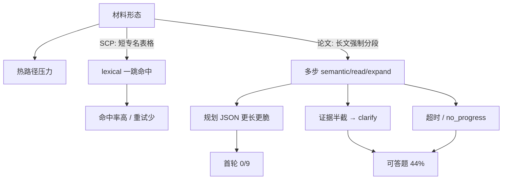

# GrayDraft 架构升级优化方案（赛事联调驱动）

> **基线日期**：2026-10-29  
> **实现与验收要分开看**（2026-11-02）。S0/S1 热路径、长文分段、`doc_group`、目录与按篇内容总览、`accepted`/`qa` 消费者已接入开发环境。本轮 24 题升级回归自动评分为 SCP 可答 9/9、论文可答 10/10（含新增目录题）、拒答/隔离 5/5；之后补强目录缺篇检测的最终镜像又通过 6 题定向复测。部分回归问法与原基线不同，**不等于原题集 S1 通过**。新入库与 QA 故障恢复仍未验收，完整多阶段 subject 拆分仍未做。过程见 [测试总结](upgrade-optimization-test-summary-2026-10-29.md) §2.12–§2.13 与 [下一步](upgrade-next-steps-2026-11-02.md)。
> **测试依据**：[赛事双工作区联调报告](../../tests/contest/edu/REPORT-scp-papers-2026-10-29.md)  
> **相关文档**：[设计理念](设计理念.md)、[Agent 实现说明](Agent流程技术实现方案.md)、[问答可靠性治理](agent-import-chat-reliability.md)、[性能优化 1.0](performance-optimization-v1.md)、[语义驱动检索方案](semantic-driven-retrieval-scheme.md)

本文把 2026-10-29 双工作区实测结果，与当前架构中可替换的热路径机制合并成一份可落地的升级方案。目标不是换模型厂商，也不是把系统调成「只擅长 SCP 或只擅长论文」，而是抽出两类材料共同暴露的热路径缺陷，使说明类、长文类，以及后续菜谱、药物等工作区能走同一套更稳的路径。

原则补充见[设计理念 · 局部最优要导向全局最优](设计理念.md#局部最优要导向全局最优)：优化修的是材料**结构**（专名、参数、步骤、跨段、拒答），不是某一垂类的专项分支。

---

## 1. 结论摘要

| 指标 | SCP 技能/工具 | 论文 | 合计 |
| --- | ---: | ---: | ---: |
| 可答题严格命中率（含重试） | **88.9%**（8/9，另 1 部分） | **44.4%**（4/9） | 66.7%（12/18） |
| 首轮纯自动化命中率 | 66.7%（6/9） | **0/9** | — |
| 拒答/隔离不编造 | 3/3 | 2/2 | 5/5 |

**产品底线已守住**：材料外与跨工作区题均未编造。差距集中在「材料里有答案时能否稳定查到并收口」，不是「会不会胡说」。

**根因不是单一 bug**。SCP 与论文的材料形态不同，把热路径上叠在一起的三套检索决策、规划 JSON 脆弱性、以及「证据够仍澄清」放大成近一倍的命中率差。Gateway `finish_reason` 空串截断已修；规划双 JSON、过度澄清、论文分段与 Query4D 偏航仍在。

**升级方向**：热路径只留一条检索计划 + 一次成文；Query4D / 瀑布从硬过滤降为加分；证据够时禁止空澄清；入库分阶段且 QA 退出 `index_ready`。验收以 `contest-scp-skills` / `contest-papers` 复测，并要求改动对「短说明 / 长叙述」两类结构同向受益，避免 SCP 专项或论文专项把后续域（菜谱、药物等）甩远。

---

## 2. 实测基线（摘自联调报告）

### 2.1 环境与语料

| 项 | 值 |
| --- | --- |
| 环境 | `make dev-up`（Nginx 8443 / BFF 8787 / Core 18080） |
| 策略 | `edu_workspace_v1` |
| 模型 | 规划 `intern-s1-mini`，作答 `intern-s2` |
| 工作区 A | `contest-scp-skills` → `gd_7286eeb3…`，36 篇 SCP 技能/工具说明 |
| 工作区 B | `contest-papers` → `gd_d80578ab…`，44 篇（InternLM2 / InternVL / InternVL 2.5 分段摘录） |

### 2.2 失败形态对照

| 失败形态 | SCP 出现 | 论文出现 | 典型用例 |
| --- | --- | --- | --- |
| 规划 JSON 截断 / 双对象 / `unsupported decision` | 首轮偶发，重试可过 | **首轮几乎全军覆没** | `paper-infra`、论文首轮 0/9 |
| 过度澄清（材料有答案仍「请补充范围」） | 少 | **多** | `paper-name-2`、`paper-25-1`、`paper-theme` |
| 超时 / `run.no_progress` | 偶发（`scp-hop-1`） | 明确（`paper-hop`） | 跨文档长链 |
| 部分命中 / 问法敏感 | `scp-hop-2` 未完整对照 | `paper-name-1` 需改写问法才命中 | 跨材料对照、开源规模 |
| 正确拒答 vs 澄清拒答 | 1 正确 + 2 澄清 | 2 澄清 | 隔离与材料外 |

联调中已修复：`internal/gateway/service/provider/openai_compat.go` 仅在 `finish_reason` 为**非空字符串**时结束流（Intern 增量常带 `finish_reason: ""`）。

---

## 3. 双工作区差异：技术分析

两套工作区共用同一套 Agent Runtime、同一 Classifier、同一混合检索与同一规划/作答模型。命中率差约 **44 个百分点**，来自「材料形态 × 热路径机制」的交互，而不是分区配置不同。

### 3.1 材料形态对比

| 维度 | SCP（技能/工具说明） | 论文（arXiv HTML 摘录） |
| --- | --- | --- |
| 文体 | 短章节、表格、参数表、工具名清单 | 长段落、摘要、相关工作、实验叙述 |
| 专名密度 | 高且局部：`crystalx_prepare_input_upload`、`p_ref`、`SCP-HUB-API-KEY` | 高但弥散：模型名、参数量、基准分散落多段 |
| 答案形态 | 「参数名 = 值」「先调 A 再调 B」可精确匹配 | 「6B / ViT-22B / MMMU 70.1」需跨句甚至跨文档对齐 |
| 入库形态 | 原文接近可检索说明，分段少 | 质量门禁拦长文 → **强制重复折叠与多文档拆分**，同一论文变成多条 `kb_documents` |
| 检索友好性 | 词法（`knowledge.lexical`）即可命中多数题 | 更依赖语义、read、expand；词法常只命中半截 |

SCP 的 CrystalX 文档把 `INS 10 MiB / HKL 100 MiB` 和工具名写在同一小节；论文把 `InternViT-6B` 与 `ViT-22B` 写在摘要与引言不同位置，且导入后可能落在不同 chunk / 不同文档。同一套「先 lexical 再 read」在 SCP 上够用，在论文上经常停在「命中半截 → 规划选择 clarify」。

### 3.2 热路径机制如何放大差距

当前未命中缓存的一次提问，决策被做了多遍：

```text
用户问题
  → classifier（规则，<5ms）改 FT/向量权重
  → ExtractQuery4D（快层 LLM）抽 domain/scene/style/entities
  → 4D 瀑布（严格档与软档并行；严格空则用无 4D 的混合检索）
  → Agent 每步再调规划模型选 lexical/semantic/read/expand（最多 8 步）
  → 规划 JSON 可带 answer → AnswerGate → StreamFinalAnswer 再用 intern-s2 成文
```

| 机制 | 对 SCP 的影响 | 对论文的影响 |
| --- | --- | --- |
| **Classifier 规则** | 专名/参数题走高全文权重，与材料匹配 | 主题/对比题偏 concept/hybrid；权重对，但后面仍被规划重选工具 |
| **Query4D + 瀑布** | 实体多为短工具名，对齐成功时严格档易命中；失败也有 soft 兜底 | 实体易抽成背景短语或非 query 子串（可靠性文档已记）；常落到 `_wf_soft`，等于白付一次 LLM + 双路检索 |
| **规划每步重选工具** | 首跳 lexical 命中率高，步数少，JSON 短、失败可重试 | 首跳常空或半截 → 多步 read/expand → token 更长 → **双 JSON / 截断 / 超时概率上升** |
| **成文两遍** | 规划草稿与最终流式往往一致 | 规划已倾向 clarify 时，门禁与成文拿不到可引用证据包 |
| **入库单任务 + 强门禁** | 短文易过门禁 | 长文被 spam/低密度拒绝，分段后实体与步骤跨文档，**跨文档题（hop/theme）系统性变难** |

因此：SCP 走的是「短专名 → lexical → 一次 read → 收口」的窄路径；论文被推进「多决策、多工具、长上下文」的宽路径，而宽路径正好踩中规划 JSON 与过度澄清的弱点。

### 3.3 按失败用例拆开

#### A. 规划稳定性（论文首轮 0/9 的主因）

- **现象**：`invalid character '{' after top-level value`、`unsupported decision "answer"`、空/截断 JSON。
- **代码点**：
  - `planner.go`：`extractJSONObject` 取首个 `{` 到最后一个 `}`；双对象 `{}{...}` 会拼成非法 JSON。
  - `DecodeDecision` 只接受 `final | tool_calls | clarify`；模型若输出 `"decision":"answer"` 直接失败。
  - Gateway 空 `finish_reason` 截断已修，但**上游偶发双对象与 schema 漂移仍在**。
- **为何论文更重**：论文题观察更长、步数更多，规划输出更长，双对象与「自然语言夹 JSON」更常见。SCP 多数一跳 lexical 即可，暴露窗口小。

#### B. 过度澄清（`paper-name-2` / `paper-25-1` / `paper-theme`）

- **现象**：工具轨迹已有 `lexical→read` 或 `read+expand`，仍回复「请补充范围」，判定为未命中。
- **机制缺口**：AnswerGate 管的是「有没有引用、能不能发出去」；**没有「证据已够时禁止 clarify」**。`DecisionClarify` 与 `DecisionFinal` 在 runtime 里同等收口，澄清不要求先证明检索为空。
- **材料因素**：论文数值分散；read 读到相邻节仍可能不含 6B/70.1。规划在不确定时倾向 clarify，而不是再换 expand 或换 query。设计理念要求「能换查法就继续查，缺无法代替的对象才问一句」——当前实现未把门禁化。

#### C. 问法敏感与部分命中

- `paper-name-1`：原问法多次规划失败；改写成「是否包括 1.8B/7B/20B」后 semantic 命中。说明 **embedding/lexical 对封闭列举问法更稳**，开放「开源规模」需要 Query 侧扩写或别名，而不是再加一层 LLM 分类。
- `scp-hop-2`：广场侧 `tools_count=5` 命中，技能侧「暴露 5 个工具」未对照——跨文档对照需要强制二次检索或 expand，而不是一次 lexical 收口。

#### D. 超时与跨文档（`paper-hop` / `scp-hop-1`）

- 瀑布双路 + 多步工具 + 成文，尾延迟叠加。论文 hop（InternViT-6B 与 78B）跨摘要/实验段，步数预算更容易打满或触发 `run.no_progress`（同指纹工具重复）。
- SCP hop 重试可过，说明能力存在，**稳定性与预算分配**不足。

#### E. 拒答形态（两边都不编造，产品表述偏弱）

- 隔离与材料外多为「澄清拒答」而非「本工作区资料没有」。
- 隔离正确（未泄漏另一工作区数字），但用户侧不如明确拒答清晰。应在**检索确认无 hit 或 Grade D** 后强制 `final` + 固定拒答模板，而不是 `clarify`。

#### F. 入库门禁与分段

- 报告明确：原始长文常被 `spam_pattern_detected` / `low_information_density` 拒绝，论文需预处理分段才入库。
- 结果：同一逻辑论文变成多文档；`paper-theme`「三篇各讲什么」需要跨文档汇总，当前工具集没有「列出工作区文档摘要」的一等公民，只能 semantic/read/expand 拼，易澄清失败。

### 3.4 差异因果链（归纳）



**一句话**：同一架构下，SCP 验证了「出处约束 + 工具检索」在说明文档上可行；论文暴露了「多层决策叠加 + 规划协议脆弱 + 澄清无门禁」在长文分段语料上不可接受。升级应让论文题也能走 SCP 那种窄、确定的路径。

---

## 4. 升级原则（与设计理念对齐）

1. **自动门禁，不加人审**：证据够则作答或拒答；证据不够则换查法；仍不够则说明本工作区无依据。
2. **默认策略固定**：一次 Run 绑定 `policy_version`；专家/工具选择写入策略表，不按题现场调参。
3. **出处先于措辞**：讲解只引用原文切片；记忆与 QA 对不能当引用。
4. **热路径变窄**：少一次模型决策、少一路无效检索，优先于再叠一层「更智能」的路由。
5. **局部最优导向全局最优**：不为 SCP、论文、菜谱或药物开专项过度优化。改的是跨域共用的协议、门禁、首跳计划、长文分段与跨文档结构；领域词表与主题只进工作区背景 / Blueprint。一项改动若只抬高当前样例集、预期对其它材料形态无效或有害，不进入实现。详见[设计理念](设计理念.md#局部最优要导向全局最优)。
6. **验收用赛事集，不塑造专域产品**：以 `contest-scp-skills` / `contest-papers` 回归；通过标准是两类结构同向不回退，而不是单域刷分。后续增加菜谱、药物等样例时，应直接复用同一机制，而不是先开垂类分支。

### 4.1 从双工作区差读「结构」而不是「垂类」

赛事集只是探针。真正要修的是两种反复出现的材料结构；新域通常仍落在这两种或其组合上：

| 结构 | 本轮代表 | 后续可能同构的域 | 机制落点（领域无关） |
| --- | --- | --- | --- |
| 短说明 / 参数表 / 工具清单 | SCP 技能与工具 | 药物用法与禁忌表、设备手册、API 文档 | 专名意图 → lexical；证据够禁止澄清 |
| 长叙述 / 强制分段 / 跨段数字 | 论文摘录 | 长菜谱与变体步骤、综述、教材章节 | 自动分段与 doc_group；read/expand 预算；主题汇总 observation |
| 材料外 / 隔离 | 两边拒答题 | 任意新工作区 | 无 hit → 明确拒答模板，不编造 |

因此 P0/P1 优先做「两边都痛或一边痛但机制通用」的项；P2 的「长文」指叙述型材料，不写成「仅论文流水线」。菜谱里的分步火候、药物里的剂量表，应吃到同一套分段与专名路径，而不是再各做一套 Agent。

---

## 5. 建议改动（机制替换清单）

下列项承接此前架构可行性分析，并与 §3 失败形态一一对应。

### 5.1 P0 — 堵住实测出血点

| ID | 改动 | 替换/约束的机制 | 主要修复的实测问题 | 关键代码锚点 |
| --- | --- | --- | --- | --- |
| P0-1 | **规划 JSON 加固** | 脆弱的自由 JSON | 论文首轮 0/9、`paper-infra` | `planner.go` `extractJSONObject`；`DecodeDecision`；Gateway 流式回归 |
| P0-2 | **证据够禁止空澄清** | 无条件 `DecisionClarify` | `paper-name-2`、`paper-25-1`、过度澄清 | `runtime.go` 在 clarify 前检查 observations / AnswerGate 信号 |
| P0-3 | **无 hit / Grade D → 明确拒答模板** | 澄清拒答 | 隔离与材料外表述弱 | AnswerGate + clarify 分支 |
| P0-4 | **规划协议枚举收敛** | `"answer"` 等非法 decision | `unsupported decision` | 提示词 + 解码别名映射到 `final` |
| P0-5 | **Gateway/Intern 流式回归用例** | 空 `finish_reason` 再发 | 防回归截断 | `openai_compat.go` + contest 冒烟 |

P0-1 建议细则：

- 只解析**第一个**完整 JSON 对象；其后丢弃。
- 失败时对快层做**一次**受限重试（「只输出一个 JSON 对象」），计入步数预算。
- 将 `decision: answer` 归一为 `final`。
- 规划输出关闭思考或截断思考进事件，避免 reasoning 污染 JSON（前端已不映射 `llm.reasoning.delta`）。

P0-2 建议细则：

- 若已有带 chunk 引用的 observation，且 AnswerGate 粗判 coverage 达标 → **禁止 clarify**，改为 `final` 或强制 `knowledge.expand`/`read` 一次。
- 仅当工具结果为空、或连续两跳无新指纹进度时，才允许 clarify，且文案固定为「本工作区资料未写明 X」。

### 5.2 P1 — 热路径收成一条检索计划 + 一次成文

| ID | 改动 | 替换什么 | 预期 |
| --- | --- | --- | --- |
| P1-1 | **首跳由 Classifier `RoutePlan` 固定工具** | 每问先让规划模型选 lexical/semantic | 短说明/专名结构稳定命中；长叙述减少首步空转 |
| P1-2 | **Query4D 降级为扩词 + `BoostSemantic4D`** | 4D SQL 硬过滤 + 五档瀑布双路 | 去掉论文上常落到 soft 的无效 LLM/双查；对齐可靠性文档「Query4D 只能收敛」 |
| P1-3 | **规划不写用户正文** | 规划 JSON 的 `answer` 与 `StreamFinalAnswer` 双写 | 只保留 `intern-s2` 成文；规划只出 `tool_calls` / `ready_to_answer` |
| P1-4 | **证据不足才进入 read/expand** | 最多 8 步任意工具循环 | 「1 次计划检索 + 按需补读」；压超时与 `no_progress` |
| P1-5 | **不做 O-09 分类器模型化** | roadmap 中「替换规则分类器」 | 规则意图跨域可用；再加 LLM 分类会成第四个决策者 |

首跳映射建议（写入 `edu_workspace_v1` 策略表）：

| Classifier 意图 | 首跳工具 | 权重 |
| --- | --- | --- |
| ProperNoun / 含代码型 token | `knowledge.lexical` | 高 FT |
| Fact | `knowledge.lexical`（可并行轻量 semantic） | 中 FT |
| Concept | `knowledge.semantic` | 高向量 |
| Hybrid / 跨材料信号 | `knowledge.semantic` + 允许随后 `expand` | 中 |

规划模型在首跳之后只允许：`read`、`expand`、或 `ready_to_answer`。禁止用相同参数重复同一工具（已有指纹；收紧为跨步全局）。

### 5.3 P2 — 入库与长叙述材料（由论文暴露，不绑死论文）

论文集暴露的是「长叙述 + 门禁逼出多文档」；菜谱长文、药物说明书全文会碰到同一结构。下列改动按**材料结构**命名，禁止落成 `if kb_is_paper` 或垂类专用管道。

| ID | 改动 | 替换什么 | 对应实测 / 可迁移域 |
| --- | --- | --- | --- |
| P2-1 | **UGC 分阶段 JetStream**（accepted→parsed→chunked→embedded→indexed） | 单 subject 整单流水线 | 长文失败整单重放；任意域大文件 |
| P2-2 | **`kb_qa_pairs` 移出 `index_ready` 路径** | 入库同步 QA 生成 | QA 不参与检索却占队列；面板需要时再异步 |
| P2-3 | **长叙述自动分段策略产品化** | 手工预处理才过门禁 | 报告 §6.4；论文 / 教材 / 长菜谱同构 |
| P2-4 | **工作区文档目录工具或系统 observation** | 无「多篇各讲什么」一等路径 | `paper-theme`；多菜谱、多药品对照同构 |
| P2-5 | **分段保留来源级 `doc_group` / 章节锚** | 纯扁平多文档 | hop/theme；同说明书多节、同菜谱变体 |

P2-3 与设计理念一致：不确定则收束或丢弃，不把行号交给人改；**自动分段规则**进 Worker，按长度/密度/标题层级触发，不按「是否论文」触发。

### 5.4 P3 — 记忆与成本（不挡赛事复测）

| ID | 改动 | 说明 |
| --- | --- | --- |
| P3-1 | 长期记忆改为独立 observation，不拼进 `run.Prompt` 前缀 | 避免规划把记忆当用户问题提前收口（`launcher.go`） |
| P3-2 | 快层/讲解层按难度门控（证据齐的专名事实可用快层成文） | 应用层 MoE；策略进 `policy_version` |
| P3-3 | 答案缓存仅 exact + `kb_catalog_version` | 不做跨 query 语义复用（可靠性文档已否） |
| P3-4 | OpenTelemetry 串 BFF→Core→Worker→Gateway | 对照赛事 trace：wf_tier、decision、gate_reason |

---

## 6. 明确不采用的方向

| 方向 | 原因 |
| --- | --- |
| 自研/自托管神经网络 MoE | 无训练栈；与出处/回放无关 |
| 多讲解模型并行投票 | 抬时延；引用无法对齐单次生成 |
| 用更大规划模型「增强路由」 | 论文失败主因是协议与澄清，不是模型太小；先收窄决策 |
| Query4D / 瀑布再加深硬过滤 | 实测与可靠性文档均显示易偏航，软档才是有效召回 |
| 导入预览逐段人审、笔记审批 | 违反[设计理念](设计理念.md) |
| 向量引擎立即迁出 PG | 性能 1.0 已预留接口；当前瓶颈在决策与规划，不在 ANN |
| **SCP / 论文 / 菜谱 / 药物专项分支或专用提示刷分** | 单域局部最优，换域失效或互斥；违反「局部导向全局」 |
| 按垂类硬编码首跳工具或门禁阈值 | 领域差异应留在工作区背景与 Blueprint，不进 Runtime 分叉 |

---

## 7. 落地顺序与验收

### 7.1 Sprint 建议

| Sprint | 范围 | 退出标准（相对 2026-10-29 报告） |
| --- | --- | --- |
| **S0** | P0-1～P0-5 | 论文**首轮**可答题命中 ≥ 4/9；规划 JSON 错误率在同题 3 次内 ≤ 1 次；无 finish_reason 回归 |
| **S1** | P1-1～P1-5 | SCP 最终 ≥ 88% 不回退；论文最终可答题 ≥ **70%**（≥7/9）；`paper-name-2`/`paper-25-1` 不再空澄清 |
| **S2** | P2-1～P2-5 | `paper-theme`/`paper-hop` 至少部分命中；长文导入无需手工折叠即可过门禁（或自动分段可观测） |
| **S3** | P3 | 记忆不污染规划；成本/trace 可按 Run 对比专家选择 |

### 7.2 复测协议（冻结）

1. 工作区密钥与语料目录不变：`tests/contest/edu/corpus/{scp,papers}`。
2. `skip_cache=true`、`skip_answer_cache=true`，与报告一致。
3. 同时公布：**首轮纯自动**与**最多 2 次重试、禁止改写问法**两套分。S1 起取消「改写问法」作为得分手段（`paper-name-1` 应用扩词/别名解决）。
4. 每题记录：`decision` 序列、工具指纹、`retrieval_grade` / `waterfall_tier`（若仍存在）、`gate_reason`、是否 clarify。
5. 拒答题单独统计「明确拒答率」；澄清拒答在 S1 后视为不及格（隔离/材料外）。
6. **双集同向门禁**：合并 PR 要求 SCP 与论文相对基线均不回退超过约定阈值；禁止「论文大涨、SCP 明显跌」或反向的单边刷分合并。
7. **跨域可迁移抽检**（S2 起）：另选一份非赛事主题的小语料（如公开菜谱或药品说明摘录，题型仍覆盖专名/步骤/拒答），不改代码只换工作区；机制应可直接跑通，允许分数低于赛事集，但不得出现依赖 SCP/论文专名才能工作的路径。

### 7.3 目标数值

| 指标 | 2026-10-29 基线 | S1 目标 | S2 目标 |
| --- | ---: | ---: | ---: |
| SCP 最终可答题命中率 | 88.9% | ≥ 88.9% | ≥ 90% |
| 论文最终可答题命中率 | 44.4% | ≥ 70% | ≥ 80% |
| 论文首轮命中率 | 0% | ≥ 44% | ≥ 60% |
| 可答题空澄清率 | 论文高 | ≤ 1/9 | 0 |
| 拒答明确率（非澄清） | 低 | ≥ 80% | 100% |
| 跨工作区泄漏 | 0 | 0 | 0 |
| 双集同向（相对基线） | — | 两边均不回退 | 两边均不回退 |
| 非赛事小语料冒烟 | — | — | 专名/步骤/拒答可跑通 |

### 7.4 2026-10-29 晚首轮复测

重建 Core / Worker / Gateway / BFF 后，按 7.2 跑了子集首轮（不改写、不重试）。明细在 [赛事报告 §9](../../tests/contest/edu/REPORT-scp-papers-2026-10-29.md)。

- Stage stream 不能再挂 `graydraft.ugc.ingest`（与 `GRAYDRAFT_UGC` 重叠，JetStream 400）。拆开后 Core `nats=jetstream`，Worker 已订阅 `graydraft.ingest.accepted` 与 `graydraft.ingest.qa`。
- 校正后：SCP 可答命中 1/6，论文可答命中 1/7、部分 1。论文拒答 2/2 为明确拒答且零泄漏。
- 未过 S0：规划 JSON 仍出现 `unexpected end of JSON input`，多题 300s 超时；SCP 专名题检索结果粘在 `multiomics_integration`，库内 `9606` / CrystalX 块没有被用上。
- 随后的四题门槛（`scp-name-1`、`scp-step-1`、`paper-name-2`、`paper-reject`）已通过：专名走 lexical，截断规划不再二次补全。见报告 §9.1。
- 同一子集再次首轮（不改问法、不重试）：SCP 可答 **6/6**，论文可答 **4/7**、部分 1、未命中 1、超时 1。拒答 4/4 明确且零泄漏，无规划 JSON 截断。论文首轮达到子集上的 S0 线。见报告 §9.2。

---

## 8. 与现有文档的关系

| 文档 | 关系 |
| --- | --- |
| [REPORT-scp-papers-2026-10-29.md](../../tests/contest/edu/REPORT-scp-papers-2026-10-29.md) | 本方案的实测基线；本文不重复复现步骤全文 |
| [upgrade-optimization-test-summary-2026-10-29.md](upgrade-optimization-test-summary-2026-10-29.md) | 2026-10-29 至 11-02 优化测试的过程与各轮分数 |
| [upgrade-next-steps-2026-11-02.md](upgrade-next-steps-2026-11-02.md) | 11 月 2 日下午之后的下一步建议 |
| [agent-import-chat-reliability.md](agent-import-chat-reliability.md) | Query4D 收口、禁 L3 跨 query、ready barrier；P1-2/P0 与之同向 |
| [performance-optimization-v1.md](performance-optimization-v1.md) | 分阶段入库、微批 Embedding；纳入 P2-1/P2-2 |
| [semantic-driven-retrieval-scheme.md](semantic-driven-retrieval-scheme.md) | Blueprint/进化保留在导入后异步；**检索热路径不再依赖 4D WHERE** |
| [roadmap.md](../roadmap.md) | O-09 分类器模型化降级；本方案 P0/P1 优先于 O-09 |
| [设计理念.md](设计理念.md) | 证据够禁止澄清、明确拒答，落实「能换查法继续查」 |

---

## 9. 一页纸决策

| 问题 | 决策 |
| --- | --- |
| 为何 SCP≈89% 而论文≈44%？ | 短说明文档适配 lexical 窄路径；长论文分段 + 多层决策放大规划脆弱与空澄清 |
| 先改模型还是先改机制？ | **先改机制**（JSON、澄清门禁、首跳计划、Query4D 降级） |
| MoE 怎么用？ | 仅应用层：阶段专家（快层/讲解/视觉）+ 难度门控；不自研模型内 MoE |
| 语义 4D 废弃吗？ | **不废弃**；退出 SQL 硬过滤，改为扩词与排序加分，进化仍异步 |
| 是否按 SCP/论文分别专项优化？ | **否**。修材料结构上的通用机制；垂类只进工作区背景与 Blueprint |
| 后续菜谱、药物怎么办？ | 同一热路径；用小语料冒烟验证可迁移，不开垂类 Agent 分叉 |
| 如何算升级成功？ | 双集同向：论文最终 ≥70% 且空澄清 ≤1，SCP 不回退，拒答明确且零泄漏；S2 起非赛事主题可直接跑通 |
