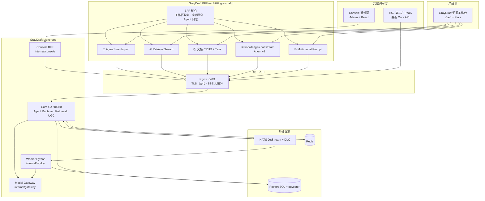
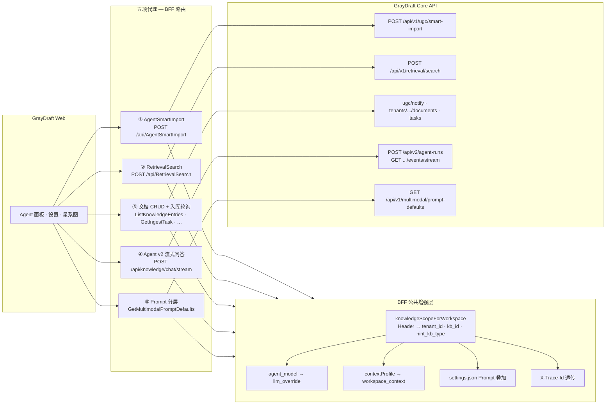
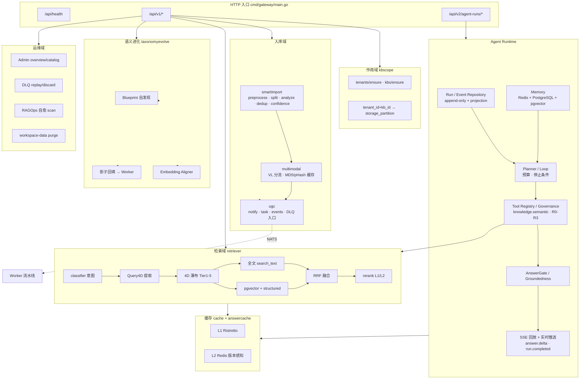
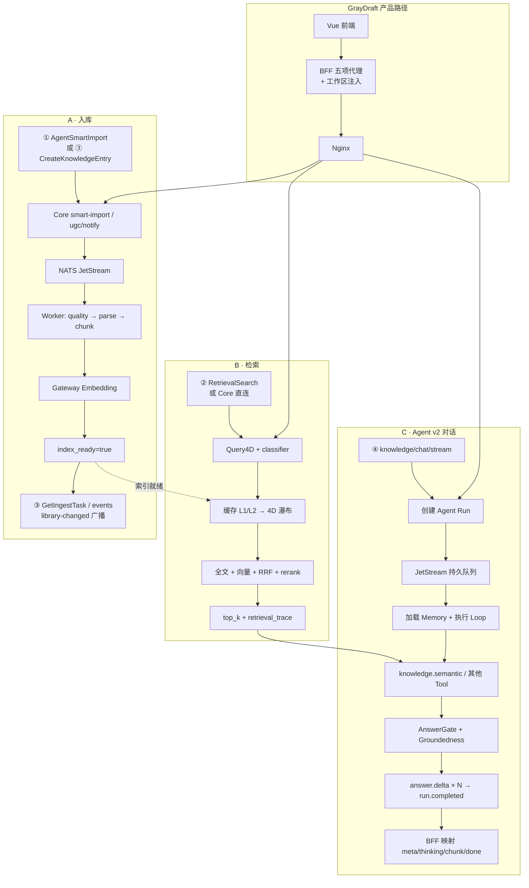
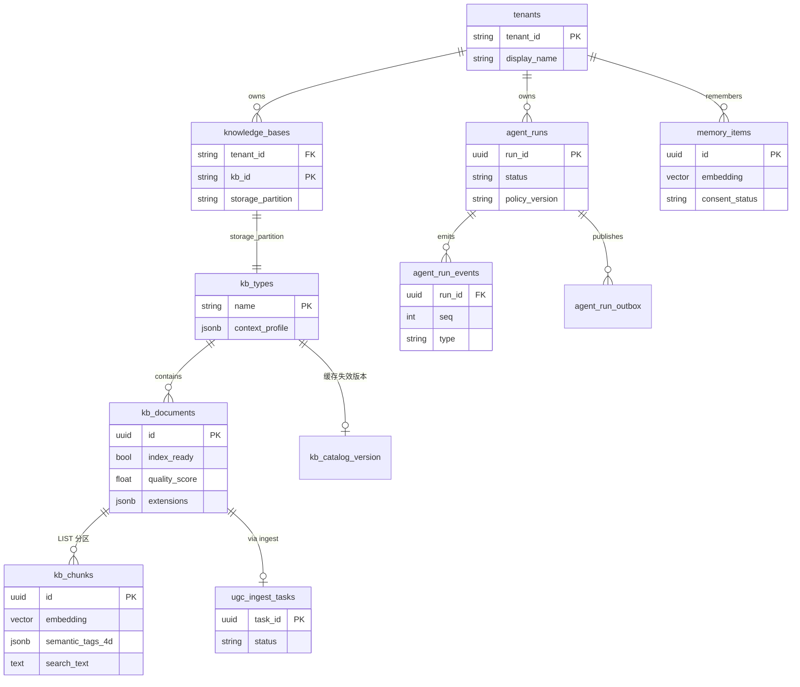
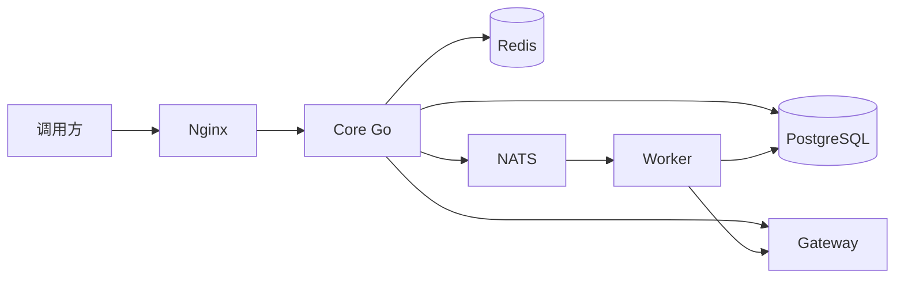
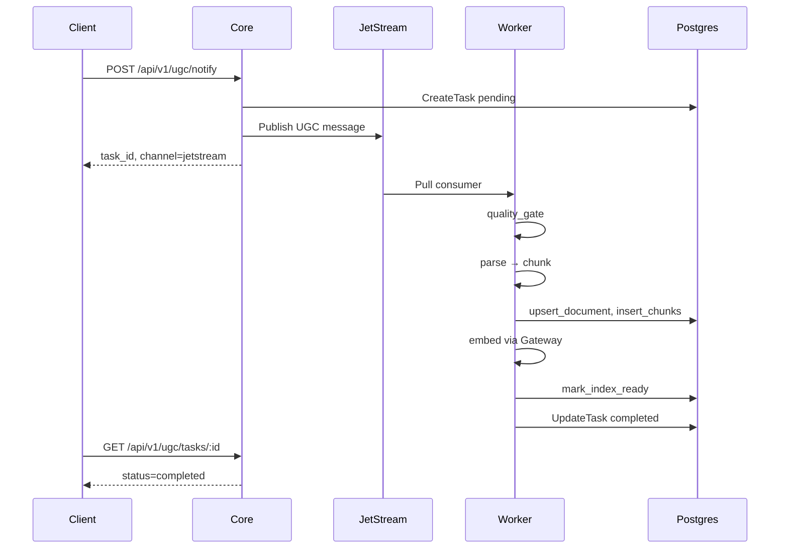
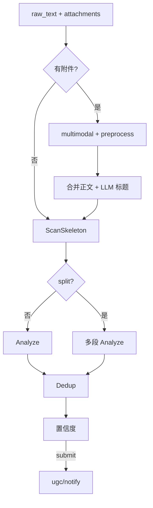
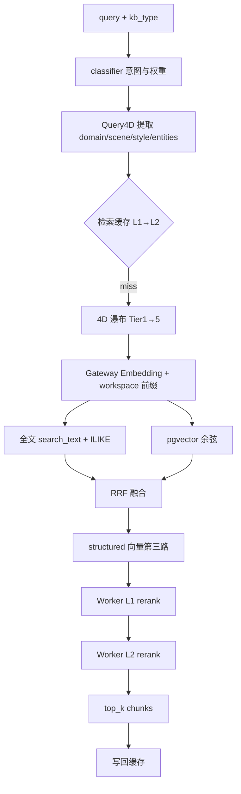
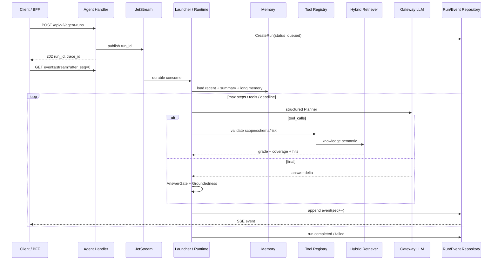

# GrayDraft 系统逻辑总览

> **基线日期**：2026-10-28

本文描述**当前代码实现**中的服务职责、数据模型与端到端流程，作为阅读代码与 API 文档的入口。功能细节见 [功能文档](../README.md#功能实现)；ADR 见 [ADR README](README.md)。

---

## 0. 整体架构汇总图

以下分图从**生态部署**、**BFF 五项代理**、**Core 模块**、**业务流**、**数据域**五个视角概括 GrayDraft 全貌。细节分章见本文 §4–§7；BFF 能力详解见 [bff-proxy-capabilities.md](../learning/04-architecture/06-bff-proxy-capabilities.md)。

### 0.1 生态与部署分层



| 层级 | 组件 | 端口 / 路径 | 职责 |
|------|------|-------------|------|
| 产品 | GrayDraft Web | — | `callBackend` 业务语义；不直连 Core |
| **BFF** | **graydraftd** | **:8787** | **五项代理 + 工作区映射 + Prompt/模型注入** |
| 网关 | Nginx | :8443 | `/api/*` 反代 Core；SSE 关缓冲 |
| 编排 | Core Go | :18080 | Agent Runtime、PaaS API、检索、UGC、Admin |
| 异步 | Core Agent Consumer / Worker + NATS | — | Agent Run 持久队列；入库流水线、rerank |
| 模型 | Gateway | — | Embedding / LLM / Rerank |
| 存储 | PG + Redis | — | 文档切片向量、版本感知缓存 |

典型 GrayDraft 请求路径：

`Vue → BFF (:8787) → Nginx (:8443) → Core (:18080) → Gateway / Worker`

---

### 0.2 GrayDraft BFF 五项代理能力

BFF 将「工作区 / Agent 设置」等产品概念，映射为 Core 的 `tenant_id`、`kb_id`、`storage_partition` 及注入字段。五项能力对应 `internal/graydraft/pkg/nexus/`。



| # | BFF 能力 | BFF 路由 / 前端方法 | Core 接口 | BFF 额外职责 |
|---|----------|---------------------|-----------|--------------|
| **①** | 智能快速导入 | `AgentSmartImport` | `POST /api/v1/ugc/smart-import` | <ul><li>**媒体预处理**：若请求携带图片/视频/URL，BFF 先调用 VLM 识别描述媒体内容，将描述文本拼入 `raw_text` 后再发给 Core。识别调用与后续 import 均使用 `context.Background()`，客户端断开不会中断长链路处理。</li><li>**模型与 Prompt 注入**：从工作区 `settings.json` 解析 `agent_model` → `llm_override`，读入工作区补充 Prompt，一并注入请求体。</li><li>**降级容错**：Core 返回错误但仍携带预览体时，BFF 回 HTTP 422 并注入用户友好错误提示，前端仍可展示置信度/预览信息。</li></ul> |
| **②** | 混合检索调试 | `RetrievalSearch` | `POST /api/v1/retrieval/search` | <ul><li>**作用域映射**：将工作区键映射为 Core 所需的 `tenant_id`、`kb_id`、`hint_kb_type`，限定检索仅命中当前工作区分区。</li><li>**上下文注入**：从工作区读取 `context_profile`（描述 + 实体列表）和 `workspace_context` 文本，注入检索请求以增强语义匹配。若未显式设置上下文，则回退使用工作区 Prompt 作为上下文文本。</li></ul> |
| **③** | 文档 CRUD + 任务 | `ListKnowledgeEntries` · `CreateKnowledgeEntry` · `GetIngestTask` · `GetKnowledgeGraph` 等 | `ugc/notify` · `tenants/.../documents` · `ugc/tasks/:id` | <ul><li>**作用域映射**：所有 CRUD 操作均通过 `knowledgeScopeForWorkspace` 解析工作区 → `tenant_id`/`kb_id`，确保跨工作区数据隔离。</li><li>**实时事件推送**：创建/删除文档成功后，BFF 通过 SSE 广播 `library-changed` 事件，前端星系图收到事件后自动刷新知识图谱视图。</li></ul> |
| **④** | Agent v2 流式问答 | `streamKnowledgeChat` → `/api/knowledge/chat/stream` | `POST /api/v2/agent-runs` + `GET .../events/stream` | <ul><li>**多模态预处理**：图片/视频/URL 先经 VLM 生成描述并合入用户问题。</li><li>**认证与策略注入**：BFF 生成 `X-Tenant-ID`、`X-Actor-ID`、`X-Authorized-KBs`，将 `top_k` / `chat_mode` 等写入 prompt，创建 `edu_workspace_v1` Run。</li><li>**协议适配**：消费 Core 原生 `run.* / step.* / tool.* / answer.*` 事件，将可公开过程映射为前端兼容的 `meta / thinking / chunk / done / error`；`llm.reasoning.delta` 仅用于审计，不映射到前端。</li><li>**断线恢复**：Core 事件按 `seq` 持久化，SSE 支持 `after_seq` 回放与 NATS 实时唤醒。</li></ul> |
| **⑤** | Prompt 分层配置 | `GetMultimodalPromptDefaults` · `SaveMultimodalWorkspacePrompt` | `GET /api/v1/multimodal/prompt-defaults`（只读 Base） | <ul><li>**分层读取**：从 Core 拉取系统级 Base Prompt 默认值，再读取工作区 `settings.json` 中的补充 Prompt，合并为 `{ base_prompt, workspace_prompt }` 返回。</li><li>**本地写入隔离**：保存仅写入工作区本地的 `settings.json`，不对 Core 的 Base Prompt 做任何修改，保证多工作区 Prompt 叠加互不污染。</li></ul> |

**Prompt 三层堆叠**（①④⑤ 共用）：

```
最终 Prompt = Core DefaultBasePrompt + 工作区补充（settings.json）+ workspace_prompt_override（单次请求）
```

---

### 0.3 Core 内部模块拆分



| Core 域 | 关键包路径 | 对外 API 示例 |
|---------|------------|---------------|
| 作用域 | `service/kbscope/` | `tenants/ensure`、`kbs/ensure` |
| 入库 | `service/smartimport/`、`service/ugc/` | `ugc/smart-import`、`ugc/notify` |
| 检索 | `service/retriever/`、`service/classifier/` | `retrieval/search`、`retrieval/diagnose` |
| Agent | `service/agent/`、`handler/agent*.go` | `agent-runs` 创建/查询/取消、SSE、Memory、Tool 审批 |
| RAG 内部复用 | `service/chat/`、`service/answercache/`、`service/confidence/` | v1 Chat HTTP 已下线；分级、缓存等能力供 Runtime 复用 |
| 进化 | `service/taxonomyevolve/` | 导入/Blueprint 触发；Admin backfill |
| 运维 | `handler/admin*.go` | `admin/*`、`admin/dlq/*`、`admin/ragops/*` |

---

### 0.4 三大核心业务流（含 BFF 产品路径）



| 流程 | 产品入口（BFF） | Core 入口 | 关键输出 |
|------|-----------------|-----------|----------|
| **A 入库** | ① `AgentSmartImport` / ③ CRUD | `/ugc/smart-import`、`/ugc/notify` | `task_id`、`index_ready`、`readiness` |
| **B 检索** | ② `RetrievalSearch` | `/retrieval/search`、`/retrieval/diagnose` | `strategy`、`query_semantic_4d`、`chunks[]` |
| **C Agent** | ④ `knowledge/chat/stream` | `/api/v2/agent-runs` + `.../events/stream` | 原生 Run 事件；BFF 映射至 `done` |

---

### 0.5 数据域与关键状态



| 状态 / 字段 | 含义 | 影响 |
|-------------|------|------|
| `index_ready` | Worker 完成 embedding 后为 `true` | 检索 SQL 仅查 `true` 的切片 |
| `kb_catalog_version` | 每库单调递增 | 检索/答案缓存 Key 失效 |
| `storage_partition` | PaaS 映射到 `kb_types.name` | 数据隔离边界 |
| `context_profile` | 工作区背景 JSONB | 导入/检索/对话 Prompt 注入 |
| `quality_score` | 文档/切片质量 | 检索排序；feedback 点踩可删文档 |
| `policy_version` | Agent 不可变策略版本 | 固定为 `edu_workspace_v1`，支持回放与 Canary |
| `agent_run_events.seq` | Run 内单调事件序号 | 幂等投影、SSE `after_seq` 断线续传 |

---

## 1. 系统定位

GrayDraft 是 **Agent Runtime + 知识治理独立服务**：以持久化 Run、受限 Loop、Memory、Tool Registry / Governance 为 Agent 核心，以 UGC 入库、自适应混合检索、RAG、智能快速导入和语义进化为知识能力。GrayDraft 通过 BFF 注入业务上下文，并把 Core v2 事件映射为产品侧流式协议。详见 [Agent v2 API](../api/agent-v2.md) 与 [GrayDraft 集成](../integrations/graydraft.md)。

> 完整分层与业务流见上文 **[§0 整体架构汇总图](#0-整体架构汇总图)**。下图为核心依赖简图。



---

## 2. 服务与代码入口

| 服务 | 路径 | 进程入口 | 职责 |
|------|------|----------|------|
| **Core** | `internal/core` | `cmd/gateway/main.go` | Agent Runtime v2；检索与工具编排；Memory；UGC；智能导入；Admin/DLQ |
| **Worker** | `internal/worker` | `api/main.py` | 质量门禁 → 解析 → 分块 → 向量化 → 写库；可选 QA；NATS 消费 |
| **Gateway** | `internal/gateway` | `cmd/main.go` | Embedding、Rerank、LLM 流式；多 Provider 路由 |
| **Console** | `internal/console` | BFF + `frontend/` | 运维仪表盘（概览、目录、UGC 任务、DLQ） |
| **Ops** | `internal/ops` | `api/main.py` | RAG 评估、缺陷定位、自愈触发（可选部署） |

共享库：`pkg/gocommon`（Go）、`pkg/pycommon`（Python）。契约：`protos/`（buf 生成）。

### 2.1 作用域：PaaS 多租户与 legacy `kb_type`

Core 同时支持两种调用约定（解析逻辑：`internal/core/service/kbscope/`）：

| 约定 | 请求字段 | 解析结果 |
|------|----------|----------|
| **PaaS（推荐）** | `tenant_id` + `kb_id`（JSON 或 Header `X-GrayDraft-Tenant-Id` / `X-GrayDraft-KB-Id`） | 查 `knowledge_bases` 表得 `storage_partition`，即实际 Postgres 分区键 |
| **Legacy** | `kb_type` 或 `hint_kb_type` | 直接作为 `kb_types.name` 分区 |

GrayDraft 工作区：`tenant_id = tn_` + SHA256(workspace_key)[:16]，`kb_id = default`，`storage_partition = gd_<hash>`。打开工作区时 BFF 调用 `tenants/ensure` + `kbs/ensure` 写入 `settings.json`。

**工作区背景**（`context_profile`）存于 `kb_types.context_profile`，通过 `GET/PUT /api/v1/kb/:kb_type/context` 维护；检索请求仍可附带 `workspace_context` / `context_profile`。Agent v2 由 BFF 将工作区背景和 `chat_mode` 等信息组装进 Run prompt，并以 `X-Authorized-KBs` 约束 `knowledge.semantic` 的租户范围。详见 [工作区背景](../features/workspace-background.md)。

**语义 4D 与蓝图**：入库/检索使用 `domain / scene / style / entities` 四维标签；检索侧通过 **瀑布退避**（Tier 1→5）与 `BoostSemantic4D` 软过滤避免误杀；工作区可通过 `taxonomyevolve` 自动进化 Blueprint。详见 [语义驱动检索](semantic-driven-retrieval.md)。

---

## 3. 数据模型（PostgreSQL）

迁移脚本：`deploy/migrations/`。

| 表 / 对象 | 作用 |
|-----------|------|
| `tenants` / `knowledge_bases` | PaaS 租户与知识库注册；`storage_partition` 映射到 `kb_types.name`（迁移 000009） |
| `kb_types` | 知识库类型注册；含 `context_profile` JSONB（工作区背景，`000001_init.up.sql`） |
| `kb_documents` | 文档元数据：`kb_version`、`content_hash`、`index_ready`、`quality_score`、`extensions` |
| `kb_chunks` | 按 `kb_type` **LIST 分区**的切片；`embedding` + `embedding_structured`（1024 维）；`search_text`（标题+实体+正文）；`semantic_tags_4d`；仅 `index_ready=true` 参与检索 |
| `multimodal_content_cache` | 多模态 MD5/pHash 缓存（迁移 000014、000015） |
| `kb_catalog_version` | 每库版本号与时间戳，用于**缓存失效** |
| `kb_qa_pairs` | 可选自动生成的 QA 对（分区表） |
| `kb_doc_tags` | 文档标签 |
| `kb_global_index` | 物化视图：跨库实体/摘要级召回 |
| `ugc_ingest_tasks` | UGC 任务状态（pending / completed / failed） |
| `kb_documents.extensions` | 业务自定义 JSON（文章 ID、经纬度等），对话 `citations` 带回 |
| `agent_runs` / `agent_run_events` / `agent_run_outbox` | Agent Run 状态、append-only 事件与事务 Outbox；事件序号支持投影重建和 SSE 回放 |
| `conversation_messages` / `conversation_summaries` | PostgreSQL 完整消息与版本化摘要；Redis 保存短期热数据 |
| `memory_items` | 长期记忆；关系召回与 pgvector 召回经 RRF 融合，含同意、冲突、过期状态 |
| `tool_specs` / `tenant_tool_bindings` | 版本化 Tool Registry 与租户绑定 |
| `tool_approvals` / `tool_invocations` | R2 审批与工具调用审计（参数/输出哈希） |
| `model_cost_events` | Agent / LLM 成本落库，供评估与成本看板 |

**关键状态：`index_ready`**

- 入库流水线先将文档与切片写入，`index_ready=false`。
- Worker 完成 embedding 与索引后 `mark_index_ready`，检索 SQL **只查** `index_ready = true` 的切片。
- 问答无结果时，常见原因是任务未完成或尚未 `index_ready`。

**版本与去重**

- 同标题内容变化：`kb_version` 递增（Worker `upsert_document`）。
- 智能导入去重：`content_hash` 相同 → `unchanged`；同标题不同内容 → `update` 并带 `doc_id`。

---

## 4. 流程 A：UGC 标准入库



**Core 实现要点**（`internal/core/service/ugc/service.go`）：

1. 校验 `kb_type` 存在于 `kb_types`。
2. 创建 `ugc_ingest_tasks` 记录。
3. 优先 **NATS JetStream** 发布（subject 默认 `graydraft.ugc.ingest`，stream `GRAYDRAFT_UGC`）。
4. NATS 失败且 `ugc.sync_fallback=true` 时，HTTP 同步调用 Worker `/ingest`。
5. 二者均失败则任务标记 failed。

**Worker 流水线**（`internal/worker/worker/pipeline/ingest.py`）：

1. `quality_gate`：长度、敏感规则等。
2. `parse_content`：按 mime 规范化正文与标题。
3. `chunk_text`：语义分块（size/overlap 可配置）。
4. `upsert_document` + `insert_chunks`（可先 `index_ready=false`）。
5. `embed_texts` → Gateway Embedding API。
6. 可选 `generate_qa_pairs`。
7. `mark_index_ready` → 切片可被检索。

**DLQ**：JetStream 重试耗尽后进入 `GRAYDRAFT_UGC_DLQ`（subject `graydraft.ugc.dlq`）。Admin 可查询与重放，见 [dlq.md](../api/dlq.md)。

---

## 5. 流程 B：智能快速导入（含多模态）

入口：`POST /api/v1/ugc/smart-import`（`internal/core/service/smartimport/`）。



| 阶段 | 模块 | 说明 |
|------|------|------|
| 多模态 | `smartimport/preprocess.go` + `service/multimodal/` | VL Plus 分流、MD5/pHash 缓存、多图合并表；用户短说明作**导入说明**而非标题 |
| 标题 | `title_llm.go` | `InferTitleLLM`；拒绝 `json`、导入意图句（`title_validate.go`） |
| 拆分 | `splitter.go` / `split_llm.go` | 2.0：`line_range`、single / multi_segment |
| 分析 | `analyzer.go` | 规则 + 可选 LLM 修正 `kb_type` |
| 去重 | `dedup.go` | hash / `target_doc_id` 强制更新 |
| 置信度 | `service/confidence` | 默认阈值 0.55；过低 422 仍带预览 |
| 提交 | `service.go` | `ugc.Notify`；extensions 含 `multimodal`、`import_title_hint` |

**响应约定**：均含 `confidence`、`import_allowed`；拆分模式含 `items[]`、`tasks[]`。

实现说明：[features/smart-import.md](../features/smart-import.md)、[features/multimodal.md](../features/multimodal.md)。API：[smart-import.md](../api/smart-import.md)。

---

## 6. 流程 C：混合检索

入口：`POST /api/v1/retrieval/search`（`internal/core/service/retriever/hybrid.go`）。



| 步骤 | 说明 |
|------|------|
| 分类器 | `classifier` 根据查询意图（fact / concept / proper_noun / hybrid）调整 `fulltext_weight` / `vector_weight`；可启用全局索引 boost |
| Query4D | `retriever/query4d.go`：规则或 LLM 提取四维标签；实体经 `FinalSanitize` + 别名对齐 |
| 4D 瀑布 | Tier 1 全量过滤 → Tier 5 `_wf_soft` 仅软加分；`retrieval_trace` 记录 tier/suffix |
| 缓存 | Key 含 catalog 版本与 `semantic_4d_fingerprint`；L2 Redis 支持语义相似命中；**不跨不同 query 回放** |
| 召回 | 并行全文 + 向量；中文场景有 ILIKE 分词 fallback（`search_terms.go`） |
| 融合 | RRF（`rrf_constant_k`）+ 可选 **structured 向量**第三路 |
| 重排 | Worker/Gateway rerank 两阶段；passage 格式 `标题 \| 实体 \| 正文` |
| 过滤 | 仅 `index_ready=true` 的切片 |

诊断入口：`POST /api/v1/retrieval/diagnose` 返回 Query4D、waterfall、gate/grade、top chunks，用于 Agent 无结果排障。

配置见 `config.dev.yaml` 中 `retrieval`、`classifier`、`cache`。详见 [features/retrieval-and-chat.md](../features/retrieval-and-chat.md)。

---

## 7. 流程 D：Agent v2 对话（Run + SSE）

旧 `POST /api/v1/chat/stream` 已下线。当前入口：

- `POST /api/v2/agent-runs`：创建 Run，返回 `202`。
- `GET /api/v2/agent-runs/:run_id/events/stream?after_seq=N`：回放并实时订阅事件。
- `POST /api/v2/agent-runs/:run_id/cancel`：取消。

认证上下文由 `X-Tenant-ID`、`X-Actor-ID`、`X-Authorized-KBs`（或 JWT Claims）派生，body 不得覆盖租户身份。核心实现位于 `internal/core/service/agent/`。



### 7.1 Runtime 与策略

| 能力 | 实现 |
|------|------|
| Run Actor | JetStream Durable Consumer、Ack/Nak、最大 5 次投递、租户级并发限制 |
| 受限 Loop | 最大步数、工具次数、重复调用、无进展和 deadline 预算 |
| Planner 协议 | 结构化 `final / tool_calls / clarify`；非法 JSON 拒绝 |
| `edu_workspace_v1` | 唯一策略。Planner 在 `knowledge.lexical`、`knowledge.semantic`、`knowledge.read`、`knowledge.expand`、`note.draft` 中选择 |
| Shadow / Canary | 确定性采样候选策略，失败率自动熔断 |

Agent Run 强依赖 JetStream，不保留进程内执行降级；这与 UGC 的可选同步 fallback 不同。

### 7.2 Core 原生 SSE 事件

事件持久化于 `agent_run_events`，同一 Run 内 `seq` 单调递增。SSE 连接先回放 `seq > after_seq`，再由 NATS pub/sub 实时唤醒。

| `type` | 含义 | 主要字段 |
|--------|------|----------|
| `run.started` | Run 开始 | `run_id`, `policy_version` |
| `step.started` | Loop 步开始 | `step_id`, `step_index` |
| `planner.thought` | 面向用户的脱敏规划摘要 | `message` |
| `tool.started` / `tool.completed` | 工具执行 | 工具名、参数/结果摘要 |
| `tool.approval_required` | R2 工具等待审批 | approval id、参数哈希 |
| `answer.generating` | 开始生成最终回答 | — |
| `llm.reasoning.delta` | 模型原始推理增量 | 仅审计/Trace，不映射给普通前端 |
| `answer.delta` | Token 级答案增量 | `message` |
| `answer.validated` | Groundedness 门禁通过 | grade、coverage、confidence、sentence_labels |
| `answer.rejected` | 证据不足或高风险门禁拒绝 | reason、hit_summaries、sentence_labels |
| `run.completed` | 成功终态 | 最终答案 |
| `run.failed` / `run.cancelled` | 失败或取消 | 错误摘要 |

### 7.3 BFF 前端兼容事件

GrayDraft `internal/graydraft/pkg/nexus/chat_stream.go` 与 GrayDraft `server/internal/graydraft/pkg/nexus/chat_stream.go` 将 v2 事件映射为现有 UI 协议：

| Core v2 | 前端事件 | 用途 |
|---------|----------|------|
| Run 元数据 | `meta` | `strategy=agent_v2`、引用和检索摘要 |
| `planner.thought` / step、tool 状态 | `thinking` | 展示可公开的过程摘要 |
| `answer.delta` | `chunk` | 增量渲染 Markdown |
| `answer.validated` + `run.completed` | `done` | confidence、citations、sentence_labels |
| `run.failed` | `error` | 错误提示 |

`llm.reasoning.delta` 是审计数据，不应直接向终端用户暴露。前端看到的 `meta / thinking / chunk / done` 是 **BFF 兼容协议**，不是 Core v2 原生事件名。

### 7.4 RAG 工具与可靠性门禁

`knowledge.lexical` 与 `knowledge.semantic`（`service/agent/edu_tools.go`）复用 §6 Hybrid Retriever，并强制 `X-Authorized-KBs` 作用域。输出包含召回 lane、`retrieval_grade`、`coverage_score` 和证据 hits。

| 门禁 | 作用 |
|------|------|
| Retrieval Grade | A/B/C/D 质量分级；综合分仍由 rerank、vector、标题与表格 bonus 组成 |
| AnswerGate | 组合检索等级、coverage 与风险；高风险阈值 0.80 |
| GroundedAnswerValidator | Claim 拆分、citation precision/recall、NLI 句级来源 |
| Version Guard | 资料版本冲突时拒答 |

答案通过发 `answer.validated`；不足时以安全拒答替换并发 `answer.rejected`。详见 [agent-v2.md](../api/agent-v2.md) 与 [问答可靠性治理](agent-import-chat-reliability.md)。

### 7.5 Memory

| 层 | 实现 |
|----|------|
| 短期消息 | Redis 热缓存 + PostgreSQL 完整消息；Redis 不可用时回退进程内缓存 |
| 摘要 | 版本化摘要与 24K 字符 Context 预算 |
| 长期记忆 | `memory_items` + pgvector；关系与向量召回经 RRF 融合 |
| 治理 | 显式同意、敏感信息门禁、冲突确认、删除/导出、过期清理 |

### 7.6 Tool Governance

ToolSpec 定义名称、版本、JSON Schema、Scope 与 R0–R3 风险等级。R2 调用绑定参数哈希并等待审批；远程 Runner 采用只读 Docker、最小权限、Egress Allowlist 与 Secret Ref，调用写入 `tool_invocations` 审计。

### 7.7 旧 Chat 模块定位

`service/chat/`、`service/answercache/` 和 `service/confidence/` 中仍保留检索分级、答案缓存和可靠性算法供 Runtime 或维护代码复用，但 **不再注册 `/api/v1/chat/stream` Handler**。旧协议只用于历史文档说明；新集成必须使用 [Agent v2 API](../api/agent-v2.md)。

---

## 8. 流程 E：管理面与可观测性

| 能力 | 路径 | 说明 |
|------|------|------|
| Admin API | `/api/v1/admin/*` | overview、catalog、文档统计、UGC 任务、chunk 列表 |
| Admin Ops | `/api/v1/admin/global-index/*`、`tier/*`、`ragops/*` | 全局索引刷新、冷热分层、RAG 自愈扫描 |
| DLQ Admin | `/api/v1/admin/dlq/*` | 统计、列表、replay、discard |
| 工作区数据 | `GET/POST /api/v1/kb/:kb_type/workspace-data/*` | 分区统计与缓存 purge |
| 工作区背景 | `GET/PUT/POST .../kb/:kb_type/context` | 结构化 `context_profile` 读写与 LLM  enrich |
| PaaS 面板 | `/api/v1/tenants/.../documents` | 多租户文档 CRUD、文档图谱 |
| Metrics | `GET /metrics` | Prometheus（`observability` 包）；含 gate、waterfall、first_token 等 |
| Agent 日志 | `AGENT_LOG_ROOT` | 按日 `*_core.log`；与 BFF `trace_id` 关联 |
| Agent Trace | `/api/v2/agent-runs/:run_id/trace`、Admin Trace | Run / Step / Tool / LLM / Retrieval span |
| Agent Eval | `/api/v1/admin/agent-evals*` | 黄金集回放、质量指标、成本看板、定时评估 |
| Console | `internal/console` | BFF 代理 Core Admin API + React UI |
| OpenTelemetry | `middleware.OtelTrace` | 可选分布式追踪（`observability.otel_enabled`） |
| 限流 | `middleware.RateLimiter` | UGC ingest 按工作区限流（`dynconfig`） |

RAG 指标与 Grafana 面板见 [ragops.md](../api/ragops.md)。

---

## 9. 配置与环境变量

| 层级 | 位置 |
|------|------|
| YAML | `internal/core/config/config.{dev,prod}.yaml` |
| 环境变量 | `deploy/config/dev/.env.core` 等；运行时覆盖见 `config.Load` / `overlayEnv` |
| 端口映射 | `deploy/config/dev/.env.ports` |

**Core 常用环境变量**

| 变量 | 作用 |
|------|------|
| `CONFIG_PATH` | YAML 路径 |
| `DB_*` | PostgreSQL 连接 |
| `REDIS_*` | 缓存 |
| `NATS_URL` | UGC 与 Agent Run 持久队列、SSE 实时通知 |
| `MODEL_GATEWAY_URL` | Gateway 基址 |
| `AI_WORKER_URL` | Worker 基址 |
| `CACHE_*` / `ANSWER_CACHE_*` | 缓存开关与阈值 |
| `SMART_IMPORT_MIN_CONFIDENCE` | 智能导入最低置信度 |

**关键 YAML 段**

| 段 | 作用 |
|----|------|
| `retrieval` | top_k、RRF、rerank 池大小、auto_embed、`semantic_4d_*` 瀑布与实体严模式 |
| `classifier` | 意图分类、`llm_enabled` |
| `taxonomy_evolve` | Blueprint 自发现、Delta/Merge/Birth |
| `nats.jetstream` | stream、subject（勿用 `graydraft.ugc.>` 与 DLQ 重叠）；可选 stage pipeline |
| `ugc.sync_fallback` | NATS 不可用时同步 Worker |
| `smart_import.min_confidence` | 导入置信度门槛 |
| `chat` | 旧 RAG 内部复用参数（缓存、分级、超时）；对外 HTTP 已下线 |
| Agent / Tool / Eval 相关配置 | Run 预算、并发、Memory、Tool Runner / Vault / Egress、Shadow/Canary、评估与成本 |

---

## 10. HTTP API 一览（Core）

实现注册：`internal/core/cmd/gateway/main.go`。

| 方法 | 路径 | 功能 |
|------|------|------|
| GET | `/api/health` | 健康检查（DB、NATS、缓存） |
| POST | `/api/v1/retrieval/search` | 混合检索 |
| POST | `/api/v1/retrieval/diagnose` | 检索诊断（Query4D、waterfall、gate、top chunks） |
| POST | `/api/v1/classifier/preview` | 查询分类预览 |
| POST | `/api/v2/agent-runs` | 创建异步 Agent Run |
| GET | `/api/v2/agent-runs/:run_id/events` | 分页读取持久化事件 |
| GET | `/api/v2/agent-runs/:run_id/events/stream` | SSE 回放 + 实时事件（`after_seq`） |
| GET | `/api/v2/agent-runs/:run_id/trace` | Run / Step / Tool Trace |
| POST | `/api/v2/agent-runs/:run_id/cancel` | 取消 Run |
| GET/DELETE | `/api/v2/conversations/:conversation_id/messages` | 导出或删除会话 Memory |
| GET/POST | `/api/v2/memories/*` | 长期记忆列表与冲突处理 |
| POST | `/api/v2/tools/publish`、`/bind`、`/:name/disable` | Tool Registry 发布、租户绑定与禁用 |
| GET/POST | `/api/v2/tools/approvals/*` | R2 工具审批 |
| POST | `/api/v1/chat/feedback` | 回答点赞/点踩，调整 quality_score |
| POST | `/api/v1/ugc/notify` | UGC 入库 |
| POST | `/api/v1/ugc/smart-import` | 智能/拆分导入（含 attachments） |
| GET | `/api/v1/ugc/tasks/:task_id` | 任务状态 |
| GET | `/api/v1/ugc/tasks/:task_id/events` | 任务阶段事件（stage pipeline） |
| GET | `/api/v1/multimodal/prompt-defaults` | 多模态 Base Prompt |
| GET | `/api/v1/multimodal/media/:md5` | 附件预览 |
| POST | `/api/v1/auth/login` | Console 登录 |
| POST | `/api/v1/tenants/ensure` | 注册租户（PaaS） |
| GET/POST | `/api/v1/tenants/:id/kbs/*` | 知识库注册与文档 CRUD、图谱 |
| POST | `/api/v1/kb/types/ensure` | 注册 kb_type 分区 |
| GET/PUT/POST | `/api/v1/kb/:kb_type/context` | 工作区背景读写与 enrich |
| GET/POST | `/api/v1/kb/:kb_type/workspace-data/*` | 分区统计与缓存 purge |
| GET/DELETE | `/api/v1/kb/:kb_type/documents/*` | Legacy 文档面板 |
| GET | `/api/v1/admin/overview` | 运维概览 |
| GET | `/api/v1/admin/catalog` | 知识库目录 |
| GET | `/api/v1/admin/documents/stats` | 文档统计 |
| GET | `/api/v1/admin/ugc/tasks` | UGC 任务列表 |
| GET | `/api/v1/admin/chunks` | Chunk 抽样列表 |
| POST/GET | `/api/v1/admin/global-index/*` | 全局索引刷新与统计 |
| POST/GET | `/api/v1/admin/tier/*` | 冷热分层 |
| POST/GET | `/api/v1/admin/ragops/*` | RAG 自愈扫描与任务 |
| GET/POST | `/api/v1/admin/dlq/*` | DLQ 管理 |

对外统一入口（开发）：`http://localhost:8443/api/...`（Nginx → Core）。

---

## 11. 本地验证路径

```bash
make dev-up
curl http://localhost:8443/api/health

# UGC
curl -X POST http://localhost:8443/api/v1/ugc/notify \
  -H 'Content-Type: application/json' \
  -d '{"kb_type":"tutorial","title":"测试","content":"正文足够长……"}'

# 智能导入（拆分预览）
curl -X POST http://localhost:8443/api/v1/ugc/smart-import \
  -H 'Content-Type: application/json' \
  -d '{"raw_text":"……","split":true,"submit":false,"use_llm":false}'

# 检索
curl -X POST http://localhost:8443/api/v1/retrieval/search \
  -H 'Content-Type: application/json' \
  -d '{"query":"index_ready","kb_type":"tutorial","top_k":5}'

# Agent v2：创建 Run
RUN_ID=$(curl -sS -X POST http://localhost:8443/api/v2/agent-runs \
  -H 'Content-Type: application/json' \
  -H 'X-Tenant-ID: demo' \
  -H 'X-Actor-ID: learner' \
  -H 'X-Authorized-KBs: tutorial' \
  -d '{"agent_id":"edu","policy_version":"edu_workspace_v1","idempotency_key":"docs-demo-1","prompt":"top_k=5\nchat_mode=hybrid\n什么是 index_ready？"}' \
  | python3 -c 'import json,sys; print(json.load(sys.stdin)["run_id"])')

# Agent v2：SSE 回放 + 实时订阅
curl -N "http://localhost:8443/api/v2/agent-runs/${RUN_ID}/events/stream?after_seq=0" \
  -H 'X-Tenant-ID: demo' \
  -H 'X-Actor-ID: learner'
```

更完整的命令见 [development.md](../development.md)。

---

## 12. 相关文档索引

- [文档中心 README](../README.md)
- [智能导入](../features/smart-import.md) · [多模态](../features/multimodal.md) · [检索与对话](../features/retrieval-and-chat.md) · [工作区背景](../features/workspace-background.md)
- [语义驱动检索](semantic-driven-retrieval.md) · [问答可靠性治理](agent-import-chat-reliability.md)
- [GrayDraft 集成](../integrations/graydraft.md) · [多租户 API](../api/tenants.md)
- [UGC API](../api/ugc.md) · [smart-import API](../api/smart-import.md)
- [检索](../api/retrieval.md) · [Agent v2](../api/agent-v2.md) · [旧 Chat（已下线）](../api/chat.md) · [答案缓存](../api/answer-cache.md)
- [Agent 实现说明](Agent流程技术实现方案.md) · [模型配置](../api/models.md)
- [JetStream](../api/jetstream.md) · [部署](../deployment.md)
