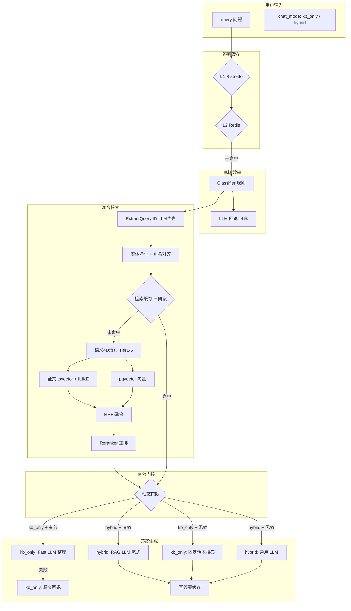

# 问答模式方案（历史设计 · v1 Chat）

> **文档类型：设计方案与计划。** 正文含设计目标或待办，实际交付以架构、接口文档和代码为准。 [当前文档入口](../README.md)

> **状态**：本文描述旧 `chat/stream` 时代的问答设计，**当前实现已迁移至 Agent v2**。以 [retrieval-and-chat.md](retrieval-and-chat.md)、[agent-v2.md](../api/agent-v2.md)、[系统逻辑总览 §7](../architecture/系统逻辑总览.md#7-流程-dagent-v2-对话run--sse) 为准。  
> 代码：`internal/core/service/agent/`（Runtime）；检索仍见 `retriever/`、`classifier/`
> 架构：[semantic-driven-retrieval.md](../architecture/semantic-driven-retrieval.md)

## 1. 能力概述

问答模式让用户在知识库分区内以自然语言提问，系统自动检索相关内容并给出答案。提供两种模式：

- **仅知识库（kb_only）**：仅从已入库知识中检索并整理答案，找不到时明确告知未收录。
- **知识库 + LLM（hybrid）**：优先从知识库检索；检索有效则走 RAG 流式 LLM；检索无效则降级到通用 LLM，诚实回答。

核心能力：

- **意图感知检索**：规则分类器（fact / concept / proper_noun / hybrid）动态调整全文/向量权重
- **语义 4D 瀑布过滤**：从严格 4D SQL WHERE 逐级退避到软加分，避免漏检
- **多级缓存叠罗汉**：L1 精确缓存（Ristretto）→ L2 Redis（精确+语义）→ 答案缓存（L1/L2）
- **动态有效门控**：复合置信度分 + 高质量信号 + 直接证据三路放行
- **LLM 降级保底**：LLM 失败时退回检索摘要；kb_only 无命中时固定话术拒答
- **流式 SSE 输出**：meta → chunk... → done，带置信度、来源、引用、检索 trace

## 2. 技术栈

| 层次 | 技术选型 |
|------|----------|
| 语言 | Go 1.23（Core 服务） |
| HTTP 框架 | Chi（路由）+ 标准 `net/http` |
| SSE 流 | 标准 `text/event-stream`，每 chunk 实时推送 |
| 数据库 | PostgreSQL（分块/文档/元数据） |
| 向量检索引擎 | pgvector（PostgreSQL 扩展），1024 维 `text-embedding-v4` |
| 全文检索 | PostgreSQL `tsvector` + ILIKE 双向实体匹配 |
| 嵌入模型 | `text-embedding-v4`（1024 维），经 Gateway 调用 |
| LLM Gateway | 内部 `llmclient` 统一代理，支持 Tier（Fast / Complex）+ provider/model 覆盖 |
| Reranker | 内部 Worker Rerank 服务（`reranker.Client`），L1/L2 候选池二次排序 |
| 答案缓存 | Ristretto（L1 内存）+ Redis（L2 跨实例），按 query + kb_type + catalog 版本 + 4D fingerprint 建 key |
| 检索缓存 | Ristretto（L1 精确）+ Redis（L2 精确/语义余弦相似），三阶段命中 |
| 分类器 | 规则版 `classifier.Classifier`（<5ms），可选 LLM 回退 |
| 4D 语义 | `query4d.go`（LLM 提取）→ 实体净化（`FinalSanitize`）→ 别名对齐 → embedding 对齐 → 瀑布过滤 |
| 日志 | `slog` 结构化日志 + `observability` 检索/对话指标 |
| 前端集成 | GrayDraft（Vue 3 + Vite），通过 BFF 代理 Agent v2 → legacy SSE，Agent 面板展示 retrieval trace |

## 3. 端到端流程



## 4. 关键技术节点

### 4.1 答案缓存（`answercache/`）

**目标**：对相同 query + 相同知识库版本直接返回缓存答案，跳过检索和 LLM 调用。

| 层级 | 实现 | Key 组成 | TTL |
|------|------|----------|-----|
| L1 | Ristretto 内存 | `BuildKey(query, kb_type, topK, catalogVer, catalogUpdated, sem4dFP)` | 可配，默认 30min |
| L2 | Redis 跨实例 | 同上 | 同上 |

**缓存不可用条件**（命中即跳过写入）：
- 答案含「没有找到」「无法回答」等无信息标记词（`noInfoAnswerMarkers` 黑名单）
- `ChunksUsed <= 0`（无 KB 上下文时不缓存通用 LLM 答案）
- `kb_only` 模式不写缓存（每次重跑保证确定性）

Key 中包含 `catalog_updated`（最近文档更新时间）和 `sem4dFP`（语义 4D 指纹），知识库数据变更时自动淘汰旧缓存。

### 4.2 意图分类（`classifier/classifier.go`）

**目标**：在 <5ms 内判断用户问句意图，调整后续检索策略权重。

| 意图 | 含义 | 全文权重 | 向量权重 | 门限基础分 |
|------|------|----------|----------|------------|
| `proper_noun` | 专名查询（人名/地名/物品名） | 低 | 高 | 0.20 |
| `fact` | 事实查询（版本号/日期/数值） | 高 | 低 | 0.25 |
| `concept` | 概念查询（机制/策略/对比） | 中等 | 较高 | 0.15 |
| `hybrid` | 混合查询 | 平衡 | 平衡 | 0.20 |

**分类规则**（纯代码，无 LLM 调用）：
- `proper_noun`：正则匹配大写缩写（`[A-Z]{2,}`）、带书名号的专名、引号内字符串
- `fact`：正则匹配版本号（`v?\d+\.\d+`）、关键词「是多少」「什么时候」「在哪」「多少」「多久」
- `concept`：匹配解释类关键词「是什么」「什么意思」「怎么」「如何」「有什么区别」
- 置信度 < 0.35 时可选 LLM 回退（`classifier.llm_enabled: true`）

`Route` 方法根据意图 + 配置权重输出 `RoutePlan`（全文权重、向量权重、是否启用 Global Index Boost）。

### 4.3 语义 4D 提取与对齐（`retriever/query4d.go`）

**目标**：从用户问句中提取 Domain / Entities / Scene / Style 四维语义标签，用于检索时精筛。

**管线**：

1. **Query4D 提取**（`ExtractQuery4D` / `ExtractQuery4DCached`）：
   - 服务级 Ristretto 缓存，Key = SHA256(query + 4D taxonomy version)
   - LLM 优先（`semantic_4d_llm_enabled: true`），Prompt 注入工作区 Blueprint 的 domain/scene/style 有效值字典
   - 失败回退规则（`GenericNormalize` 关键词子串匹配）

2. **实体净化**（`model/entity_sanitize.go` `FinalSanitize`）：
   - 短词博弈：同前缀长词（如「魂师大赛预选赛」）与短词（如「魂师大赛」）去重，保留长词
   - 原子 NER：分词后去掉单字和纯停用词

3. **实体别名对齐**（`classifier/alias.go` `CanonicalizeEntities`）：
   - 从知识库实体别名组（KB Entity Alias Index）中找到最短代表词
   - 例如「InternLM」「书生大模型」「卢」统一为「InternLM」

4. **Entity Embedding 对齐**（`taxonomyevolve/entity_align.go`）：
   - 将 entities 向量化，与 Blueprint 中已有 entity embeddings 做余弦匹配（≥0.85 对齐）

5. **Scene/Style 对齐**（`taxonomyevolve/aligner.go` `AlignQuery4D`）：
   - embedding 优先对齐，对齐失败的 scene/style 直接从 4D 中剔除，走瀑布退避

6. **Global Entity Pool**：对于 `gd_*` 分区，从 DB 拉取跨分区 DISTINCT entities 注入 query 实体池，补充可能的缺失。

### 4.4 检索缓存三阶段（`retriever/hybrid.go`）

**目标**：在不牺牲准确性的前提下尽可能命中缓存，避免重复计算 embedding。

| 阶段 | 缓存层 | 匹配方式 | 是否需 embedding |
|------|--------|----------|------------------|
| Phase 1 | L1（Ristretto）+ L2（Redis）exact | query + kb_type + catalog_ver + 4D fingerprint 精确匹配 | 否 |
| Phase 2 | 计算 query embedding | 仅必要时调用 `embedder.EmbedQuery` | — |
| Phase 3 | L2（Redis）semantic | 余弦相似（query embedding vs 缓存 embedding） | 是 |

- Phase 1 命中直接返回，避免 embedding API 调用
- Phase 3 仅当 Phase 1 未命中 + 已计算 embedding + 语义过滤器未启用时才使用
- 写入缓存时仅写 `resp.Total > 0` 或 4D 过滤器未启用的结果

### 4.5 语义 4D 瀑布过滤（`retriever/waterfall.go`）

**目标**：4D SQL WHERE 太严格时自动退避，避免「库里有但因为 4D 标签不匹配而搜不出」。

**优化**：严格（Tier 1）和软过滤（Tier 5）并发执行，Tier 1 先出结果则直接采用，消除串行 5 级等待。

| Tier | 后缀 | SQL 4D WHERE | 说明 |
|------|------|--------------|------|
| 1 | `_wf` | domain + entities + scene + style | 全量 4D，最严格 |
| 2 | `_wf_core` | domain + entities | 去掉 scene/style，消除意图噪音 |
| 3 | `_wf_ent` | domain + 最短实体 | 仅保留原子 ID 级实体 |
| 4 | `_wf_dom` | 仅 domain | 语义域门，无实体强制 |
| 5 | `_wf_soft` | 无 4D WHERE | 全文+向量召回后由 `BoostSemantic4D` 软加分 |

命中 Tier 2-5 时在 `strategy` 中追加后缀（如 `+sem4d_wf_ent`），同时写入 `retrieval_trace` 供前端 Agent 面板展示。

**实体双向 ILIKE**（`postgres/semantic_filter_entities.go`）：SQL WHERE 中 entities 匹配同时检查 `chunk.content ILIKE '%entity%'` 和 `entity ILIKE '%chunk_word%'`，避免短实体漏检。

### 4.6 混合检索与 RRF 融合（`retriever/hybrid.go`）

**目标**：融合全文、向量、结构化三路召回，经 RRF + Reranker 输出 Top-K。

**候选池**：
- **全文**：PostgreSQL `tsvector` + ILIKE（双向实体匹配），经 `ExpandedTerms` 别名扩展
- **向量**：pgvector cosine similarity，`text-embedding-v4` 1024 维
- **结构化**：`SearchStructuredRRF` 第三路（全局索引 / 结构化字段匹配）

**RRF 融合**：
- `RRFConstantK` 默认 60
- 全文和向量按 `RoutePlan` 中动态权重融合
- 可选 Global Index Boost（跨分区提权，boost_weight 默认 0.35）

**Reranker**（Worker 侧服务）：
- L1/L2 候选池（`RerankL1Pool`，默认 3×TopK）先经 Reranker 重排
- 满足 `shouldSkipRerank` 条件（质量极高分+TopK 量大+非语义过滤模式）时跳过，策略标记 `+rerank_skip_confident`
- Reranker 失败降级：截断前 TopK，标记 `+rerank_skip`

### 4.7 动态有效门控（`confidence/gate.go` + `confidence/threshold.go`）

**目标**：判断检索结果是否「足够有用」，决定是走 RAG 还是降级。

**三路放行**（任一满足即为 useful）：

| 路 | 条件 | Reason |
|----|------|--------|
| 高质量接地 | Top-1 chunk `QualityScore ≥ 0.72` +（TitleMatched / EntityMatched / 词元重叠） | `high_quality_grounding` |
| 直接证据 | Top-3 有 title hit / table keyword hit / quality≥0.65 + 内容关键词命中 | `direct_evidence` |
| 分数过线 | 复合置信度 ≥ 动态门限 | `score_above_threshold` |

**复合置信度计算**（`CalculateFinalConfidenceWithIntent`）：
```
score = max( RerankScore )×0.6 + max( VectorScore )×0.3 + TitleHitBonus + StructuredTableBonus
```

**动态门限**（`RetrievalGateThresholdDynamic`）：
```
threshold = base_intent − quality_bonus − title_bonus − entity_bonus
```
- `fact` 意图基础分最高（0.25），宁缺毋滥
- `concept` 意图基础分最低（0.15），允许更多上下文
- 质量分减让：`QualityScore ≥ 0.80` 减 0.05；`≥ 0.65` 减 0.03
- 标题命中减 0.02，实体命中减 0.02
- 硬地板 0.12，硬天花板 0.32

### 4.8 答案生成与流式 SSE（`chat/service.go` + `chat/llm_stream.go`）

入口：`POST /api/v1/chat/stream`

`Stream` 方法的核心分支：

#### kb_only 模式

| 门控结果 | 行为 |
|----------|------|
| 有效 | Fast LLM（`BuildKBOnlyMessages`）整理检索片段为结构化 Markdown；失败则退回 `KBAnswer`（原文拼接） |
| 无效 | 固定话术「当前知识库未入录该知识点。」 |

- Fast LLM Prompt：要求仅保留与问题直接相关的内容，删除无关/重复段落；可合并多来源按主题组织
- LLM 返回空时：如果 `search_only_fallback` 开启则退回原文拼接，否则报错
- 不写答案缓存（每次重新整理保证一致性）

#### hybrid 模式

| 门控结果 | 行为 |
|----------|------|
| 有效 | RAG LLM（`BuildMessages`）：system prompt 含工作区背景 + 所有检索片段 + 格式要求，流式输出 |
| 无效 | 通用 LLM（`BuildGeneralMessages`）：无 KB 上下文，提醒「未检索到足够相关资料」，基于通用知识回答 |

- RAG Prompt：要求仅根据参考资料回答、不编造事实；可合并多来源按主题组织；对比/多维度信息优先表格
- 通用 LLM Prompt：提醒勿假装引用知识库内容
- LLM 失败时：如果 `search_only_fallback` 开启则退回 kb_only 流程
- 有效命中（ChunksUsed > 0）时写入答案缓存

**Markdown 规范化**（`textutil.NormalizeKBMarkdown`）：
- 修正常见列表/日期排版问题
- 保留 `MM.DD` 日期区间（不误转为序号）

### 4.9 答案置信度自检（`confidence/answer.go`）

**目标**：在 done 事件中给出 answer_confidence 分，评估 LLM 生成答案是否与其引用的 chunk 一致。

配置 `chat.answer_self_check: true` 时开启。对答案文本和所用上下文 chunks 做交叉对比，返回 `AnswerConfidence`。

### 4.10 SSE 事件结构（`chat/service.go`）

| 事件类型 | 含义 | 关键字段 |
|----------|------|----------|
| `meta` | 检索完成后首个事件 | `gate_score`、`gate_threshold`、`gate_reason`、`strategy`、`query_intent`、`total`、`chunks_used`、`sources`、`citations`、`retrieval_trace` |
| `chunk` | LLM 流式增量 | `delta`（纯文本，已去 emoji） |
| `done` | 答案完成 | `answer_confidence`、`strategy`、`confidence`、`sources`、`citations` |
| `error` | 任何阶段出错 | `message` |

`sources`：按 chunk 去重（chunk_id），含 `chunk_id`、`doc_id`、`doc_title`、`quality_score`。

`citations`：按 doc 聚合（doc_id），含 `doc_title`、`chunk_ids[]`、`extensions`。

`retrieval_trace`：包含 waterfall_tier、waterfall_suffix、scene/style 对齐前后值、entity_align 方式、entities_final。

### 4.11 知识库未入录判定（`chat/prompt.go`）

kb_only 模式未命中时的固定话术：
```
当前知识库未入录该知识点。
```

LLM 生成的答案中出现无信息标记词（`noInfoAnswerMarkers`）时不写入缓存，标记词包括「没有找到」「无法回答」「资料不足」等 14 组。

## 5. API 契约

### `POST /api/v1/chat/stream`

| 字段 | 必填 | 说明 |
|------|------|------|
| `query` | 是 | 用户问题 |
| `kb_type` | 否 | 知识库分区（`gd_*`），空时全局索引 |
| `kb_types` | 否 | 多分区检索时使用 |
| `chat_mode` | 否 | `hybrid`（默认）/ `kb_only` |
| `top_k` | 否 | 检索结果数，默认 `chat.max_context_chunks`（20） |
| `skip_cache` | 否 | 跳过检索缓存 |
| `skip_answer_cache` | 否 | 跳过答案缓存 |
| `workspace_context` | 否 | 工作区上下文文本 |
| `context_profile` | 否 | 工作区语义配置（Domain/Scene/Style/Entities） |
| `llm_override` | 否 | `{provider, model, api_key}` 覆盖 LLM 配置 |

### `POST /api/v1/retrieval/search`

| 字段 | 必填 | 说明 |
|------|------|------|
| `query` | 是 | 检索查询 |
| `kb_type` | 否 | 知识库分区 |
| `top_k` | 否 | 返回数量 |
| `skip_cache` | 否 | 跳过缓存 |
| `skip_classifier` | 否 | 跳过意图分类 |
| `fulltext_weight` | 否 | 覆盖全文权重 |
| `vector_weight` | 否 | 覆盖向量权重 |

### `POST /api/v1/retrieval/diagnose`

返回 Query4D、cache、waterfall、top chunks、useful gate 分数与原因，用于排查 Agent 问答无结果。

## 6. 核心模块索引

| 模块 | 路径 | 职责 |
|------|------|------|
| 对话入口 | `chat/service.go` | Stream 总调度、缓存查找、门控路由、SSE 事件发送、答案缓存写入 |
| 对话模式 | `chat/mode.go` | NormalizeChatMode、HasUsefulRetrieval、RetrievalGateDecision |
| LLM 流 | `chat/llm_stream.go` | streamLLM / streamLLMWithTier（Fast/Complex Tier）+ LLMOverride |
| Prompt 构建 | `chat/prompt.go` | BuildMessages（RAG）、BuildKBOnlyMessages、BuildGeneralMessages、workspace 背景注入、KBNotRecordedAnswer |
| 来源/引用 | `chat/sources.go` + `chat/citations.go` | SourcesFromChunks（按 chunk 去重）、CitationsFromChunks（按 doc 聚合） |
| 答案缓存校验 | `chat/answer_cacheable.go` | IsAnswerCacheable（无信息标记词黑名单） |
| 混合检索 | `retriever/hybrid.go` | Search 总调度、缓存三阶段、意图路由、RRF 融合、Reranker、Global Index Boost |
| 4D 瀑布 | `retriever/waterfall.go` | searchWithSem4DWaterfall（Tier 1-5 并发退避） |
| Query4D 提取 | `retriever/query4d.go` | ExtractQuery4D（LLM 优先 + 规则回退）+ Ristretto 缓存 |
| Query4D 缓存 | `retriever/query4d_cache.go` | 服务级 4D 提取结果缓存 |
| 意图分类 | `classifier/classifier.go` | Classify（规则）+ Route（权重路由），可选 LLM 回退 |
| 实体别名 | `classifier/alias.go` | CanonicalizeEntities（KB 别名组最短词） |
| 置信度 | `confidence/gate.go` | CalculateFinalConfidenceWithIntent、EvaluateRetrievalGate、passesHighQualityGrounding、hasDirectEvidence |
| 动态门限 | `confidence/threshold.go` | RetrievalGateThreshold / RetrievalGateThresholdDynamic（意图基础分 + 质量减让） |
| 答案自检 | `confidence/answer.go` | FromAnswer（LLM 生成答案 vs chunk 一致性） |
| 答案缓存 | `answercache/manager.go` | L1/L2 答案缓存 Lookup + Store |
| 答案缓存 Key | `answercache/key.go` | BuildKey（query+kb_type+catalog_ver+sem4dFP） |
| 检索缓存 | `cache/` | L1（Ristretto 精确）+ L2（Redis 精确/语义）三阶段缓存 |
| 多 KB | `retriever/multi_kb.go` | searchMultiKB（跨分区检索） |
| 媒体富化 | `retriever/media_enrich.go` | enrichChunksWithMedia |
| 实体池 | `retriever/entity_pool.go` | globalEntityPool（跨 `gd_*` 分区 DISTINCT entities） |
| Rerank 跳过 | `retriever/rerank_skip.go` | shouldSkipRerank（高置信度跳过） |
