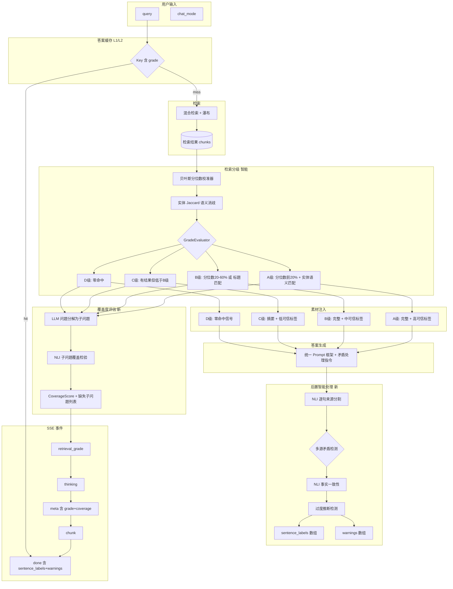

# 问答模式优化方案

> 现状：[chat-qa-design.md](./chat-qa-design.md)
> 代码：`internal/core/service/chat/`、`internal/core/service/confidence/`、`internal/core/service/answercache/`
> 架构：[semantic-driven-retrieval.md](../architecture/semantic-driven-retrieval.md)

## 1. 问题诊断

### 1.1 当前核心缺陷

现网 hybrid 模式采用「检索有效→RAG 直出；检索无效→通用 LLM」的二分逻辑，存在三个根本问题：

| 问题 | 现状 | 根因 |
|------|------|------|
| **有效时 LLM 退化为复读机** | RAG Prompt 写死「仅根据参考资料回答」，LLM 无法理解整合，输出生硬 | `chat/prompt.go` `BuildMessages` system prompt 约束过紧 |
| **无效时完全放弃知识库** | 门控判定 useless 后走 `streamHybridGeneral`，零 KB 上下文注入 | `chat/service.go` `Stream` 分支逻辑为 bool 二分 |
| **kb_only 拒答过于生硬** | 未命中直接返回固定话术，用户看不到覆盖边界 | `chat/service.go` `streamKBOnly` 无中间态 |

### 1.2 核心思路

无论检索结果置信度高低，知识库内容始终作为 LLM 回答的**参考素材**，而非唯一答案源。

```
                  ┌──────────────────────────────┐
                  │      知识库检索结果            │
                  │  （始终作为参考素材注入）        │
                  └──────────────┬───────────────┘
                                 │
                    ┌────────────┴────────────┐
                    │                         │
              ┌─────▼─────┐           ┌───────▼──────┐
              │ 高置信度命中 │           │ 低置信度/未命中 │
              └─────┬─────┘           └───────┬──────┘
                    │                         │
        ┌───────────▼───────────┐   ┌─────────▼──────────┐
        │ LLM 基于参考素材深度整合 │   │ LLM 基于稀疏参考素材   │
        │ + 标注「知识库已有」    │   │ + 标注「知识库覆盖有限」 │
        │ + 引用来源              │   │ + 补充通用知识但明确区分 │
        └───────────────────────┘   └──────────────────────┘
```

### 1.3 智能增强方向

在上述统一参考素材角色的基础上，进一步消除方案中对**硬阈值、关键词匹配、LLM 自觉分隔**的依赖，将分级、覆盖度评估、事实校验、来源分割全部升级为语义驱动的自适应机制。

## 2. 技术栈

| 层次 | 现状 | 优化后变化 |
|------|------|------------|
| 门控模型 | `confidence/gate.go` 输出 `bool`（useful/miss） | 输出 `GradeDecision{A/B/C/D, CoverageScore}`，内置贝叶斯分位数校准器 |
| 分级校准 | 无 | **新增** `confidence/calibrator.go`：离线统计各 `kb_type` 质量分分布，在线映射为分位数等级 |
| 覆盖度评估 | 无（仅 top1 线性映射） | **新增** `confidence/coverage.go`：LLM 问题分解 + 轻量 NLI 子问题覆盖检验 |
| Prompt 引擎 | `chat/prompt.go` 三套独立 Prompt | 统一 `BuildUnifiedMessages`，按 grade 注入分级指引 + 矛盾处理指令 |
| 答案自检 | `confidence/answer.go` 词元重叠检查 | 升级为 NLI 蕴含检测 + 实体别名归一化 + 数值规范化 |
| 回答来源分割 | 无（依赖 LLM 文本标记字符串） | **新增** NLI 逐句判别，输出结构化 `sentence_labels` 数组 |
| 矛盾检测 | 无 | **新增** `confidence/contradiction.go`：多 chunk 同实体冲突识别 + 警告 |
| 答案缓存 | `answercache/manager.go` 简单 TTL | 增加逻辑 TTL + catalog 联动淘汰，治理 grade 维度导致的碎片化 |
| SSE 事件 | 4 种：meta/chunk/done/error | 新增 `retrieval_grade`、`thinking`；done 新增 `sentence_labels`、`warnings` |
| 前端交互 | 文本标记解析分区 | 接收结构化 `sentence_labels` 渲染分区，覆盖度指示条含缺失子主题提示 |

不变部分：语言（Go 1.23）、HTTP（Chi）、数据库（PostgreSQL + pgvector）、消息队列（NATS）、检索（混合 + RRF + Reranker）、LLM Gateway（`llmclient`）、日志（`slog`）均沿袭现状。

## 3. 优化后端流程



## 4. 关键技术节点

### 4.1 检索分级智能化（`confidence/gate.go` + `confidence/calibrator.go` 新增）

**现状问题**：A 级判定固定 `QualityScore ≥ 0.72 + 实体匹配`，B 级固定 `≥ 0.50`，完全依赖人工预设数值。不同知识分区、不同知识密度的文本，其「高可信」的绝对分值含义不同——新领域优质短文可能因分数略低而被降级。

**优化方案**：

#### 4.1.1 贝叶斯分位数校准器（`confidence/calibrator.go` 新增）

**原理**：离线统计各 `kb_type` 下历史 chunk 质量分分布，在线将原始 `QualityScore` 映射为**分位数等级**，动态消除分区偏差。

**数据结构**：

```go
// confidence/calibrator.go
type PartitionCalibration struct {
    KBType      string
    P20         float64  // 前 20% 阈值
    P60         float64  // 前 60% 阈值
    SampleCount int
    UpdatedAt   time.Time
}

type Calibrator struct {
    mu      sync.RWMutex
    byKB    map[string]*PartitionCalibration
    repo    CalibrationRepo  // 从 postgres 读取历史质量分分布
    refresh time.Duration    // 刷新间隔，默认 6h
}

// CalibrateGrade 将原始质量分映射为等级
func (c *Calibrator) CalibrateGrade(kbType string, rawQuality float64, hasEntityMatch bool) RetrievalGrade
```

**等级映射逻辑**：

| 条件 | Grade | 说明 |
|------|-------|------|
| `rawQuality ≥ P20` + 实体语义匹配 | A | 分区内前 20% 优质，且有实体支撑 |
| `rawQuality ≥ P20` 但无实体匹配 | B | 质量高但实体信号弱，降一档 |
| `P20 > rawQuality ≥ P60` | B | 分区内中等偏上 |
| `rawQuality < P60` 但有标题匹配 | B | 标题命中救回一档 |
| `rawQuality < P60` 且无标题匹配 | C | 低质量，稀疏参考 |
| 零命中 | D | — |

**兼容性**：若分区历史数据不足（`SampleCount < 100`），回退到全局固定阈值（`0.72` / `0.50`），确保冷启动可用。

#### 4.1.2 实体匹配语义消歧（`confidence/gate.go`）

**现状问题**：当前「实体匹配」可能是字面重合（`c.EntityMatched` flag），无法区分同义不同名（如「InternLM」和「书生大模型」），误判风险高。

**优化**：升级为**实体归一化集合的 Jaccard 相似度**。

```go
// confidence/gate.go 新增
func EntityJaccardMatch(queryEntities, chunkEntities []string, aliasIdx *EntityAliasIndex) bool {
    // 1. 双方实体均经 CanonicalizeEntities 归一化
    // 2. 计算 Jaccard = |交集| / |并集|
    // 3. 阈值 ≥ 0.3 视为语义匹配
    normalizedQuery := aliasIdx.CanonicalizeEntities(queryEntities)
    normalizedChunk := aliasIdx.CanonicalizeEntities(chunkEntities)
    intersection := intersect(normalizedQuery, normalizedChunk)
    union := union(normalizedQuery, normalizedChunk)
    return float64(len(intersection)) / float64(len(union)) >= 0.3
}
```

**调用链**：`EvaluateRetrievalGrade` 中，原有的 `c.EntityMatched` 布尔检查改为 `EntityJaccardMatch(queryEntities, chunkEntities, aliasIdx)`。

### 4.2 覆盖度语义评估（`confidence/coverage.go` 新增）

**现状问题**：`CoverageScore` 仅依据 top-1 chunk 质量分线性计算，无法反映检索结果是否覆盖了问题的多个子方面。复杂问题（如「InternLM 推理参数配置」）可能只检索到武器部分，推理参数部分缺失，但 top1 质量分仍高，导致 coverage 虚高。

**优化方案**：问题分解 + 子问题覆盖检验。

**技术栈**：LLM（问题分解） + 轻量 NLI 模型（子问题覆盖检验，如 `bart-large-mnli` 或同等小参数量模型）。

**流程**：

```
query → LLM 分解为子问题列表 [q1, q2, ..., qn]
       → 对每个子问题 qi，NLI 判断是否有 chunk 能蕴含或部分支持
       → CoverageScore = 满足的子问题数 / 总子问题数
       → 未覆盖子问题列表写入 missing_subtopics
```

**数据结构**：

```go
// confidence/coverage.go
type CoverageResult struct {
    Score            float64    // 0-1
    TotalSubQuestions int
    CoveredCount     int
    MissingTopics    []string  // 未覆盖的子问题原文
}
```

**问题分解 Prompt**（LLM 调用，Tier Fast）：

```
将以下用户问题分解为 2-5 个独立的子问题，每个子问题应是可以单独检验的事实点。
输出纯 JSON 数组，不附带解释。
问题：InternLM 推理参数配置
输出：["InternLM 推荐接口", "InternLM 推荐参数", "InternLM武器推理参数搭配思路"]
```

**NLI 覆盖检验**：对每个子问题 `qi`，将 Top-5 chunk 拼接为 `premise`，`qi` 为 `hypothesis`，NLI 模型返回 `entailment` / `neutral` / `contradiction`。`entailment` 视为覆盖。

**性能策略**：
- 子问题 ≤ 5，NLI 调用 ≤ 5 次，串行总耗时 < 500ms
- NLI 结果缓存：Key = SHA256(subquestion + chunk_ids_hash)，TTL 30min
- NLI 服务不可用时：回退为词元重叠估算（`coverage = sum(token_overlap_i) / total_tokens`）

### 4.3 统一 Prompt 框架（`chat/prompt.go`）

**现状**：三套独立 Prompt 构建函数，分散在 `BuildMessages`（RAG）、`BuildKBOnlyMessages`（kb_only）、`BuildGeneralMessages`（通用 LLM），各有一套 system prompt。

**优化**：合并为 `BuildUnifiedMessages(query, kbType, chunks, grade, profile, missingTopics)`，按 grade 动态生成对应的上下文指引，并传入覆盖度评估结果。

**新增 Prompt 构建函数**（替换 `prompt.go` 中的三个 `Build*Messages`）：

```go
// chat/prompt.go 新增
func BuildUnifiedMessages(
    query, kbType string,
    chunks []model.Chunk,
    grade confidence.RetrievalGrade,
    profile *model.ContextProfile,
    mode string,          // "hybrid" / "kb_only"
    missingTopics []string, // 覆盖度评估未覆盖的子问题
) []llmclient.Message
```

**核心 Prompt 指令变更**：

| 位置 | 旧指令 | 新指令 |
|------|--------|--------|
| 角色定义 | 「仅根据下方参考资料回答，不要编造事实」 | 「以下是知识库中的相关内容，它们经过精选和校验，是可靠的参考素材」 |
| 使用约束 | 「不得编造资料中不存在的事实；资料不足时说明缺口，勿猜测」 | 「以这些内容为基础，结合你的理解，用清晰、连贯的语言回答问题」 |
| 补充规则 | 无 | 「当参考资料不足时，可补充你的通用知识，但后端会自动区分来源，你只需正常回答」 |
| 矛盾处理 | 无 | 「如果参考素材之间存在明显矛盾（如同一实体属性数值不同），请优先采信 quality_score 最高或来源最新的内容，并指出其他来源的分歧」 |

**按 grade 的动态指引**（注入到 system prompt 中）：

| Grade | Prompt 追加段落 |
|-------|----------------|
| A | 「上述参考素材与您的问题高度相关，请优先使用素材内容深度整合回答，可引用来源编号。」 |
| B | 「上述参考素材与您的问题部分相关，请以素材为主进行整合，不确定处可补充通用知识。」 |
| C | 「上述参考素材与您的问题关联度较低，请仅将其作为背景知识参考。知识库中关于该主题的信息有限，请诚实告知。」 |
| D | 「知识库中未检索到与该问题直接相关的内容。请基于你的通用知识回答，并在首句诚实声明覆盖范围。」 |

**未覆盖子问题注入**（`missingTopics` 不为空时追加）：
```
知识库中以下子问题暂无资料：[子问题1]、[子问题2]。回答时请明确指出这些缺口。
```

**kb_only 模式 Prompt 差异**：相比 hybrid 增加：
- 「你只能使用参考素材中的信息，不得引入外部知识」
- 部分命中（B/C 级）时允许按「已知部分 + 未覆盖部分」结构输出
- 注：分隔标记不再由 LLM 负责，后端会通过 NLI 自动分割

### 4.4 kb_only 部分命中中间态（`chat/service.go`）

**现状**：`streamKBOnly` 只有两条路径——有用时走 Fast LLM，无用时固定话术拒答。

**优化**：增加「部分命中」中间态，利用 `CoverageScore` 区分：

| 覆盖度 | 行为 | SSE strategy 标记 |
|--------|------|-------------------|
| A 级 (≥0.80) | Fast LLM 基于素材深度整合（同现状有效路径） | `kb_only_llm` |
| B 级 (0.40-0.79) | Fast LLM 输出「已知部分」+「未覆盖部分」分隔结构 | `kb_only_partial` |
| C 级 (0.10-0.39) | Fast LLM 输出三段式：「已知片段」→「覆盖不足声明」→「建议」 | `kb_only_sparse` |
| D 级 (0) | 固定话术 + entity 覆盖列表（从 Blueprint entities 取 Top-15） | `kb_only_miss` |

**零命中时话术优化**（`chat/prompt.go` `KBNotRecordedAnswer` → `KBCoverageBoundary`）：

```
当前知识库未收录该主题。
知识库目前覆盖范围：[entity_1]、[entity_2]、[entity_3]...
您可尝试换个问法，或联系管理员补充相关内容。
```

其中 entity 列表从工作区 Blueprint 的 `workspace_4d_taxonomy.entities` 中取出现频率最高的 15 个。

### 4.5 门控逻辑重定义（`confidence/gate.go`）

**现状**：`EvaluateRetrievalGate` 返回 `GateDecision{Useful bool, ...}`。

**优化**：返回值从 `GateDecision` 改为 `GradeDecision`，内置分位数校准。

**新结构**：

```go
// confidence/gate.go
type RetrievalGrade string

const (
    GradeA RetrievalGrade = "A"
    GradeB RetrievalGrade = "B"
    GradeC RetrievalGrade = "C"
    GradeD RetrievalGrade = "D"
)

type GradeDecision struct {
    Grade         RetrievalGrade
    Confidence    float64
    CoverageScore float64
    Reason        string
    MissingTopics []string  // 覆盖度评估未覆盖的子问题
}
```

**改动清单**：

| 文件 | 改动 |
|------|------|
| `confidence/gate.go` | 新增 `RetrievalGrade`、`GradeDecision`、`EvaluateRetrievalGrade`；三路放行逻辑改为分位等级判断 |
| `confidence/calibrator.go` | **新增**：`Calibrator` + `PartitionCalibration`，后台定时刷新分区质量分分布 |
| `confidence/coverage.go` | **新增**：`EvaluateCoverage`，LLM 分解 + NLI 子问题覆盖检验 |
| `chat/mode.go` | `HasUsefulRetrieval` → `EvaluateRetrievalGrade`，返回 `GradeDecision` |
| `chat/service.go` | `Stream` 方法 gate 分支从 `if useful` 改为 `switch grade`；所有子方法入参增加 `grade` + `missingTopics` |

**兼容性**：`EvaluateRetrievalGate` 保留为 deprecated wrapper，内部调用 `EvaluateRetrievalGrade` 后返回 `grade != D`。

### 4.6 回答来源自动分割（`confidence/answer.go` + `chat/service.go`）

**现状问题**：Prompt 要求 LLM 用 `──以下为补充信息（非知识库内容）──` 分隔补充内容，依赖 LLM 自觉遵守。但 LLM 可能遗漏分隔符、使用变体符号（`--` / `---`）、或将知识库内容误标为补充，导致前端分区渲染失败，甚至让用户误以为知识库包含幻觉内容。

**优化方案**：**后置语义分割**——不依赖 LLM 标记字符串，而是将 LLM 输出按句子拆分，用 NLI 模型逐句判断是否能由参考 chunk 集合推导出。

**技术栈**：轻量 NLI 模型（复用覆盖度评估使用同一模型）。

**流程**：

```
LLM 输出完整答案
  → 按句号/换行拆分为句子列表 [s1, s2, ..., sk]
  → 对每个句子 si：
      premise = 拼接所有参考 chunk 内容
      hypothesis = si
      NLI 模型判断：
        entailment → source = "kb"
        neutral     → source = "supplement"
        contradiction → source = "supplement" (标记 warning)
  → 生成 sentence_labels 数组
```

**数据结构**：

```go
// model/chat.go
type SentenceLabel struct {
    Sentence string `json:"sentence"`
    Source   string `json:"source"` // "kb" / "supplement"
    Warning  string `json:"warning,omitempty"` // "contradiction" 时标记
}
```

**SSE done 事件扩展**（`chat/service.go`）：

```go
type ChatStreamEvent struct {
    // ... 现有字段 ...
    SentenceLabels []SentenceLabel `json:"sentence_labels,omitempty"` // 新增
}
```

**性能策略**：
- 句子数通常 ≤ 20，NLI 调用 ≤ 20 次，并发执行总耗时 < 1s
- NLI 结果缓存：Key = SHA256(sentence + chunks_hash)，TTL 30min
- NLI 服务不可用时：回退为 LLM 文本标记解析（降级路径，保留兼容）

**对 Prompt 的影响**：Prompt 中不再要求 LLM 输出分隔标记。原有「补充信息必须使用分隔标记」指令删除，改为后端自动分割，LLM 只需正常回答。

### 4.7 答案自检升级为语义级（`confidence/answer.go`）

**现状问题**：事实一致性检查仅为字面匹配——「答案中专有名词和数字必须在参考 chunk 中出现」。LLM 可能用同义词、缩写或归纳性表达（「InternLM」写为「书生大模型」，提炼后数字「1.5倍」→「150%」），字面不匹配却语义正确，导致误报。

**优化方案**：三道自检分别升级。

#### 4.7.1 事实一致性：NLI 蕴含检测

```go
// confidence/answer.go
type AnswerConfidence struct {
    Score                  float64          `json:"score"`
    FactConsistency        float64          `json:"fact_consistency"`   // 升级为 NLI 蕴含率
    OverConfidenceWarning  bool             `json:"over_confidence_warning"`
    SourceConfusionRisk    bool             `json:"source_confusion_risk"`
    ContradictionWarnings  []string         `json:"contradiction_warnings,omitempty"` // 新增
}
```

**NLI 事实一致性**（替代原词元重叠）：

```
对答案全文：
  premise = 拼接所有参考 chunk
  hypothesis = 答案
  NLI 返回 entailment_score（0-1）
  FactConsistency = entailment_score
```

**别名归一化**：在 NLI 调用前，对答案和 chunk 做实体别名归一化——将「书生大模型」「书生」替换为规范名「InternLM」（复用 `classifier/alias.go` `CanonicalizeEntities` + 扩展的别名表），消除同义不同名带来的字面差异。

**数值规范化**：正则提取所有数值，统一为浮点数比较。`1.5倍` ↔ `150%` ↔ `1.5x` 归一化后比较。

#### 4.7.2 过度推断检测

| 检查项 | 旧方法 | 新方法 |
|--------|--------|--------|
| 触发条件 | 检索 Grade ≤ C | 检索 Grade ≤ C |
| 检测逻辑 | 关键词正则（「一定」「绝对」「所有」） | 同旧 + 增加 NLI 矛盾检测：若答案断言与 chunk 内容为 `contradiction` 关系，则标记 |
| 输出 | `bool` 告警 | `bool` 告警 + 具体矛盾句子列表 |

#### 4.7.3 来源混淆检测

| 检查项 | 旧方法 | 新方法 |
|--------|--------|--------|
| 触发条件 | Grade D 时强制检查（检测分隔标记） | 始终执行 |
| 检测逻辑 | 字符串包含检查 | 依赖 4.6 节的 NLI 逐句分割结果：若 `sentence_labels` 中 supplement 比例 > 60% 且无明确声明，则标记风险 |
| 输出 | `bool` 告警 | `bool` 告警 + `supplement_ratio` |

### 4.8 多源矛盾检测（`confidence/contradiction.go` 新增）

**现状问题**：统一 Prompt 允许整合多个参考素材，但未处理素材之间的不一致。如果知识库存在版本更新导致的新旧数据冲突（如「引用最大生命值 30000」和「引用最大生命值 35000」），LLM 可能随机选一或输出矛盾信息。

**优化方案**：在答案生成后的后置处理中，检测多 chunk 间对同一实体的矛盾信息。

**技术栈**：实体提取 + 数值比较 + NLI 矛盾检测。

**流程**：

```
1. 从所有参考 chunk 中提取 (entity, attribute, value) 三元组
   例: ("引用", "最大生命值", 30000), ("引用", "最大生命值", 35000)
2. 按 (entity, attribute) 分组，同组内 value 差异 > 容差（数值 5%，文本不同）则标记矛盾
3. 对矛盾的三元组，取 quality_score 最高的 chunk 的值作为优先采信
4. 生成警告列表写入 done.warnings
```

**数据结构**：

```go
// confidence/contradiction.go
type ContradictionResult struct {
    HasConflict    bool
    Conflicts      []ConflictItem
}

type ConflictItem struct {
    Entity    string   `json:"entity"`
    Attribute string   `json:"attribute"`
    Values    []ConflictValue `json:"values"`
    Preferred string   `json:"preferred"` // 优先采信的 chunk_id
}

type ConflictValue struct {
    ChunkID      string  `json:"chunk_id"`
    Value        string  `json:"value"`
    QualityScore float64 `json:"quality_score"`
}
```

**Prompt 配合**：Prompt 中已加入矛盾处理指令（见 4.3 节），LLM 会尝试优先采信高质量来源。后置矛盾检测作为兜底校验，确保即使 LLM 未正确处理矛盾，done 事件中也会有警告。

**SSE done 事件扩展**：

```go
type ChatStreamEvent struct {
    // ... 现有字段 ...
    Warnings []string `json:"warnings,omitempty"` // 多源矛盾警告
}
```

### 4.9 SSE 事件扩展（`chat/service.go`）

**现状**：4 种事件类型——`meta`、`chunk`、`done`、`error`。

**优化**：新增 2 种事件类型，`meta` 扩展，`done` 扩展。

**新增事件**：

| 事件 | 触发时机 | 关键字段 |
|------|----------|----------|
| `retrieval_grade` | 检索分级 + 覆盖度评估完成后（首个 SSE 事件） | `grade`（A/B/C/D）、`coverage_score`（0-1）、`missing_topics`（未覆盖子问题列表）、`chunk_summary` |
| `thinking` | LLM 开始生成前 | `message`（如「正在基于 2 条高可信参考整合回答...」）、`grade`、`chunk_count` |

**meta 事件扩展字段**：

| 字段 | 类型 | 说明 |
|------|------|------|
| `retrieval_grade` | `string` | 新增，A/B/C/D |
| `coverage_score` | `float64` | 新增，0-1 |
| `grade_reason` | `string` | 新增，分级原因摘要 |
| `missing_topics` | `[]string` | 新增，未覆盖的子问题 |
| `chunks_summary` | `[]ChunkSummary` | 新增，每条 chunk 的 id/title/grade_label |

**done 事件扩展字段**：

| 字段 | 类型 | 说明 |
|------|------|------|
| `sentence_labels` | `[]SentenceLabel` | 新增，逐句来源标注（kb/supplement） |
| `warnings` | `[]string` | 新增，多源矛盾警告 |

**SSE 事件时序**（优化后）：
```
retrieval_grade → thinking → meta → chunk... → done（含 sentence_labels + warnings）
```

### 4.10 答案缓存碎片化治理（`answercache/`）

**现状问题**：缓存 Key 新增 `grade` 维度后，若因检索策略微调或新增文档导致同一 query 的 grade 从 A 滑至 B，会生成新缓存，旧缓存永不淘汰但访问频率急剧下降，造成 Redis 内存浪费。

**优化方案**：逻辑 TTL + catalog 联动淘汰。

**措施**：

| 措施 | 实现 | 说明 |
|------|------|------|
| **逻辑 TTL** | Redis Key 的 `EXPIRE` 设置为正常 TTL（30min），写入时再 SET | 基础保障，到期自动删除 |
| **同 query 低 grade 变体提前淘汰** | 写入 A 级缓存时，主动删除同 query 的 B/C 级 Key | 高等级出现时低等级不再有价值 |
| **catalog 版本跃进淘汰** | 后台协程监听 `catalog_updated` 变更，若同一 kb_type 下 catalog 版本号跳跃 > 5，清空该分区所有非 A 级缓存 | 知识库大更新时旧缓存可能全部过时 |
| **最小访问监控** | Redis `OBJECT IDLETIME` 检测，若低 grade（B/C 级）缓存 10min 内无访问，主动删除 | 防止僵尸缓存堆积 |

**缓存策略不变**（与 v1 优化方案一致）：

| 模式 | Grade | 策略 | TTL |
|------|-------|------|-----|
| kb_only | A / B | 缓存 | 30min |
| kb_only | C | 缓存 | 15min |
| kb_only | D | 不缓存 | — |
| hybrid | A / B | 缓存 | 30min |
| hybrid | C | 缓存 | 15min |
| hybrid | D | 不缓存 | — |

### 4.11 前端交互数据化（GrayDraft）

**现状问题**：前端通过搜索 `──以下为补充信息──` 文本来划分知识库内容与补充内容，LLM 可能输出微小差异导致分区失效。

**优化方案**：后端提供结构化分区信息，前端不再解析文本标记。

| 优化点 | 旧方案 | 新方案 | 依赖的后端字段 |
|--------|--------|--------|----------------|
| **知识库/补充分区** | 搜索文本标记字符串 | 直接使用 `sentence_labels[]` 渲染底色/边框 | `done.sentence_labels` |
| **覆盖度指示条** | `coverage_score` 进度条 | 进度条 + 「缺失子主题」悬停提示 | `meta.coverage_score` + `meta.missing_topics` |
| **多源矛盾提示** | 无 | 回答顶部黄色警告条，展开可查看冲突详情 | `done.warnings` |
| **参考来源可点击** | `sources[].doc_id` 链接 | 同旧 | `meta.sources` |
| **反馈按钮分层** | 有用/无用 | 有用/无用 + 「知识库覆盖不足」 | `POST /api/v1/chat/feedback` `vote_type: coverage` |
| **检索 trace 可视化** | Agent 面板展示 trace | 增加 grade 徽标（A/B/C/D 色标）+ 各 chunk 匹配度 | `meta.retrieval_grade`、`meta.chunks_summary` |

**feedback 扩展**（`chat/feedback.go`）：
- 请求体 `ChatFeedbackRequest` 新增 `vote_type` 字段：`"quality"`（默认，有用/无用） / `"coverage"`（知识库覆盖不足）
- `coverage` 类型投票不触发 chunk 质量分调整，单独写入 `ragops` 覆盖缺口分析表

## 5. 实施计划

### 5.1 P0（核心逻辑变更：二分 → 分级）

| 任务 | 文件 | 工作量 | 风险 |
|------|------|--------|------|
| 门控输出从 `bool` 改为 `GradeDecision` | `confidence/gate.go`、`chat/mode.go` | 1d | 低 |
| Prompt 重构为统一框架 + 矛盾指令 | `chat/prompt.go` | 1.5d | 中：需灰度 A/B 测试 |
| Stream 分支从二分改为 grade switch | `chat/service.go` | 1d | 中：子方法入参变化 |
| kb_only 增加部分命中中间态 | `chat/service.go`、`chat/prompt.go` | 1d | 低 |

### 5.2 P1（智能分级与覆盖度）

| 任务 | 文件 | 工作量 | 风险 |
|------|------|--------|------|
| 贝叶斯分位数校准器 | `confidence/calibrator.go` **新增** | 1.5d | 中：需对接 postgres 历史质量分统计 |
| 实体 Jaccard 语义消歧 | `confidence/gate.go` | 0.5d | 低：复用现有别名索引 |
| 覆盖度语义评估（问题分解 + NLI） | `confidence/coverage.go` **新增** | 2d | 中：NLI 模型部署 + 性能调优 |
| 覆盖度结果注入 Prompt + SSE | `chat/prompt.go`、`chat/service.go` | 0.5d | 低 |

### 5.3 P2（来源分割与自检升级）

| 任务 | 文件 | 工作量 | 风险 |
|------|------|--------|------|
| NLI 逐句来源分割 | `chat/service.go` + `confidence/answer.go` | 2d | 中：NLI 并发调度 + 降级路径 |
| 答案自检升级：NLI 蕴含检测 | `confidence/answer.go` | 1d | 中：依赖 NLI 模型 |
| 答案自检升级：实体别名归一化 + 数值规范化 | `confidence/answer.go` | 0.5d | 低：复用现有函数 |
| 多源矛盾检测 | `confidence/contradiction.go` **新增** | 1.5d | 低：纯后端逻辑，无外部依赖 |
| SSE done 事件扩展 `sentence_labels` + `warnings` | `chat/service.go`、`model/chat.go` | 0.5d | 低 |

### 5.4 P3（缓存与兜底）

| 任务 | 文件 | 工作量 | 风险 |
|------|------|--------|------|
| 缓存 Key 增加 grade 维度 | `answercache/key.go` | 0.5d | 低 |
| kb_only 命中缓存 + C 级缓存 | `answercache/manager.go`、`chat/answer_cacheable.go` | 1d | 中：需验证 Redis 容量 |
| 缓存碎片化治理（逻辑淘汰 + catalog 联动） | `answercache/manager.go` **扩展** | 1d | 低 |
| feedback 增加 `coverage` 投票类型 | `chat/feedback.go`、`ragops/` | 0.5d | 低 |

### 5.5 P4（前端配合）

| 任务 | 位置 | 工作量 | 风险 |
|------|------|--------|------|
| 基于 `sentence_labels` 分区渲染 | GrayDraft Markdown 渲染器 | 1.5d | 低 |
| 覆盖度指示条 + 缺失子主题提示 | GrayDraft 回答组件 | 1d | 低 |
| 多源矛盾警告条 | GrayDraft 回答组件 | 0.5d | 低 |
| 检索 trace grade 徽标可视化 | GrayDraft Agent 面板 | 1d | 低 |
| 反馈「覆盖不足」按钮 | GrayDraft 反馈组件 | 0.5d | 低 |

## 6. 核心模块变更索引

| 模块 | 路径 | 变更类型 | 变更说明 |
|------|------|----------|----------|
| 门控 | `confidence/gate.go` | **重构** | `EvaluateRetrievalGate`(bool) → `EvaluateRetrievalGrade`(GradeDecision)；实体匹配升级为 Jaccard 语义消歧 |
| 分位数校准器 | `confidence/calibrator.go` | **新增** | `Calibrator`：离线统计分区质量分分布，在线分位数映射，消除硬阈值 |
| 覆盖度评估 | `confidence/coverage.go` | **新增** | `EvaluateCoverage`：LLM 问题分解 + NLI 子问题覆盖检验 |
| 门控阈值 | `confidence/threshold.go` | 不变 | 动态门限逻辑保留，作为冷启动回退 |
| 接地检测 | `confidence/grounding.go` | 小改 | `passesHighQualityGrounding` 额外参与 A 级质量分判断 |
| 答案自检 | `confidence/answer.go` | **重构** | NLI 蕴含检测替代词元重叠；增加实体别名归一化、数值规范化；扩展 AnswerConfidence 结构 |
| 矛盾检测 | `confidence/contradiction.go` | **新增** | `DetectContradictions`：多 chunk 同实体冲突识别，输出警告列表 |
| Prompt 构建 | `chat/prompt.go` | **重构** | 三套 `Build*Messages` → `BuildUnifiedMessages` + grade 指引 + 矛盾指令 + 缺失子问题注入；移除 LLM 分隔标记要求 |
| 对话服务 | `chat/service.go` | **重构** | 二分 branch → grade switch；新增 NLI 来源分割后置处理；`streamKBOnly` 增加部分命中路径 |
| 对话模式 | `chat/mode.go` | 小改 | `HasUsefulRetrieval` → `EvaluateRetrievalGrade` |
| 答案缓存校验 | `chat/answer_cacheable.go` | 小改 | 删除 kb_only 硬编码排除，改为按 grade 判断 |
| 答案缓存 Key | `answercache/key.go` | 小改 | Key 增加 grade 维度 |
| 答案缓存管理 | `answercache/manager.go` | **扩展** | 半 TTL 写入支持；新增逻辑淘汰（同 query 低 grade 删除、catalog 跃进淘汰、最小访问监控） |
| 反馈 | `chat/feedback.go` | 扩展 | 新增 `vote_type: coverage` 分支 |
| SSE 模型 | `model/chat.go` | 扩展 | 新增 `retrieval_grade`/`thinking` 事件；`ChatStreamEvent` 新增 grade/coverage/sentence_labels/warnings/missing_topics 字段；新增 `SentenceLabel`、`ChunkSummary` 结构体 |
| 检索模型 | `model/retrieval_trace.go` | 扩展 | 新增 `RetrievalGrade` 字段 |
