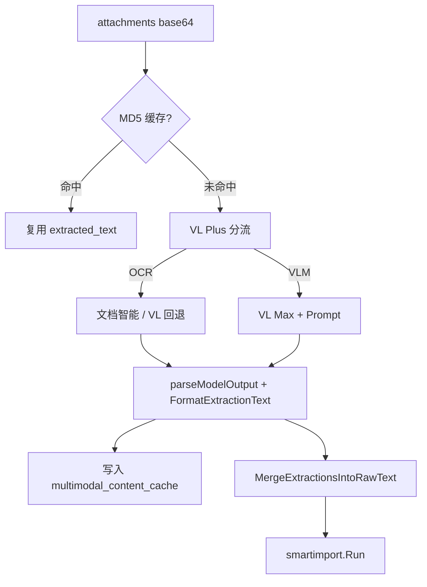

# 多模态内容处理（4.0 实现说明）

> 实现代码：`internal/core/service/multimodal/`、`internal/core/service/smartimport/preprocess.go`  
> 迁移：`deploy/migrations/000001_init.up.sql`（`multimodal_content_cache`）

PDF 先尝试用 `pdftotext` 提取文本层，成功时记录 `pdf_text`。失败时使用已配置的文档 OCR，缺少 OCR 能力时返回 `unsupported_media`。PDF 路由优先于仅图像使用的强制 VLM 设置。[处理入口](../../internal/core/service/multimodal/processor.go)

## 1. 设计目标

- **Workspace 分层 Prompt**：系统 Base + 工作区 Override（GrayDraft `settings.json`）。
- **降本**：MD5 强缓存 + pHash 近重复复用。
- **分流**：VL Plus 判断 OCR 路径 vs VLM 路径。
- **双向量索引**：`kb_chunks.embedding` + `embedding_structured`（结构化 KV 文本）。
- **与智能导入一体**：附件经多模态解析后并入 `raw_text`，再走拆分 / 入库。

## 2. Prompt 堆叠

```
最终 Prompt = DefaultBasePrompt（通用事实提取 Markdown）
            + 【工作区补充指令】
            + workspace_prompt_override（请求级，BFF 注入）
```

- API：`GET /api/v1/multimodal/prompt-defaults`
- GrayDraft：**设置 → Agent 配置** 编辑非结构化补充；Base 只读来自 Core。

## 3. 处理管线



| 步骤 | 说明 |
|------|------|
| MD5 | 表 `multimodal_content_cache`，命中跳过 VL/OCR |
| pHash | 汉明距离 ≤6 复用相似图缓存 |
| OCR | `doc_intel_enabled` 时走百炼文档处理 API。图像可回退 VL，PDF 文档 OCR 失败时返回错误 |
| VLM | `qwen-vl-max`；输出经 `FormatExtractionText` 去 JSON 围栏与视觉噪声 |
| 多图合并 | ≥2 张图时 `FinalizeIngestText`：要点表 + 分图详情；标题由 **LLM** 推断（见 [smart-import.md](smart-import.md)） |

## 4. 向量化与检索

| 项 | 实现 |
|----|------|
| 嵌入模型 | `text-embedding-v4` @ **1024** 维（Gateway） |
| 结构化向量 | Worker 对 `extensions.multimodal.structured_kv_text` 嵌入 `embedding_structured` |
| 检索融合 | RRF 第三路 `SearchVectorStructured`，权重 `structured_vector_weight`（默认 0.35） |
| 工作区上下文 | `SearchRequest.workspace_context`；BFF 带入工作区 Prompt |
| 隔离 | **kb_type 分区**（1 GrayDraft 工作区 = 1 分区），非独立 `workspace_id` 列 |

## 5. 媒体与元数据

- 文档 `extensions.multimodal`：`workspace_id`、`assets[]`（md5、media_url、route、phash）。
- 预览：`GET /api/v1/multimodal/media/:md5`
- 召回 enrichment：`Chunk.media_url`、`media_timestamps`（Chat citations 尚未完整暴露媒体 URL）。

## 6. 已知差距（未实现）

| 能力 | 说明 |
|------|------|
| 2048 维向量 | 仍为 1024，升级需迁移 + 全量 re-embed |
| 原文件 OSS | 仅存提取文本与 API 引用，非对象存储外链 |
| OCR 坐标 / bbox | 无带坐标的 Document Mind 完整接入 |
| 跨图联合推理 | 多附件仍为逐张处理 + 后合并 |
| Console 多模态运营台 | 仅 GrayDraft 工作区设置可配 Prompt |
| 分工作区 Token 监控 | 未做 |

## 7. 配置依赖

- `DASHSCOPE_API_KEY`、`MULTIMODAL_ENABLED=true`（`deploy/config/*/env.core`）
- 迁移 000014、000015 已应用
- 可选：`doc_intel_enabled`、`doc_intel_base_url`

## 相关文档

- [智能导入](smart-import.md)
- [GrayDraft 集成](../integrations/graydraft.md)
- [检索 API](../api/retrieval.md)
- [智能导入 API](../api/smart-import.md)
