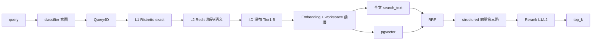

# 检索与 Agent v2 对话（实现说明）

> **基线日期**：2026-10-28  
> 检索：`internal/core/service/retriever/`、`classifier/`、`cache/`  
> 对话：`internal/core/service/agent/`（Runtime）；分级/缓存复用 `confidence/`、`answercache/`

当前运行时将用户问题与配置分开，成文与门禁使用同一个有界证据包。门禁独立核对摘要，并记录可复算的数值拒绝和待复核的角色歧义。[正确性架构](../architecture/correctness-architecture.md)

## 1. 混合检索

入口：`POST /api/v1/retrieval/search`

诊断入口：`POST /api/v1/retrieval/diagnose`，返回 Query4D、cache、waterfall、top chunks、gate/grade 分数与原因，用于排查 Agent 问答无结果。

Agent v2 通过 `knowledge.semantic` 工具调用同一 Hybrid Retriever，检索逻辑与本文 §1 完全一致。

| 能力 | 说明 |
|------|------|
| 意图分类 | 规则/LLM `classifier`：fact / concept / proper_noun / hybrid，调整全文/向量权重 |
| Query4D | domain / scene / style / entities；LLM 或规则提取，经 taxonomy 对齐 |
| 4D 瀑布 | Tier 1 全量 → Tier 5 `_wf_soft` 软加分；`retrieval_trace` 可观测 |
| 语义身份 | `search_anchors`、`parent_title`、`search_text` 参与打分与展示 |
| 检索分级 | A/B/C/D；`knowledge.semantic` 输出 `retrieval_grade`、`coverage_score` |
| 缓存 | Key 含 catalog 版本与 4D fingerprint；不跨不同 query 回放 |
| 工作区背景 | `workspace_context` / `context_profile` 注入 Embedding 与实体 bonus |
| 隔离 | 仅 `index_ready=true`；按 `kb_type` 分区；PaaS `tenant_id`+`kb_id` 解析 |

配置：`internal/core/config/config.*.yaml` → `retrieval`、`classifier`、`cache`、`taxonomy_evolve`。

## 2. Agent v2 对话

入口：`POST /api/v2/agent-runs` + `GET .../events/stream`（旧 `POST /api/v1/chat/stream` 已下线）

| 层 | 协议 |
|----|------|
| Core 原生 | `run.started` → `step.*` / `tool.*` → `answer.delta` → `run.completed` |
| BFF 映射（GrayDraft） | `meta` → `thinking` → `chunk` → `done` |

完整字段说明见 [系统逻辑总览 §7](../architecture/系统逻辑总览.md#7-流程-dagent-v2-对话run--sse) 与 [agent-v2 API](../api/agent-v2.md)。

### RAG 执行路径

| 策略 | 行为 |
|------|------|
| `edu_workspace_v1` | 唯一 policy。Planner 选择词法、语义、相邻章节、实体扩展或 `note.draft` |

`chat_mode`（`hybrid` / `kb_only`）由 BFF 注入 prompt 前缀，Launcher 解析后影响注入与拒答策略。

### 可靠性

| 机制 | 说明 |
|------|------|
| AnswerGate | 组合 retrieval_grade、coverage、高风险阈值（0.80） |
| Groundedness | 句级 citation、专名/数字一致性；拒答发 `answer.rejected` |
| 答案缓存 | 内部模块仍可用；Grade D 不写入；时效性 query 跳过 |
| 断线续传 | `after_seq` SSE 回放 + NATS 实时唤醒 |

排障方案见：[Agent 导入与问答可靠性治理方案](../architecture/agent-import-chat-reliability.md)。

## 3. 与 GrayDraft

- BFF：`POST /api/knowledge/chat/stream` → Core v2，映射为 legacy SSE
- GrayDraft：`POST /ai/chat/stream` → `internal/graydraft/pkg/nexus/chat_stream.go`
- 检索调试：`RetrievalSearch` + `workspace_context` / `context_profile`
- 作用域：`X-Authorized-KBs` 约束 `knowledge.semantic`；BFF 注入 tenant/actor

## 相关文档

- [retrieval API](../api/retrieval.md)
- [agent-v2 API](../api/agent-v2.md)
- [answer-cache API](../api/answer-cache.md)
- [cache API](../api/cache.md)
- [classifier API](../api/classifier.md)
- [语义驱动检索](../architecture/semantic-driven-retrieval.md)
- [工作区背景](workspace-background.md)
- [正确性架构与验收边界](../architecture/correctness-architecture.md)
