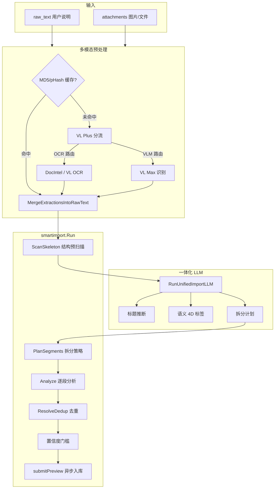

# 智能导入方案

> **文档类型：设计方案与计划。** 正文含设计目标或待办，实际交付以架构、接口文档和代码为准。 [当前文档入口](../README.md)

> 代码：`internal/core/service/smartimport/`、`internal/core/service/multimodal/`
> API：[smart-import.md](../api/smart-import.md)

## 1. 能力概述

智能导入将用户粘贴的长文、说明文字与图片附件，自动转为结构化的可检索知识文档。核心能力：

- **多模态预处理**：图片/PDF/视频经 VL/OCR 提取为结构化文本
- **一体化 LLM 分析**：单次 LLM 调用完成标题推断、语义 4D 标签、分类、拆分计划
- **智能拆分**：规则 + LLM 将混杂长文拆为独立知识条目
- **去重与版本管理**：按 content_hash / target_doc_id 决定 create / update / unchanged
- **置信度管控**：低于阈值自动拦截，预览模式不提交
- **异步入库**：提交后走 NATS → Worker 门禁 → 分块 → 向量索引

## 2. 技术栈

| 层次 | 技术选型 |
|------|----------|
| 语言 | Go 1.23（Core 服务） |
| HTTP 框架 | Chi（路由）+ 标准 `net/http` |
| 数据库 | PostgreSQL（文档/分块/缓存元数据） |
| 消息队列 | NATS（UGC 异步入库） |
| 向量检索引擎 | pgvector（PostgreSQL 扩展），1024 维 `text-embedding-v4` |
| LLM Gateway | 内部 `llmclient` 统一代理，支持 provider/model 覆盖 |
| VL/OCR 服务 | 阿里云百炼 DashScope（`qwen-vl-max`、`doubao-seed-2-0-mini-260428`） |
| 文档智能 | 百炼 DocIntel（PDF/文档 OCR，可选回退 VL） |
| 缓存 | Redis（检索缓存、答案缓存），PostgreSQL `multimodal_content_cache`（MD5 + pHash 近重复复用） |
| 日志 | `slog` 结构化日志 + `agentlog` 会话追踪 |
| 前端集成 | GrayDraft（Vue 3 + Vite），通过 BFF 代理 Core API |
| 嵌入模型 | `text-embedding-v4`（1024 维），经 Gateway 调用 |

## 3. 端到端流程



## 4. 关键技术节点

### 4.1 多模态预处理（`multimodal/processor.go`）

**目标**：将 `attachments[]`（base64 图片/PDF/视频）转为结构化 Markdown 文本，合并入 `raw_text`。

处理管线：

1. **MD5 缓存查找**：表 `multimodal_content_cache`，命中则直接复用 `extracted_text`
2. **pHash 近重复查找**：汉明距离 ≤6 的相似图可复用已有缓存，避免重复 VL 调用
3. **VL Plus 分流（heuristicTriage）**：
   - PDF → DocIntel OCR
   - 视频 → VLM（`doubao-seed-2-0-mini-260428`）
   - 图片 < 512KB → 疑似文档截图，走 OCR
   - 图片 ≥ 512KB → 感知型内容，走 VLM
4. **OCR 路径**：优先百炼 DocIntel API，失败回退 VL OCR（`qwen-vl-max` + `SceneOCRExtract` Prompt）
5. **VLM 路径**：`qwen-vl-max` 多模态识别，经 `FormatExtractionText` 去 JSON 围栏与视觉噪声
6. **多图合并**（≥2 张）：
   - `FinalizeIngestText` 构建「要点汇总表」（`| 主题 | 时间/区间 | 要点 | 属性/类型 | 补充 |`）
   - 文档标题由 LLM `InferTitleLLM` 结合用户说明、附件文件名、正文摘要生成
   - `multimodal_consolidated = true`，`ingest_chunk_strategy = fact_table`

**并发控制**：可配置 `multimodal.concurrency`（默认 3），逐附件并行处理。支持可选链式 VLM（多图上下文传递）。

### 4.2 结构预扫描（`skeleton.go`）

**目标**：在不将全文发给 LLM 的情况下，提取文档结构骨架，供后续拆分与锚点对齐使用。

`ScanSkeleton(raw)` 逐行扫描，标记每行类型：

| Kind | 含义 | 正则规则 |
|------|------|----------|
| `h1`-`h4` | Markdown 标题 | `^#{1,6}\s+.+$` |
| `sep` | 分隔线 | `^\s*[-=*_]{3,}\s*$` |
| `bold` | 加粗行 | `^\s*\*\*[^*]+\*\*\s*$` |
| `qa` | Q/A 行 | `^\s*(Q[:：]\|问[:：]\|A[:：]\|答[:：])` |
| `text` | 普通文本 | 默认 |
| `empty` | 空行 | 默认 |

同时推断 `DocAnalysis`：

| 字段 | 推断逻辑 |
|------|----------|
| `subject` | 正则匹配 `《...》` / `「...」` 书名号内容；或从 `parent_title` 冒号前缀提取 |
| `doc_type` | 规则：`sep≥2 或 (h2≥2 且 h3≥1)` → 综合合集；`qa≥4 且 h2=0` → 问答集；`sep≥1 且 h2≥1` → 分段文档；默认 → 单体文档 |
| `parent_title` | 优先第一个 H1 文本 → 备选 `inferSubjectTitle` → `extractTitle` → `fallbackTitle` |

### 4.3 一体化 LLM（`unified_import_llm.go`）

**目标**：一次 LLM 调用完成标题推断、语义 4D 标签、分类确认、拆分计划，避免多次串行调用。

`RunUnifiedImportLLM` 向 LLM 发送结构化 Prompt，要求输出一个 JSON，包含全部任务：

| 任务 | 输出字段 | 说明 |
|------|----------|------|
| 标题 | `title` | 8–48 字，须符合工作区领域实体，禁止空泛汇总标题 |
| 语义 4D | `domain`, `entities(≤8)`, `scene`, `style` | 检索过滤用，entities 须为正文或工作区专名 |
| 关键短语 | `key_phrases(≤3)` | 正文专有检索词（接口名、术语等），不包含泛词 |
| 全局摘要 | `global_summary` | 80–200 字中文 |
| 结构重整 | `structured_markdown` | 优先输出；否则 `outline` |
| 分类 | `kb_type` | 必须与工作区分区一致（`gd_*`），禁止 `tutorial/paper/note` |
| 语义导轨 | `logic_skeleton[]` | 每个知识单元：`range [start,end]`、`anchor_kind`、`title_hint`、`semantic_summary`（20–80 字） |
| 拆分计划 | `segments[]` | 与 `logic_skeleton` 一一对应 |

Prompt 中注入的信息：
- 工作区背景（Domain/Scene/Style 有效值字典）
- 规则预判结果（kb_type、title、confidence）
- 结构骨架（`FormatSkeletonForLLM`：`line_no|kind|text`）
- 结构锚点（`FormatSkeletonAnchorsForLLM`：标题行与分隔线的精确行号，防 LLM 编造行号）

**缓存与失败重试**：
- LLM 结果写入 `extensions.import_llm_unified`，SHA256 正文 hash 防篡改
- 失败自动重试 1 次，总计失败次数写入 `import_llm_unified_fail_count`
- 命中缓存则跳过 LLM，直接复用标题/分类/拆分计划

### 4.4 拆分策略（`plan_segments.go`）

**拆分 2.0**：`SplitPlan` 包含宏观策略 + 坐标切割。

| 策略 | 触发条件 | 说明 |
|------|----------|------|
| `single` | 默认；`forceSingle=true`；多模态合并后 | 整篇作为一条知识 |
| `multi_segment` | 综合合集/分段文档/问答集；`sep≥2` 或 `h2≥3`；两侧均 ≥40 字的分隔线 | 拆为多条独立知识 |

**切割坐标**：`line_range [start,end]`（1-based 含首尾），从原文 `ExtractByLineRange` 截取。

**规则拆分**（`splitByCoordinates`）：
- 分段文档/多分隔线 → 按 `sep` 切割
- 多 H2 → 按 H2 切割
- 短段（<40 字）合并到相邻段
- 过滤收尾废话（「以上就是」「全文完」等）
- 过滤仅附件文件名的空段

**LLM 拆分**（`split_llm.go`）：
- LLM 输出 `segments[].range`，经 `alignSplitPlanToSkeletonRails` 对齐到附近结构锚点（≤3 行偏移）
- 标题须来自原文对应行号范围，否则回退规则提取
- 优先使用 `logic_skeleton`（语义导轨）输出构建分段，比纯 `segments` 更精确

**分段扩展字段**：每段注入 `context_enhancement`（主题、版本、片段标题）、`semantic_summary`、`search_intent`、`semantic_tags_4d`。

### 4.5 逐段分析（`analyzer.go`）

**`Analyze` 函数**对每段正文提取：

1. **标题提取**：
   - 优先从一体化 LLM 缓存读取（`draftFromUnifiedCache`）
   - 备选 `InferTitleLLM`（LLM 提炼）→ 必须 `titleAppearsInContent`（标题须在正文中出现，防编造）
   - 规则回退：`extractTitle`（H1 → 首行非标题 → 首句）→ `fallbackTitle`（截断前 80 字）

2. **kb_type 分类**（`kb_type.go`）：
   - 仅接受 `gd_*` 工作区分区，分区由工作区 hint_kb_type 决定
   - 由 `hint_kb_type` 直接传入，无需 LLM 再判断

3. **内容规范化**：
   - 统一换行符（`\r\n` / `\r` → `\n`）
   - `textutil.StripEmojis` 去表情符号

4. **content_hash**：SHA256 正文，用于去重

### 4.6 去重机制（`dedup.go`）

`ResolveDedup` 三条路径：

| 场景 | 条件 | Action |
|------|------|--------|
| 选中卡片更新 | `target_doc_id` 非空 + content_hash 相同 | `unchanged` |
| 选中卡片更新 | `target_doc_id` 非空 + content_hash 不同 | `update`（强制更新该文档） |
| 普通导入 | 无 `target_doc_id` | `create`（始终新建，不按标题/哈希匹配其他文档） |

- `update` 时 Worker 将 `kb_version +1`，重建 chunks/QA

### 4.7 置信度管控（`confidence`）

| 配置 | 默认值 | 环境变量 |
|------|--------|----------|
| 最低阈值 | `0.55` | `SMART_IMPORT_MIN_CONFIDENCE` |
| 请求级覆盖 | `min_confidence` 字段 | 仅当 >0 时生效 |

- 单条模式：`preview.confidence` 与顶层一致
- 拆分模式：顶层 `confidence` 为各段最小值；低于阈值的段写入 `skipped`
- `submit=true` 且 `import_allowed=false` → HTTP 422，body 仍含完整预览
- 拆分提交时 `skipped` 段不入库，其他正常入 `tasks`

### 4.8 提交入库（`service.go`）

`submitPreview` 构造 `UGCNotifyRequest`：

- `KBType`：工作区分区（`gd_*`）
- `Extensions`：合并分段锚点（`subject`、`parent_title`、`context_enhancement`、`line_range`、`segment_index/total`、`semantic_tags_4d`）
- `Tags`：`smart-import`、`split-import`、`version-update`、`agent-update-selected`
- `GenerateQA`：由请求控制

入 `ugc.Notify` 后走标准 UGC 管线：NATS → Worker 门禁 → 分块 → 向量索引 → `index_ready`。

提交后自动清理对应 `kb_type` 的检索缓存和答案缓存。

**就绪状态**（`readiness`）：

| status | 说明 |
|--------|------|
| `preview` | 未提交 |
| `queued` | 已提交，等待异步入库完成 |
| `ready` | 同步入库路径直接完成，立即可检索 |
| `no_task` | 提交但未创建任务 |

### 4.9 相似文档检测（`similar.go`）

在预览阶段（非提交），对正文片段做向量检索，返回前 5 个 `similar_documents`（id、title、score）。用于 GrayDraft 展示「已有相似内容」警告。

## 5. API 契约

### `POST /api/v1/ugc/smart-import`

| 字段 | 必填 | 说明 |
|------|------|------|
| `raw_text` | 是* | 原始正文 |
| `attachments[]` | 是* | base64 附件（与 raw_text 至少一个） |
| `filename` | 否 | 用于推断 mime_type |
| `hint_kb_type` | 是 | 工作区分区（`gd_*`） |
| `use_llm` | 否 | 调用 LLM 辅助分析 |
| `split` | 否 | 启用拆分导入 |
| `submit` | 否 | `false` 仅预览；`true` 提交入库 |
| `min_confidence` | 否 | 覆盖阈值 |
| `target_doc_id` | 否 | 强制更新指定文档 |
| `generate_qa` | 否 | Worker 生成问答对 |
| `extensions` | 否 | 透传到文档扩展字段 |
| `llm_override` | 否 | `{provider, model, api_key}` 覆盖 LLM 配置 |
| `context_profile` | 否 | 工作区上下文（Domain/Scene/Style） |
| `workspace_prompt_override` | 否 | 多模态补充指令 |

### 响应结构

```json
{
  "confidence": 0.85,
  "min_confidence_required": 0.55,
  "import_allowed": true,
  "split": true,
  "message": "",
  "doc_analysis": { "subject": "...", "doc_type": "综合合集", "parent_title": "..." },
  "splitting_strategy": "multi_segment",
  "split_method": "unified_llm",
  "preview": { "kb_type": "...", "title": "...", "content": "...", "content_hash": "...", "action": "create", "confidence": 0.85, "method": "unified_llm" },
  "items": [
    {
      "index": 0,
      "preview": { ... },
      "import_allowed": true,
      "line_range": [1, 42],
      "context_enhancement": "..."
    }
  ],
  "similar_documents": [],
  "tasks": [],
  "skipped": [],
  "readiness": { "queryable": false, "status": "preview" },
  "multimodal_extractions": []
}
```

## 6. GrayDraft 交互约定

| 场景 | 参数 |
|------|------|
| 未选卡片、多段预览 | `split=true`，可多 task |
| 选中卡片更新 | `target_doc_id` + `split=false` |
| 模型覆盖 | `agent_model` → BFF `llm_override` |
| 工作区 Prompt | `workspace_prompt_override` + settings 持久化 |

## 7. 核心模块索引

| 模块 | 路径 | 职责 |
|------|------|------|
| 入口服务 | `smartimport/service.go` | Run 总调度、单条/拆分路由、提交、缓存清理 |
| 预处理 | `smartimport/preprocess.go` | 附件多模态处理、正文合并、标题提示注入 |
| 结构扫描 | `smartimport/skeleton.go` | ScanSkeleton 行级标记 + DocAnalysis 推断 |
| 一体化 LLM | `smartimport/unified_import_llm.go` | 单次 LLM：标题+4D+分类+拆分计划 |
| 拆分策略 | `smartimport/plan_segments.go` | PlanSegments 规则+LLM 拆分决策 |
| LLM 拆分 | `smartimport/split_llm.go` | LLM 拆分 JSON 解析与回退 |
| 骨架导轨 | `smartimport/skeleton_rail.go` | 结构锚点对齐、logic_skeleton 分段 |
| 逐段分析 | `smartimport/analyzer.go` | 标题/title_llm/kb_type/content_hash |
| LLM 标题 | `smartimport/title_llm.go` | InferTitleLLM 多模态标题推断 |
| 去重 | `smartimport/dedup.go` | content_hash / target_doc_id 策略 |
| 分段锚点 | `smartimport/anchors.go` | MergeSegmentExtensions 注入上下文元数据 |
| 语义 4D | `smartimport/semantic_pivot.go` | RunSemanticPivot 领域/实体/场景/风格标签 |
| 4D 分段 | `smartimport/segment_4d.go` | DeriveSegmentSemantic4D 分段级 4D 富化 |
| 相似检测 | `smartimport/similar.go` | 向量检索已有文档 |
| 混合信号 | `smartimport/split_signals.go` | contentLooksMixed 多主题判断 |
| 行提取 | `smartimport/extract.go` | ExtractByLineRange、标题提取、过滤 |
| 分类 | `smartimport/kb_type.go` | 工作区分区校验（`gd_*`） |
| 覆盖 | `smartimport/overrides.go` | segment_overrides 前端修正 |
| 多模态处理 | `multimodal/processor.go` | ProcessAttachments 并行/链式 VLM |
| 合并正文 | `multimodal/consolidate.go` | 多图要点表+分图详情拼接 |
| VLM 链 | `multimodal/chain_vlm.go` | 多图上下文传递 |
| 缓存 | `multimodal/phash.go` | pHash 近重复检测 |

