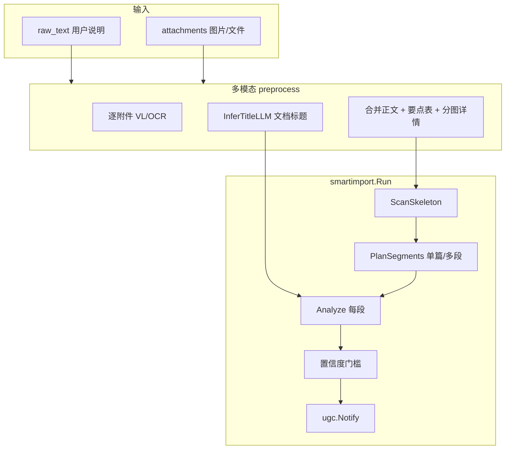

# 智能快速导入（实现说明）

> **基线日期**：2026-10-28  
> 代码：`internal/core/service/smartimport/`  
> API：[smart-import.md](../api/smart-import.md)

原始 PDF 优先尝试文本层提取，导入保留可追溯的原文位置。分段结果仍需通过质量门，Worker 对不可重试错误保留终态。[正确性架构](../architecture/correctness-architecture.md)

## 1. 能力概述

将用户粘贴的长文、说明文字与图片附件，转为可入库的知识文档：

1. **多模态预处理**（有 `attachments[]` 时）
2. **结构预扫描** + 可选 **LLM 拆分**
3. **逐段分析**（kb_type、置信度；**标题由 LLM 生成**）
4. 预览 → 确认后走 **UGC 异步入库**

## 2. 端到端流程

## 3. 多模态与正文合并

| 规则 | 说明 |
|------|------|
| 用户说明 | 短句「梳理…」「整理…」写入 **导入说明**（引用块），**不作 H1 标题** |
| 文档标题 | `InferTitleLLM`：结合用户说明、附件文件名、正文摘要；`import_title_hint` 写入 extensions |
| 多图 | 全文合并解析 → **要点汇总表** + **分图识别详情**（保留完整 VLM 文本，避免只入库残缺表格） |
| 分块提示 | `multimodal_consolidated` + `ingest_chunk_strategy: section` |

详见 [multimodal.md](multimodal.md)。

## 4. 拆分策略（2.0）

| 策略 | 条件 |
|------|------|
| `single` | 单体文档、连续教程；或多模态合并后整篇一条 |
| `multi_segment` | 综合合集、分段文档、多个 `##` / 充实 `---` 分隔 |

- 切割坐标：`line_range [start,end]`（1-based），不用 `start_marker`。
- 可选 `split_llm.go` 在骨架基础上 refine 分段。
- 过滤「以上就是」等收尾废话段。

## 5. 分析与入库

| 模块 | 职责 |
|------|------|
| `analyzer.go` | kb_type 规则分 + 可选 LLM 修正类型；**标题优先 LLM**（`title_llm.go`），失败才 `extractTitle` |
| `dedup.go` | `content_hash` → unchanged；有 `target_doc_id` 强制更新该文档 |
| `confidence` | 默认 `min_confidence` 0.55；低于门槛 `import_allowed=false`，HTTP 422 仍返回预览 |
| `anchors.go` | `subject`、`parent_title`、`context_enhancement`、`segment_index/total` → Worker QA |

提交后：与标准 UGC 相同（NATS → Worker 门禁 → 分块 → 向量 → `index_ready`）。

## 6. GrayDraft 交互约定

| 场景 | 参数 |
|------|------|
| 未选卡片、多段预览 | `split=true`，可多 task |
| 选中卡片更新 | `target_doc_id` + `split=false` |
| 模型 | `agent_model` → BFF `llm_override` |
| 工作区 Prompt | `workspace_prompt_override` + settings 持久化 |

## 7. 调试

- Core Agent 会话日志：`logs/agent/{day}/*_smart-import_core.log`（`AGENT_LOG_DIR` / `AGENT_LOG_ROOT`）
- GrayDraft BFF：`{data}/logs/agent/{workspace}/{day}/*_smart-import.log`

## 相关文档

- [多模态](multimodal.md)
- [UGC 入库](../architecture/系统逻辑总览.md#4-流程-a-ugc-标准入库)
- [API 契约](../api/smart-import.md)
