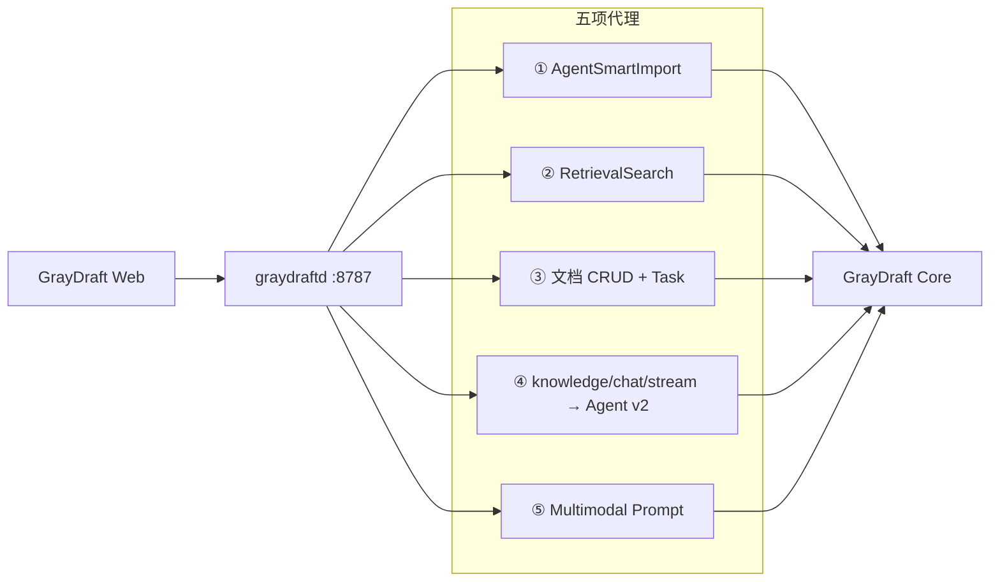

# GrayDraft 集成（BFF + Web）

> **基线日期**：2026-11-04
> 仓库：`GrayDraft_Go`、`GrayDraft_Web`（与 GrayDraft 独立部署）

## 1. 调用链

```
GrayDraft Web (Vue3 + Pinia)
  → GrayDraft Go BFF (:8787)
    → GrayDraft Core (:18080 / Nginx :8443)
      ↔ Model Gateway (Embedding / LLM / Rerank)
      ↔ Worker (入库 / 重排)
      ↔ PostgreSQL + Redis + NATS
```

## 2. 工作区与知识库映射

| 概念 | 实现 |
|------|------|
| 1 工作区 | 1 知识库分区（`kb_type` / `storage_partition`） |
| 工作区 Key | HTTP Header `X-Graydraft-Workspace-Key` → 规范化后作分区名 |
| 平台 API | Core 同时支持 `tenant_id` + `kb_id`（PaaS）；GrayDraft 打开工作区时 ensure 并写入 `nexusTenantId`、`nexusKbId`、`nexusKbType` |
| 绑定 | `OpenWorkspace` 时 `BindNexusKbType` + `tenants/ensure` + `kbs/ensure` |
| 工作区背景 | GrayDraft **设置 → Agent 配置** 同步 `context_profile` 至 Core `PUT /kb/:kb_type/context` |

## 3. BFF 五项代理能力




| # | 前端方法 | Core 接口 | BFF 增强 |
|---|----------|-----------|----------|
| ① | `AgentSmartImport` | `POST /api/v1/ugc/smart-import` | `llm_override`、工作区 Prompt、媒体识图、长任务解耦 |
| ② | `RetrievalSearch` | `POST /api/v1/retrieval/search` | `workspace_context` / `context_profile` |
| ③ | `ListKnowledgeEntries` 等 | `ugc/notify`、文档 CRUD、`ugc/tasks` | 作用域映射、`library-changed` 广播 |
| ④ | `streamKnowledgeChat` | `POST /api/v2/agent-runs` + SSE | 多模态识图、v2→legacy SSE 映射、`X-Authorized-KBs` |
| ⑤ | `GetMultimodalPromptDefaults` | `GET /api/v1/multimodal/prompt-defaults` | Core Base + 工作区 `settings.json` 合并 |

**扩展代理**（同上表体系，非五项核心）：`RetrievalDiagnose` → `/retrieval/diagnose`；`Get/PutWorkspaceContext` → `/kb/:kb_type/context`。

## 4. Agent 产品面

| 功能 | 说明 |
|------|------|
| 快速导入 | 附件 base64、`split` / `target_doc_id`、预览对话框 |
| 问答 | hybrid / kb_only；BFF 映射 SSE（meta → thinking → chunk → done）；Core 内部走 Agent Runtime |
| 设置 | Agent 配置 Tab：工作区背景 + 非结构化 Prompt（叠加 Core Base） |
| 排障 | 检索诊断 API；Trace API；`retrieval_trace` / gate JSON 展示 |

## 5. 日志与排障

| 侧 | 路径 |
|----|------|
| BFF | `{data}/logs/agent/{workspace_key}/{date}/*.log` |
| Core | `{AGENT_LOG_ROOT}/logs/agent/{date}/*_core.log` |

按 `trace_id`（`X-Trace-Id`）关联同一次请求。

## 相关文档

- [系统逻辑总览](../architecture/系统逻辑总览.md)
- [Agent v2 API](../api/agent-v2.md)
- [智能导入](../features/smart-import.md)
- [多模态](../features/multimodal.md)
- [tenants API](../api/tenants.md)
