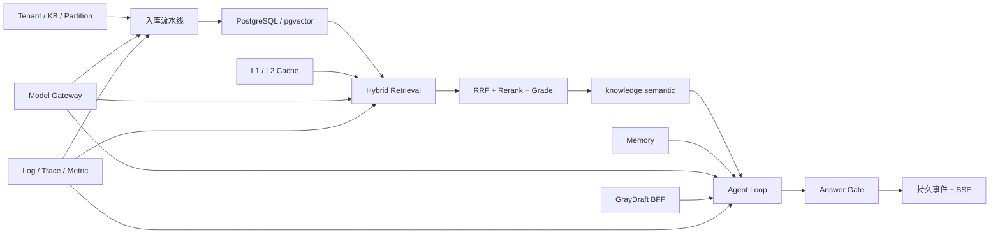

# GrayDraft 完整知识地图

上一篇：[术语表](glossary.md) · 返回：[Learning 首页](../README.md)

本文用于查找“某个知识点该读哪篇文档、看哪段代码”。第一次学习仍应按 Learning 首页的 00–06 顺序进行。

---

## 1. 主链路与知识依赖

---

## 2. 专题索引

| 想学什么 | 首读 | 深入代码 | 验证入口 |
|----------|------|----------|----------|
| 服务全貌 | [系统总览](system-overview.md) | `internal/*`、`deploy/docker-compose/` | `make health` |
| Agent Loop | [Agent Loop](../01-foundations/02-agent-loop.md) | `internal/core/service/agent/runtime.go`、`planner.go` | `runtime_test.go`、`planner_test.go` |
| Tool Use | [Tool Use](../01-foundations/03-tool-use.md) | `tools.go`、`knowledge_tool.go` | `tools_test.go`、`governance_test.go` |
| Memory | [Memory](../01-foundations/04-memory.md) | `internal/core/service/agent/` memory 相关实现 | `memory_test.go`、`long_memory_test.go` |
| 知识入库 | [入库流水线](../02-pipeline/01-ingestion.md) | `service/ugc/`、`internal/worker/worker/pipeline/` | `ugc_test.go`、Worker pipeline tests |
| 混合检索 | [检索链路](../02-pipeline/02-retrieval.md) | `service/retriever/hybrid.go` | `hybrid_test.go`、`query4d_test.go` |
| Agent v2 / SSE | [Agent v2 对话与 SSE](../02-pipeline/03-agent-v2-sse.md) | `handler/agent.go`、`service/agent/` | `handler/agent_test.go`、`answer_stream_test.go` |
| Smart Import | [智能导入](../02-pipeline/04-smart-import.md) | `service/smartimport/`、`multimodal/` | `smartimport/*_test.go` |
| 语义进化 | [语义进化](../02-pipeline/05-semantic-evolution.md) | `service/taxonomyevolve/` | `taxonomyevolve/*_test.go` |
| RRF | [RRF 专题](../03-algorithms/03-rrf.md) | Retriever / Memory 的融合逻辑 | 排名融合相关测试 |
| 分级与门控 | [检索分级与门控](../03-algorithms/04-retrieval-grading-and-gating.md) | `service/confidence/`、`service/agent/answer_gate.go` | `confidence/*_test.go`、`answer_gate_test.go` |
| 数据模型 | [数据模型](../04-architecture/02-data-model.md) | `internal/core/model/`、`repository/postgres/`、`deploy/migrations/` | Repository tests |
| 缓存 | [缓存体系](../04-architecture/03-cache.md) | `service/cache/`、`service/answercache/` | `manager_test.go`、`key_test.go` |
| 模型路由 | [模型 Gateway](../04-architecture/04-model-gateway.md) | `internal/gateway/service/` | Gateway service tests |
| BFF | [BFF](../04-architecture/05-bff.md) → [代理能力](../04-architecture/06-bff-proxy-capabilities.md) | `internal/graydraft/pkg/nexus/` | GrayDraft nexus tests |
| 可观测与运维 | [可观测性](../04-architecture/07-observability.md) → [部署运维](../04-architecture/08-deployment-ops.md) | `observability/`、`internal/ops/`、`deploy/` | Metrics tests、健康检查 |

---

## 3. 权威参考交叉表

| 学习专题 | 架构 / 功能文档 | API 文档 |
|----------|-----------------|----------|
| 系统全貌 | [系统逻辑总览](../../architecture/系统逻辑总览.md) | — |
| 入库 | 系统逻辑总览入库章节 | [UGC](../../api/ugc.md) · [Worker](../../api/worker.md) · [JetStream](../../api/jetstream.md) |
| 检索 | [语义驱动检索](../../architecture/semantic-driven-retrieval.md) · [Retrieval and Chat](../../features/retrieval-and-chat.md) | [Retrieval](../../api/retrieval.md) · [Classifier](../../api/classifier.md) |
| Agent v2 | [Agent 实现说明](../../architecture/Agent流程技术实现方案.md) | [Agent v2](../../api/agent-v2.md) |
| 智能导入 | [Smart Import](../../features/smart-import.md) · [Multimodal](../../features/multimodal.md) | [Smart Import API](../../api/smart-import.md) |
| 缓存与可靠性 | [问答可靠性治理方案](../../architecture/agent-import-chat-reliability.md) | [Cache](../../api/cache.md) · [Answer Cache](../../api/answer-cache.md) |
| 运维 | 系统逻辑总览管理面章节 | [RAGOps](../../api/ragops.md) · [DLQ](../../api/dlq.md) |

---

## 4. 推荐产出

| 学完阶段 | 最小产出 |
|----------|----------|
| 00 | 一张五类服务与三条主链路图 |
| 01 | 一张 Agent Loop 状态图 |
| 02 | 一张入库 → 检索 → Agent 回答时序图 |
| 03 | 一张召回、融合、重排、分级、门控职责表 |
| 04 | 一张数据 / 缓存 / Gateway / BFF 支撑关系图 |
| 05 | 一次可复现运行记录与一组测试结果 |
| 06 | 自测薄弱项清单与下一轮深化方向 |

继续主线：[AI Agent 核心机制全景图](../01-foundations/01-ai-agent-overview.md)。
