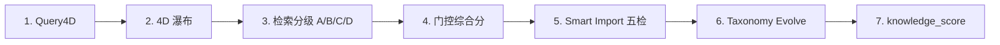
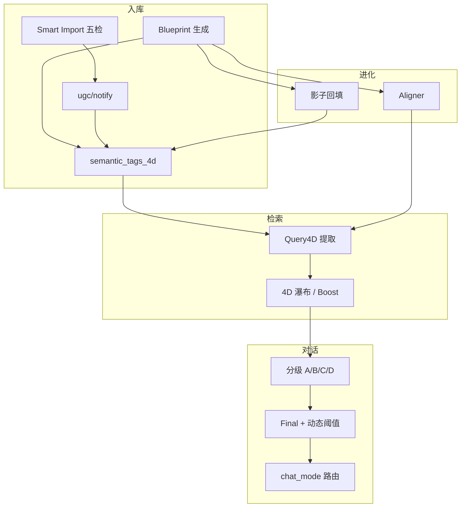

# GrayDraft 自研 AI 算法深度学习

> **定位**：面向「要读懂代码、能调参、能讲清楚」的学习文档  
> **前置**：[GrayDraft-AI算法与作用总览.md](README.md)（全景与来源标记）
> **代码依据**：`internal/core` 当前实现（2026-10-28）

本文**只讲自研部分**（🔵）：编排、打分、门控、标签体系与进化逻辑。LLM / Embedding / Rerank **模型推理**走 Gateway，不在本文「算法自研」范围内。

---

## 0. 学习地图：建议顺序



| 阶段 | 自研模块 | 先读懂什么 | 验收标准 |
|------|----------|------------|----------|
| 1 | Query4D | 四维标签从哪来、怎么约束 | 能手工给 query 填 4D 并解释 entities 为何会被清空 |
| 2 | 4D 瀑布 | Tier 退避与软加分 | 能读 `retrieval_trace.waterfall_tier` 判断本次检索严不严 |
| 3 | 检索分级 | A/B/C/D 判定树 | 能根据 `grade_reason` 说出为何是 B 而非 A |
| 4 | 门控综合分 | Final 公式与动态阈值 | 能估算一次检索的 confidence 落在哪个区间 |
| 5 | 导入五检 | Pass/Warning/Reject | 能解释某篇导入预览为何 422 |
| 6 | 语义进化 | Blueprint → Aligner → 回填 | 能描述工作区标签如何随内容变化 |
| 7 | 知识分 | 生命周期降级/淘汰 | 能说出低分文档会怎样被处理 |

**动手验证入口**：

```bash
# 检索诊断：看 Query4D、waterfall、gate、top chunks
curl -X POST http://localhost:8443/api/v1/retrieval/diagnose \
  -H 'Content-Type: application/json' \
  -d '{"query":"InternVL 怎么用","kb_type":"tutorial","top_k":5}'

# 智能导入预览（不提交）
curl -X POST http://localhost:8443/api/v1/ugc/smart-import \
  -H 'Content-Type: application/json' \
  -d '{"raw_text":"……","submit":false,"use_llm":false}'
```

---

## 1. Query4D：四维语义标签提取

### 1.0 新手导读：从用户问题到语义标签

先放下公式和代码，用一句话说清楚 Query4D 在干什么：**把用户用自然语言打的一句话，拆成结构化的四个维度标签**。就像图书馆管理员拿到一张手写书单，先分类（这是什么科目？），再判断读者意图（想借入门书还是高级文献？），再提取关键词（具体要哪本书？），最后才能精准定位书架。

下面用一个跑通的例子来感受整个过程。

**四维的含义**：先把四个维度各自回答什么问题搞清楚，再去看后面的提取流水线就不会懵。

| 维度（字段） | 中文含义 | 回答的问题 | 示例 |
|-------------|----------|-----------|------|
| `domain` | 领域 / 业务域 | 用户在**哪个知识库**里提问？ | `edu_tutorial`（教程资料库）、`product`（产品文档库） |
| `scene` | 场景 / 意图 | 用户**想干什么**？是参数对照、排障、还是学新手入门？ | `参数对照`、`排障`、`新手入门` |
| `style` | 风格 / 内容形态 | 用户**想要什么形式**的答案？要点速览、详细教程、还是公式计算？ | `教程`、`教程`、`要点`、`问答` |
| `entities` | 实体 / 专名 | 用户**提到了哪些关键对象**？模型名、API 名、参数名？ | `["InternVL", "InternLM"]`、`["AnswerGate"]`、`[]`（概念题无专名） |

> 用户在 GrayDraft 知识库输入：「**InternVL 和 InternLM 怎么配合**」

Query4D 的输出：

| 维度 | 值 | 怎么来的 |
|------|-----|----------|
| `domain` | `edu_tutorial` | 工作区（GrayDraft 的 `storage_partition`）直接覆盖 |
| `scene` | `参数对照` | LLM 从 Blueprint 字典里选，或规则从 YAML 脚手架推断 |
| `style` | `教程` | 同上 |
| `entities` | `["InternVL", "InternLM"]` | LLM 原子 NER 提取专名，经约束层验证后保留 |

这四个维度最终化为 SQL 的 `WHERE` 条件，在向量检索前先做硬过滤——只有同时满足「教程资料 + 参数说明 + 教程 + 包含 InternVL 和 InternLM」的 chunk 才会进入候选池。这比纯向量检索「问 InternVL，召回一堆模型简介但没有参数表」要精确得多。

---

#### 1.0.1 什么是「原子 NER」设计？

**NER** = Named Entity Recognition，命名实体识别。**原子** = 只输出实体本身，不加任何修饰词。

对比一下：

| 输入 | ❌ 非原子输出 | ✅ 原子输出 |
|------|-------------|------------|
| 介绍一下InternVL | `"介绍一下InternVL"` | `["InternVL"]` |
| InternVL 和 InternLM 怎么配合 | `"InternVL 配合 InternLM"` | `["InternVL", "InternLM"]` |
| RAG 是什么 | `"RAG"` | `[]` |

**为什么需要原子？** 因为 entities 最终作为 SQL `WHERE` 条件进入检索：

```sql
WHERE entities @> ARRAY['InternVL', 'InternLM']  -- ✅ 精确匹配
WHERE entities @> ARRAY['InternVL 配合 InternLM']    -- ❌ 永远匹配不上
```

如果 LLM 返回 `"InternVL 配合 InternLM"` 作为一个 entity，这个字符串不会出现在任何 chunk 的 entities 字段里，导致 strict tier **零召回**。

**GrayDraft 怎么做到原子？** 在 LLM prompt 里加了硬性约束：

```
entities：专名提取，仅返回 query 中出现的专有名词。
- 禁止返回整句、动词（如"介绍""怎么"）、疑问词（如"什么"）
- 泛化概念题无专名 → 必须返回 []
- 示例："介绍一下InternVL" → ["InternVL"]
```

同时代码层还有第二道防线（§1.5）：如果 LLM 返回的 entity 不是原 query 的子串，直接丢弃。

---

#### 1.0.2 什么是 Blueprint？

**一句话**：Blueprint 是工作区的「自动发现标签字典」，规定了 scene（场景）和 style（风格）只能从哪些词里选。

把它想象成一个**下拉菜单的可选项列表**：

| | 手工定义（YAML 脚手架） | Blueprint 自动发现 |
|---|---|---|
| 怎么来 | 运维在 `taxonomy_config.yaml` 里写死 | LLM 读了工作区所有文档后自己总结 |
| 例：教程资料工作区 | scene: `[参数对照, 排障, 新手入门]` | scene: `[参数对照, 排障, 新手入门, 图表阅读, 章节定位]` ← 更贴合实际内容 |
| 例：技术文档工作区 | scene: `[排障, 入门]` ← 不匹配 | scene: `[API参考, 部署, 性能优化, 排障]` ← 自动发现 |

**Blueprint 解决了什么问题？**

没有 Blueprint 时，LLM 对同一类问题可能输出语义不同但意思相同的词：

- 用户问「怎么配参数」→ LLM 标 scene=`"配参数"`
- 用户问「参数怎么选」→ LLM 标 scene=`"参数选取"`
- 用户问「推荐参数」→ LLM 标 scene=`"参数对照"`

这三个标签在 SQL 里被视为**不同的过滤条件**，导致本应聚合的检索互相分散。Blueprint 把它们全部映射到统一的 `"参数对照"`。

**Blueprint 的生成流程**（详见 §6.2）：

```
工作区有内容 → 触发 MaybeEnqueueBlueprint
  → 异步 LLM 分析所有文档摘要
  → 输出 {domain, scenes: [{label, keywords}, ...], styles: [...]}
  → blueprint_validator 校验（scene 数量、互斥性等）
  → 存入 workspace_4d_taxonomy
  → 版本 bump → 触发影子回填（批量更新存量文档标签）
```

Blueprint 不是一次性产物——当工作区内容变化、出现新的文档类型时，`Delta`/`Merge`/`Birth` 流程会进化它（详见 §6 Taxonomy Evolve）。

---

#### 1.0.3 entities 如何存入「专名 ID」？（从 query 到 SQL WHERE 的完整链路）

这是整个流程中最容易困惑的地方。一条用户输入的字符串「InternVL 和 InternLM 怎么配合」要经历以下步骤才能变成 SQL 里的 `entities @> ARRAY['InternVL', 'InternLM']`。按时间线走一遍：

**第 1 步：用户输入到达**

```
query = "InternVL 和 InternLM 怎么配合"
```

**第 2 步：LLM 原子 NER 提取**（如果开启 `semantic_4d_llm_enabled`）

LLM 收到的 prompt 要求它只返回专名。对「InternVL 和 InternLM 怎么配合」，LLM 输出：

```json
{"entities": ["InternVL", "InternLM"]}
```

此时 entities 还是**自由文本字符串**，没有和任何「专名 ID」挂钩。

**第 3 步：规则路径补洞**（`extractQuery4DRules`）

如果不走 LLM，或者 LLM 漏了某个 entity，规则路径用正则抓取：

- 中文 token：`[\p{Han}]{2,8}`，过滤停用词 → 「InternVL」「InternLM」被匹配
- 英文专名：`\b([A-Z][a-z]{2,16})\b` → 如「InternVL」
- 书名：`[《「](…)[》」]` → 如「《InternVL》」

**第 4 步：mergeQuery4DLlmFirst**（LLM 优先，规则填空）

如果有 LLM 结果，以 LLM 为准；LLM 未覆盖的维度（如没输出 scene），用规则路径补上。合并后：

```json
{
  "entities": ["InternVL", "InternLM"],
  "scene": "参数对照",
  "style": "教程"
}
```

**第 5 步：constrainQueryEntities（约束层）**

每个 entity 必须在原始 query 中出现，否则丢弃。此处：

- 「InternVL」✅ 在 query 中
- 「InternLM」✅ 在 query 中
- 如果 LLM 编造了「盖伦」→ ❌ 丢弃

同时检查：长度 2–16 字，最多 6 个。这里「InternVL」（2 字）和「InternLM」（2 字）都合规。

**第 6 步：FinalSanitize + Normalize**

去掉对话碎片（如「帮我查一下」被错误标为 entity），再对齐 taxonomy 字典。此例无变化。

**第 7 步：写入 QuerySemantic4D，进入检索**

最终结构：

```json
{
  "domain": "edu_tutorial",
  "scene": "参数对照",
  "style": "教程",
  "entities": ["InternVL", "InternLM"]
}
```

在检索 SQL 中，entities 数组直接参与 WHERE：

```sql
SELECT * FROM chunks
WHERE kb_type = 'edu_tutorial'
  AND semantic_tags_4d->>'scene' = '参数对照'
  AND semantic_tags_4d->>'style' = '教程'
  AND entities && ARRAY['InternVL', 'InternLM']   -- PostgreSQL 数组重叠
ORDER BY vector_score DESC
LIMIT 20;
```

> **关键**：「InternVL」「InternLM」从用户输入的字符串，到成为 SQL WHERE 里的过滤值，中间**没有做 ID 化**（不需要先查表把「InternVL」转成 `entity_id=42`），因为这些 entity 出现在 chunk 的 `entities` 字段时就是以字符串形式存的。但如果要用到别名表（「InternVL」=「InternVL」），那是在检索分级 §3.4 的 Jaccard 匹配阶段才做的。

---

#### 1.0.4 快速自查

读完 1.0 后，你应该能回答：

| 问题 | 答案一句话 |
|------|-----------|
| 原子 NER 为什么叫原子？ | 只输出实体本身，不含动词/问词/整句 |
| Blueprint 存哪？ | `workspace_4d_taxonomy`，scene/style 的可选值列表 |
| entities 是数字 ID 还是字符串？ | 字符串，直接参与 SQL 数组匹配 |
| 约束层死了想加一个不存在的实体会怎样？ | 被 `constrainQueryEntities` 丢弃 |

---

### 1.1 要解决什么问题？

纯向量相似度在知识库变大后常见两类失败：

1. **跨域误召**：问「角色技能」，召回到「活动规则」里语义相近的段落。
2. **实体漂移**：问「InternVL」，召回到没提该模型的泛化教程。

Query4D 把 query 结构化为四个维度，供后续 **SQL 硬过滤**、**瀑布退避**、**软加分** 使用：

| 维度 | 字段 | 含义 | 示例 |
|------|------|------|------|
| 领域 | `domain` | 工作区/业务域 | `edu_tutorial`、`product` |
| 场景 | `scene` | 用户在干什么 | `排障`、`参数对照`、`新手入门` |
| 风格 | `style` | 内容形态 | `教程`、`要点`、`问答` |
| 实体 | `entities[]` | 专名 ID | `InternVL`、`index_ready` |

### 1.2 提取流水线（代码路径）

`retriever/query4d.go` → `ExtractQuery4D`：

```
query
  → [可选] LLM 原子 NER（entities/scene/style 优先）
  → 规则 extractQuery4DRules（补洞）
  → mergeQuery4DLlmFirst（LLM 优先，规则只填空白维）
  → constrainQuery4D（防幻觉：实体必须在 query 中出现）
  → FinalSanitize（去停用词、对话碎片）
  → NormalizeQuerySemantic4D（对齐 taxonomy 字典）
  → AlignQuery4D（Embedding Aligner，见 §6）
  → 工作区 domain 覆盖（PaaS 分区已知时强制 domain）
```

### 1.3 LLM 路径：原子 NER 设计

启用条件：`retrieval.semantic_4d_llm_enabled=true` 且 Gateway 可用。

Prompt 核心约束（自研点）：

- **entities 必须是专名**，禁止动词/请求语（「介绍」「如何」「什么」）
- 泛化问题无专名时 **必须返回空数组** `[]`
- scene/style **必须从 Blueprint 字典择一**，无把握留空

示例：

| 用户 query | 期望 entities | 说明 |
|------------|---------------|------|
| 介绍一下InternVL | `["InternVL"]` | 去掉请求语，只留专名 |
| RAG 是什么 | `[]` | 概念题，无专名 |
| 《InternVL》参数对照推荐 | `["InternVL"]` 或书名实体 | 书名正则 `《…》` 规则也会抓 |

### 1.4 规则路径：不依赖 LLM 时的兜底

`extractQuery4DRules` + `extractQueryEntities`：

- 书名：`[《「](…)[》」]`
- 英文专名：`\b([A-Z][a-z]{2,16})\b`
- 中文 token：`[\p{Han}]{2,8}`，过滤对话碎片与停用实体
- 工作区 taxonomy：`ApplyQueryHeuristics` 从 Blueprint/YAML 脚手架推断 scene/style

### 1.5 约束层：防止 LLM「编造实体」

`constrainQueryEntities` 硬性要求：

- 每个 entity **必须出现在原 query 子串中**（大小写不敏感）
- 长度 2～16 字，最多 6 个
- 若 LLM 只吐出整句 query 作为一个 entity → **清空 entities**（避免 strict tier 误杀）

---

#### 1.5.1 每个约束的合理性分析

**Q：长度 2～16 字，合理吗？**

下限 2 字的意图是过滤单字噪声——中文里单字几乎不会是有效的专名（"剑""枪""火"等单字信息量太低）。但在实际场景中有边界 case：

| 边界 case | 举例 | 风险 |
|-----------|------|------|
| 英文缩写 | `PV`、`3D`、`AI` | 长度 = 2，刚好够；但 `API` = 3 也够 |
| 单字专名 | 过短的缩写 | 被 2 字下限排除 |
| 超长标题 | `《关于推动人工智能产业高质量发展的若干政策》`（23 字） | 被 16 字上限截断 |

**判断**：2–16 字覆盖教程里的大部分专名，例如模型名和参数名。更长的 API 路径可能需要放宽上限。

上限 6 个 entity 的分析：

| 条件 | 合理性 |
|------|--------|
| 普通用户 query（"InternVL 和 InternLM 怎么配合"） | 2 个实体绰绰有余 |
| 多实体比较 query（"InternVL、InternLM 和书生对话哪个适合读课件"） | 5 个实体，刚好在边界 |
| 极端 query（列出一长串角色名） | 超过 6 个，但这种情况通常是垃圾输入或测试 |

**判断**：上限 6 个在大众场景下足够，绝大多数用户 query 只有 0–4 个 entity。

---

#### 1.5.2 子串匹配约束的局限性

当前 `constrainQueryEntities` 的核心逻辑是**硬子串匹配**：entity 必须在 query 中出现（大小写不敏感）。

**这个策略的优点**：
- 可以 100% 防御 LLM 幻觉（编造不存在的实体）
- 性能几乎零开销
- 可解释性强——排障时一眼能看出哪个 entity 被丢掉了

**局限性**：

| 场景 | 举例 | 问题 |
|------|------|------|
| 同义别名 | query = "书生视觉怎么用"，entity = "InternVL" | LLM 正确推断「书生视觉→InternVL」，但被约束层杀死 |
| 拼写变体 | query = "internvl怎么用"，entity = "InternVL" | 大小写不敏感能过，但 query 是 "iv" 时就挂了 |
| 隐含实体 | query = "这个参数怎么调" | LLM 无法标实体（缺少专名），但用户显然在问某个参数 |

---

#### 1.5.3 更优的约束策略讨论（不改变现有代码，仅供思考）

以下策略按**实现复杂度**排序，实际落地需要结合各自场景的延迟/成本约束：

**策略 A：别名表辅助验证（低开销）**

```
当前：entity 必须 ∈ query 子串
改进：entity 必须 ∈ query 子串 OR ∈ known_alias_table[entity]
```

- 优点：解决同义别名问题（"书生视觉" → "InternVL" 通过别名表命中）
- 成本：一次内存/Redis 查表
- 风险：别名表维护成本、弱别名噪声（"那个角色" → 某个具体角色 → 过度映射）

**策略 B：Entity Embedding 相似度验证（中开销）**

```
当前：entity 必须 ∈ query 子串
改进：LLM 输出的 entity → 查向量库最近邻 → 若 top1 相似度 ≥ 0.85，接纳
```

- 优点：能处理同义/翻译/简写（"InternVL" "ys" 都能映射到实体库里的 "InternVL"）
- 成本：一次 embedding + 一次向量检索（20–50ms）
- 风险：需要维护 entity embedding 库；0.85 阈值需要按工作区校准

**策略 C：LLM 置信度评分（高开销）**

```
当前：LLM 一次输出 → 约束层硬杀
改进：LLM 输出 entities + 每个 entity 的 confidence_score → 置信度 ≥ 0.8 的直接用，0.5–0.8 的走别名表验证
```

- 优点：利用 LLM 自身判断力，减少误杀；低置信实体不丢弃而是降级（走 soft tier）
- 成本：prompt 变长（每个 entity 多 1 个数字），响应多 50–100ms
- 风险：LLM confidence 本身不可靠，需要历史数据校准

**策略 D：动态长度阈值（零成本）**

```
长度下限 = session.language == "en" ? 1 : 2
长度上限 = min(16, query.length * 0.6)
```

- 优点：对英文缩写放宽（`API` = 3 字），避免「一刀切 2 字下限」
- 风险：仍无法解决超长标题截断，但这种情况极少

**策略 E：实体-文档共现验证（离线）**

```
当前：entity 必须 ∈ query 子串
改进：entity 只要在工作区文档中出现过 ≥ 3 次（共现统计），即可通过
```

- 优点：完全基于实际文档内容，不会漏掉任何「库里有但 query 写得不准」的实体
- 成本：需要离线构建 entity 倒排索引
- 风险：冷启动（新实体未积累共现）；低频实体被误杀

---

#### 1.5.4 当前策略的实践建议

在当前代码不改的前提下，优化约束体验的几种方法：

1. **别名表先行**：在 `taxonomy_config.yaml` 里维护工作区专名的别名映射（如 `书生视觉: InternVL`），然后在 `constrainQueryEntities` 之前先跑一次 `CanonicalizeEntities`，让 LLM 输出的别名先对齐再进约束。
2. **放宽整句清空逻辑**：当前「若 LLM 只吐出整句 query → 清空 entities」可以考虑改为「吐整句时，对整句跑规则路径分词，取前 6 个 token 作为 entity」，而不是直接丢弃。
3. **trace 埋点**：在 `query_4d_method` 中附加 `entity_constraint_dropped` 字段，排障时能看到哪些 entity 被约束层杀掉了，便于迭代阈值。

### 1.6 输出与下游

| 输出 | 用途 |
|------|------|
| `query_semantic_4d` | 检索 SQL 4D WHERE、瀑布 tier |
| `semantic_4d_fingerprint` | 检索/答案缓存 key 组成部分 |
| `query_4d_method` | `rules` / `llm`，排障用 |

### 1.7 学习要点 & 常见坑

- **entities 为空不是失败**：表示「泛化概念检索」，应走软 tier 或无语义硬过滤。
- **domain 常被工作区覆盖**：GrayDraft 工作区打开时 domain 即 `storage_partition`，不必强求 LLM 猜 domain。
- **对齐失败会 NoteUnaligned**：无法映射到 Blueprint 的 scene/style 会记录为进化候选（§6.3）。

---

## 2. 4D 瀑布退避 + BoostSemantic4D

### 2.1 要解决什么问题？

4D 硬过滤提升精度，但标签不全/噪声会导致 **零召回**。瀑布在「精度」与「召回」间做可解释折中。

### 2.2 Tier 定义

`retriever/waterfall.go` 注释与 `model/retrieval_trace.go`：

| Tier | SQL 后缀 | 过滤条件 | 直觉 |
|------|----------|----------|------|
| 1 | `""`（strict） | domain + entities + scene + style | 最严，精度最高 |
| 2 | `_wf_core` | domain + entities | 丢掉 scene/style 噪声 |
| 3 | `_wf_ent` | domain + 最短 entity | 原子 ID 匹配 |
| 4 | `_wf_dom` | 仅 domain | 语义大门，不强制实体 |
| 5 | `_wf_soft` | **无 SQL 4D WHERE** | 全量召回 + 软加分 |

> 当前实现为 **乐观并发**：Tier 1（strict）与 Tier 5（soft）并行执行；strict 有结果则直接用，否则用 soft + `BoostSemantic4D`。

### 2.3 BoostSemantic4D 软加分公式

`retriever/query4d.go` → `BoostSemantic4D`：对**已召回** chunk 的 `semantic_tags_4d` 与 query 4D 对齐加分：

| 对齐信号 | 加分 |
|----------|------|
| domain 匹配/包含 | +0.06 |
| scene 匹配/包含 | +0.08 |
| style 匹配/包含 | +0.04 |
| 任一 entity 匹配/包含 | +0.10（每个 query entity 最多加一次） |

加分作用于 `chunk.Score` 与 `chunk.VectorScore`（向量分 ×0.5），上限 1.0。

### 2.4 排障：看 trace

SSE `meta` / 诊断接口中的字段：

```json
{
  "waterfall_tier": 5,
  "waterfall_suffix": "_wf_soft",
  "semantic_4d_filter_applied": false
}
```

- `tier=1` 且 `suffix=""`：严格过滤命中，结果更可信。
- `tier=5` + `_wf_soft`：靠相似度召回，靠软加分拉开 4D 对齐项。

### 2.5 学习练习

1. 用 diagnose API 对同一 query 分别带/不带 entities，观察 tier 变化。
2. 思考：为何 scene 加分（0.08）高于 style（0.04）？→ scene 对「用户在做什么」区分度通常更高。

---

## 3. 检索分级 A/B/C/D（EvaluateRetrievalGrade）

> **专题深挖**：[检索分级与门控综合分.md](04-retrieval-grading-and-gating.md)（判定树、Final 公式、动态阈值与端到端案例）

### 3.1 要解决什么问题？

旧版二元 gate（有用/无用）无法表达「有一点参考但不够硬」。分级驱动：

- RAG **Prompt 注入强度**（A 强注入，C 稀疏注入）
- `chat_mode` **路由**（hybrid / kb_only 不同降级路径）
- **答案缓存**是否写入（Grade D 不缓存）

### 3.2 判定树（按优先级）

`confidence/gate.go` → `EvaluateRetrievalGrade`：

```
chunks 为空 → D（no_chunks）

passesHighQualityGrounding?
  ├─ 是 + 实体 Jaccard ≥ 0.3 → A（high_quality_grounding_entity）
  └─ 是 + 无实体匹配 → B（high_quality_grounding_no_entity）

hasDirectEvidence?（top3：标题命中 / 表格关键词 / quality≥0.65 且正文关键词）
  → B（direct_evidence）

标题命中 OR topQuality ≥ 0.50
  → B（moderate_quality_or_title）

综合分 score vs 动态阈值
  → C（score_above_threshold_weak 或 score_below_threshold_weak）

注：只要有 chunks，最低为 C（IsUseful=true），不会落到 D。
D 仅当 chunks 为空。
```

### 3.3 高质量 grounding 条件

`confidence/grounding.go` → `passesHighQualityGrounding`：

1. `top.QualityScore >= 0.72`
2. 且满足以下之一：
   - `TitleMatched` 或 `EntityMatched`
   - `QualityScore >= 0.82` 且 query 关键词落在 chunk 正文

### 3.4 实体 Jaccard 匹配

`EntityJaccardMatch`：query 与 top chunks 的实体经 **别名表 canonicalize** 后：
\[
Jaccard = \frac{|Q \cap C|}{|Q \cup C|} \geq 0.3
\]

比简单 `EntityMatched` 布尔 flag 更抗别名（「InternVL」/「InternVL」）。

### 3.5 覆盖度 coverage_score

`computeBaseCoverage` 粗估（后续可接 LLM 覆盖度）：

| Grade | 公式直觉 |
|-------|----------|
| A | 0.80 + 按 topQuality 线性加成 |
| B | 0.40 + 按 topQuality 线性加成 |
| C | 0.10 + 按 chunk 数量缓增 |
| D | 0 |

### 3.6 与对话路由的关系

`chat/service.go` 在检索后 **首个 SSE 事件** 发 `retrieval_grade`，再 `thinking` → `meta` → `chunk`。

**kb_only 模式**（简化）：

| Grade | 行为 |
|-------|------|
| A/B | Fast 模型整理 Markdown |
| C | 三段式稀疏输出 / Fast 整理 |
| D | 固定话术「当前知识库未入录该知识点」 |

**hybrid 模式**：

| Grade | 行为 |
|-------|------|
| A/B | Complex 模型 RAG 流式 |
| C | 稀疏上下文 + RAG |
| D | 通用 LLM（无 KB 上下文） |

---

## 4. 门控综合分与动态阈值

> **专题深挖**：[检索分级与门控综合分.md](04-retrieval-grading-and-gating.md) §3–§4（公式逐项说明 + 手算案例）

### 4.1 Final 公式

`confidence/gate.go`：
\[
Final = 0.6 \times maxRerank + 0.3 \times maxVector + TitleHitBonus + StructuredTableBonus
\]

| 项 | 值 | 说明 |
|----|-----|------|
| maxRerank | top chunk 的 rerank 分，无则 score | 重排后主信号 |
| maxVector | top chunk 向量分 | 语义信号 |
| TitleHitBonus | 0.15 | 任一 chunk `TitleMatched` |
| StructuredTableBonus | 0.10 | query 词命中 markdown 事实表 |

`StructuredTableBonus` 检测逻辑（`table_hit.go`）：chunk 含 `| 主题 |` 或 `| :---` 表格，且 query 词项出现在表中。

### 4.2 动态阈值

`confidence/threshold.go`：

**意图基础分**：

| query_intent | 基础阈值 | 设计意图 |
|--------------|----------|----------|
| fact | 0.25 | 事实类宁缺毋滥 |
| concept | 0.15 | 概念类允许弱证据 |
| default | 0.20 | 其他 |

**动态调整**（在基础分上减去 bonus，阈值越低越容易判「有用」）：

| 条件 | 调整 |
|------|------|
| topQuality ≥ 0.80 | −0.05 |
| topQuality ≥ 0.65 | −0.03 |
| TitleMatched | −0.02 |
| EntityMatched | −0.02 |

最终夹在 **[0.12, 0.32]**。

### 4.3 工作区实体加成

`workspacecontext.EntityContextBonus`：若 `context_profile` 中声明了工作区实体，且检索 chunk 命中，对 `confidence` 额外加分（对话 meta 中的 `confidence` 字段）。

### 4.4 分区校准器 Calibrator（进阶）

`confidence/calibrator.go`：当某 `kb_type` 样本 ≥ 100 时，用历史 `quality_score` 的 **P20/P60 分位** 替代硬编码 0.72/0.50 做分级映射。样本不足回退全局 fallback。

---

## 5. Smart Import 置信度五检

### 5.1 要解决什么问题？

用户粘贴的 raw_text 质量参差：无结构、标题幻觉、OCR 循环噪声、实体捏造。需要 **可解释** 的提交门控，而非黑盒 0.73 分。

### 5.2 五项检查

`smartimport/confidence_label.go` → `EvaluateConfidence`：

| 检查 | 字段 | 通过条件 |
|------|------|----------|
| 结构 | StructureOk | skeleton 至少 1 个 h1–h4 |
| 实体密度 | EntityOk | info density ≥ 0.06（TF-IDF 类密度，`IsNoiseByInfoDensity`） |
| 噪声 | NoiseOk | bigram 重复率 ≤ 0.5 |
| 标题 | TitleOk | 子串 / 编辑距离≤3 / LCS≥0.70 任一命中正文 |
| 实体溯源 | EntityTraceOk | ≥50% 实体可在正文或白名单追溯 |

### 5.3 三级标签

```
failCount == 0           → Pass（可提交）
EntityOk && NoiseOk && failCount ≤ 2 → Warning（可提交，前端告警）
短知识豁免（<80字+有专名+TitleOk+EntityTraceOk）→ Warning
其他                     → Reject（422 仍返预览）
```

默认 `min_confidence` 0.55 与连续分配合使用；**标签本身**是主要可解释输出。

### 5.4 与入库的关系

Reject 时 HTTP 422，响应仍含 `preview`、`confidence`、`import_allowed=false`，方便 Agent 面板展示「为何不提交」。

---

## 6. Taxonomy Evolve：Blueprint + Aligner + 影子回填

### 6.1 整体动机

静态 `taxonomy_config.yaml` 是冷启动脚手架；每个工作区（`kb_type`）内容分布不同，需要 **自适应 scene/style 字典**。

### 6.2 Blueprint 自发现

`taxonomyevolve/blueprint.go`：

**触发**：工作区有 `context_profile` 或样例文档，且 Blueprint 未 ready/pending。

**流程**：

1. `MaybeEnqueueBlueprint` → 异步 `RunBlueprint`
2. LLM 根据工作区背景 + 文档摘要生成 `domain/scenes/styles`（含 keywords）
3. 校验（`blueprint_validator`）后写入 `workspace_4d_taxonomy`
4. 版本 bump → 触发影子回填

### 6.3 Embedding Aligner

`taxonomyevolve/aligner.go` → `alignDimension`：

将自由文本 scene/style **映射到 Blueprint 标准 label**，双路径：

1. **字符串相似度** `BestLabelSimilarity`（label + keywords），ratio ≥ 0.72
2. **Embedding 最近邻**：raw 与各 label embedding 余弦 ≥ `embed_align_min`（默认 0.88）

Blueprint 工作区优先走 embedding；YAML 脚手架走 `GenericNormalize`。

无法对齐的短语 → `NoteUnaligned` 记入候选，供 Delta/Merge/Birth 进化。

### 6.4 影子回填 Shadow Backfill

`taxonomyevolve/backfill.go`：

- Blueprint 版本变更后，异步调用 Worker 批量更新存量文档 `semantic_tags_4d`
- 默认 batch 80，完成后 **purge 检索/答案缓存**
- 在线主链路不阻塞，属于「最终一致性」

### 6.5 学习要点

- Query4D 的 scene/style **必须来自字典**，Aligner 是连接「LLM 自由文本」与「SQL 可过滤标签」的桥梁。
- 改工作区背景会重新排队 Blueprint → 注意缓存失效与回填任务。

---

## 7. knowledge_score 知识分生命周期

### 7.1 动机

入库时质量过关 ≠ 长期有用。需要从 **检索命中、引用、反馈** 持续评估文档价值。

### 7.2 打分公式

`smartimport/knowledge_score.go`：

\[
score = 0.20 \cdot norm(hits) + 0.25 \cdot norm(citations) + 0.30 \cdot norm(thumbsUp) - 0.15 \cdot norm(thumbsDown) + 0.10 \cdot decay
\]

- `norm`：对数归一化，避免头部文档线性碾压
- `decay`：按 `doc_type` 半衰期（问答集 180 天、教程 365 天等），下限 0.05

### 7.3 生命周期动作

`EvaluateLifecycle`：

| 条件 | 动作 |
|------|------|
| 连续 30 天 score < 0.2 | downgrade（降权） |
| 连续 60 天 score < 0.1 | deprecate（淘汰） |
| 淘汰会导致某实体零文档 | frozen（只降权不删，冷启动保护） |

降权影响 `quality_score` → 检索排序与分级 grounding。

---

## 线8. 自研模块协作总图



---

## 9. 分模块阅读清单（代码）

| 自研能力 | 主文件 | 测试文件 |
|----------|--------|----------|
| Query4D | `service/retriever/query4d.go` | `query4d_test.go` |
| 4D 瀑布 | `service/retriever/waterfall.go` | `hybrid_test.go` |
| 检索分级 | `service/confidence/gate.go` | `gate_test.go` |
| 动态阈值 | `service/confidence/threshold.go` | `threshold_test.go` |
| 表格加分 | `service/confidence/table_hit.go` | — |
| 导入五检 | `service/smartimport/confidence_label.go` | — |
| Blueprint | `service/taxonomyevolve/blueprint.go` | `blueprint_validator_test.go` |
| Aligner | `service/taxonomyevolve/aligner.go` | `entity_align_test.go` |
| 影子回填 | `service/taxonomyevolve/backfill.go` | — |
| 知识分 | `service/smartimport/knowledge_score.go` | — |
| 对话路由 | `service/agent/knowledge_tool.go` · `planner.go` | `knowledge_tool_test.go` |

---

## 10. 自测题（建议做完再面试/答辩）

1. **Query4D**：「帮我查一下 index_ready 是什么意思」— entities 应该是什么？为什么？
2. **瀑布**：strict tier 返回 0 条时，系统如何保证仍有结果？软加分如何体现 4D 意图？
3. **分级**：top chunk quality=0.75、无标题命中、有 direct evidence，应是几级？reason 码是什么？
4. **门控**：fact 类 query，topQuality=0.82、TitleMatched，动态阈值是多少？
5. **五检**：80 字以内、含 1 个专名、无标题但正文有该专名，会 Pass 还是 Warning？
6. **进化**：修改工作区背景后，为什么需要 shadow backfill？缓存为什么要 purge？

---

## 11. 相关文档

- [系统逻辑总览](../../architecture/系统逻辑总览.md) — 端到端流程与 SSE 字段
- [语义驱动检索](../../architecture/semantic-driven-retrieval.md) — 4D 与瀑布细节
- [工作区动态 Taxonomy](../../features/workspace-dynamic-taxonomy.md) — Blueprint 运维
- [智能导入](../../features/smart-import.md) — Smart Import 产品行为
- [检索与对话](../../features/retrieval-and-chat.md) — 混合检索与 chat_mode
