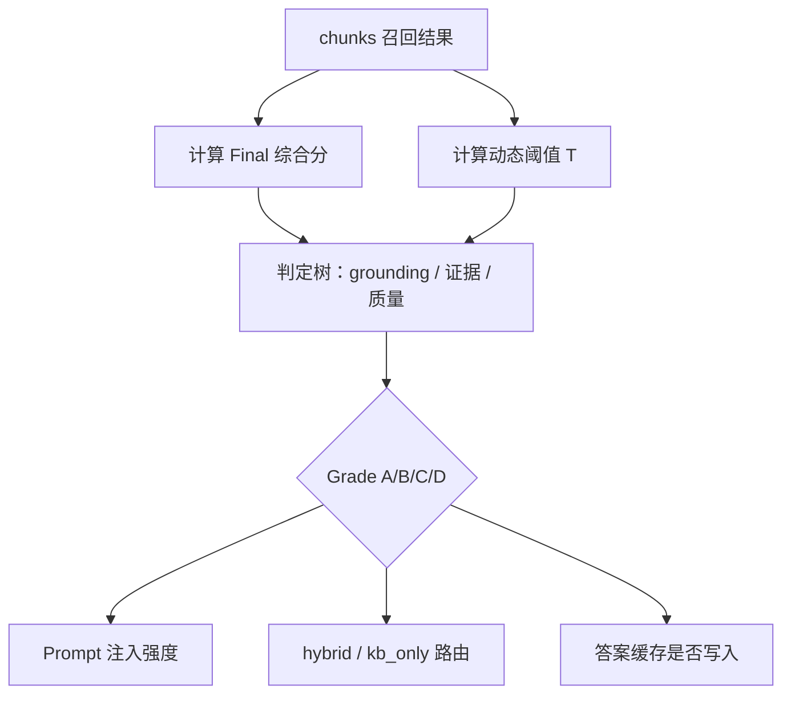

# 检索分级 A/B/C/D 与门控综合分 / 动态阈值

> **定位**：单独深挖 `EvaluateRetrievalGrade`、门控综合分 `Final`、动态阈值 `RetrievalGateThresholdDynamic`  
> **前置**：[GrayDraft-自研AI算法深度学习.md](02-custom-algorithms.md) §3–§4（学习地图中的阶段 3、4）
> **代码依据**：`internal/core/service/confidence/`（2026-10-28）

---

## 0. 一句话总结

检索返回 chunks 之后，系统还不能直接把内容塞进 LLM。需要先回答两个问题：

1. **证据够不够硬？** → 输出 **A/B/C/D 检索分级**，驱动 Prompt 注入强度、`chat_mode` 路由、答案缓存策略。
2. **这次召回的综合可信度是多少？** → 计算 **门控综合分 Final**，再与 **动态阈值** 比较，产出可观测的 `gate_score` / `gate_threshold` / `grade_reason`。

二者关系：



**关键约定**：只要 `len(chunks) > 0`，最低等级为 **C**（`IsUseful() = true`），**不会**落到 D。D 仅当 `chunks` 为空。

---

## 1. 算法要解决什么问题？

### 1.1 在 RAG 链路中的位置

```
Query4D → 4D 瀑布退避 → 混合召回 + Rerank → EvaluateRetrievalGrade → Prompt 组装 → LLM 生成
                                              ↑ 本文重点
```

分级发生在 **检索完成之后、LLM 生成之前**，是对话 SSE 的 **首个事件** `retrieval_grade`。

### 1.2 旧版二元 gate 的缺陷

旧逻辑只有「有用 / 无用」：

| 场景 | 二元 gate 的问题 |
|------|------------------|
| 召回了相关但实体对不上的教程 | 可能一律判「有用」→ 强注入，答案张冠李戴 |
| 只有弱相关 chunk | 可能一律判「无用」→ 白白丢掉可参考上下文 |
| kb_only vs hybrid | 无法区分「强引用整理」与「稀疏提示 + 通识补充」 |

### 1.3 分级后的收益

| Grade | 含义 | 注入策略（典型） | 答案缓存 |
|-------|------|------------------|----------|
| **A** | 高可信：高质量 grounding + 实体对齐 | 强注入 5–8 chunks | ✓ |
| **B** | 中可信：直接证据 / 标题命中 / 中等质量 | 正常注入 3–5 chunks | ✓ |
| **C** | 低可信：仅有弱参考 | 稀疏注入 1–2 chunks | 可选 |
| **D** | 无参考：`chunks` 为空 | 固定话术 / 通用 LLM | ✗ |

**下游路由（简化）**：

| 模式 | A/B | C | D |
|------|-----|---|---|
| **kb_only** | Fast 模型整理 Markdown | 稀疏 / 弱整理 | 「当前知识库未入录该知识点」 |
| **hybrid** | Complex 模型 RAG 流式 | 稀疏上下文 + RAG | 通用 LLM，无 KB 上下文 |

---

## 2. 检索分级 A/B/C/D（EvaluateRetrievalGrade）

**代码**：`confidence/gate.go` → `EvaluateRetrievalGrade`

### 2.1 判定树（按优先级，命中即停）

```
chunks 为空
  → D，reason = no_chunks

passesHighQualityGrounding?
  ├─ 是 + 实体匹配（Jaccard ≥ 0.3 或 EntityMatched）
  │    → A，reason = high_quality_grounding_entity
  └─ 是 + 无实体匹配
       → B，reason = high_quality_grounding_no_entity

hasDirectEvidence?（检查 top3）
  → B，reason = direct_evidence

top.TitleMatched 或 top.QualityScore ≥ 0.50
  → B，reason = moderate_quality_or_title

否则（有 chunk 但证据弱）
  ├─ Final ≥ 动态阈值 → C，reason = score_above_threshold_weak
  └─ Final <  动态阈值 → C，reason = score_below_threshold
```

> **注意**：最后两支 **都是 C**，只是 `reason` 不同，便于诊断「分数过线但信号弱」与「分数也不够」。

### 2.2 高质量 Grounding（passesHighQualityGrounding）

**代码**：`confidence/grounding.go`

判定 top chunk（`chunks[0]`）需同时满足：

1. `QualityScore ≥ 0.72`
2. 且满足以下之一：
   - `TitleMatched` **或** `EntityMatched`
   - **或** `QualityScore ≥ 0.82` 且 query 关键词落在 chunk 正文 / 标题

**设计意图**：文档本身质量高，且与问题有「标题 / 实体 / 正文词」锚点，才视为「硬证据」。

### 2.3 直接证据（hasDirectEvidence）

在 **前 3 个** chunk 中，任一满足：

| 条件 | 说明 |
|------|------|
| `TitleHit(query, docTitle, extensions)` | 标题或 search_anchors 命中 query 词 |
| `TableKeywordHit(query, content)` | query 词出现在 Markdown 事实表中 |
| `QualityScore ≥ 0.65` 且正文含 query 词项 | 正文关键词 grounding |

→ 直接给 **B**，不必依赖 Final 与阈值。

### 2.4 实体 Jaccard 匹配（EntityJaccardMatch）

有别名表 `aliasIdx` 时，用 Jaccard 替代简单布尔 `EntityMatched`：

\[
\text{Jaccard} = \frac{|Q \cap C|}{|Q \cup C|} \geq 0.3
\]

- \(Q\)：query 实体经 `FinalSanitize` + `CanonicalizeEntities` 后的集合
- \(C\)：top chunks 的 `extensions.entities` 经同样规范化后的并集

**为何需要**：抗别名（「InternVL」/「InternVL」）、抗「实体串」误匹配。

> 当前对话路径若 `aliasIdx == nil`，则退化为 top chunk 的 `EntityMatched` 布尔字段。

### 2.5 覆盖度 coverage_score

**代码**：`computeBaseCoverage`（粗估，后续可接 LLM 覆盖度）

| Grade | 公式 |
|-------|------|
| A | \(\mathrm{clamp}\big(0.80 + 0.20 \cdot \dfrac{\mathrm{topQuality} - 0.72}{0.28}\big)\) |
| B | \(\mathrm{clamp}\big(0.40 + 0.40 \cdot \dfrac{\mathrm{topQuality} - 0.50}{0.22}\big)\)；若 quality &lt; 0.50 则取 0.40 |
| C | \(\mathrm{clamp}\big(0.10 + 0.30 \cdot \dfrac{n}{n+5}\big)\)，\(n\) = chunk 数 |
| D | 0 |

---

## 3. 门控综合分（Final Score）

**代码**：`confidence/gate.go` → `CalculateFinalConfidenceWithIntent`

### 3.1 公式

\[
Final = 0.6 \times \max Rerank + 0.3 \times \max Vector + TitleHitBonus + StructuredTableBonus
\]

结果经 `clamp` 限制在合理区间。

| 项 | 权重 / 值 | 含义 |
|----|-----------|------|
| \(\max Rerank\) | × **0.6** | 遍历所有 chunk 取最大 rerank；若 `RerankScore ≤ 0` 则用 `Score` |
| \(\max Vector\) | × **0.3** | 遍历所有 chunk 取最大 `VectorScore` |
| `TitleHitBonus` | **+0.15** | **任一** chunk 的 `TitleMatched == true` |
| `StructuredTableBonus` | **+0.10** | query 词命中 Markdown 事实表（见下） |

### 3.2 各分项详解

**maxRerank / maxVector**：取全局最大值，而非只看 top1。重排后的跨编码器相关性是主信号；向量分保留语义近邻信息。

**TitleHitBonus（0.15）**：标题是强特征——影响全文召回、Rerank passage 结构（`标题 | 实体 | 正文`）、以及门控加分。

**StructuredTableBonus（0.10）**（`table_hit.go`）：

- chunk 含 Markdown 表格特征：`| 主题 |` 或 `| :---`
- 且 query 词项（`QueryTerms`）出现在表内容中
- 优先检查 rerank 最高的 chunk，再遍历其余 chunk

### 3.3 案例：手算 Final

#### 案例 F1：高相关 + 标题命中

| 信号 | 值 |
|------|-----|
| maxRerank | 0.85 |
| maxVector | 0.70 |
| TitleMatched | 是 → +0.15 |
| Table | 否 → +0 |

\[
\begin{aligned}
Final &= 0.6 \times 0.85 + 0.3 \times 0.70 + 0.15 + 0 \\
      &= 0.51 + 0.21 + 0.15 = \mathbf{0.87}
\end{aligned}
\]

#### 案例 F2：仅向量近邻、无标题

| 信号 | 值 |
|------|-----|
| maxRerank | 0.40 |
| maxVector | 0.75 |
| Title / Table | 否 |

\[
Final = 0.6 \times 0.40 + 0.3 \times 0.75 = 0.24 + 0.225 = \mathbf{0.465}
\]

语义「像」但重排不高 → Final 中等，通常进不了 A 的 grounding，更多落在 **B（若 quality / 标题）或 C**。

#### 案例 F3：事实表命中（对应 `gate_test.go`）

Query：「小夜何时出没」，intent = `fact`

| 信号 | 值 |
|------|-----|
| maxRerank | 0.35 |
| maxVector | 0.12 |
| topQuality | 0.78 |
| Table | 正文含 `| 主题 | 时间/区间 |` 且命中「小夜」→ +0.10 |

\[
Final = 0.6 \times 0.35 + 0.3 \times 0.12 + 0.10 = 0.21 + 0.036 + 0.10 = \mathbf{0.346}
\]

表格加分把弱 rerank 场景抬过 fact 基础阈值 0.25，测试用例 `TestPassesRetrievalGate_factThreshold` 验证通过。

#### 案例 F4：标题加成救场（对应 `gate_test.go`）

| 信号 | 值 |
|------|-----|
| maxRerank | 0.20 |
| maxVector | 0.05 |
| TitleMatched | 是 → +0.15 |

\[
Final = 0.6 \times 0.20 + 0.3 \times 0.05 + 0.15 = 0.12 + 0.015 + 0.15 = \mathbf{0.285}
\]

单独 rerank / vector 很低，但标题命中 +0.15 后综合分仍可过线。

---

## 4. 动态阈值（RetrievalGateThresholdDynamic）

**代码**：`confidence/threshold.go`

### 4.1 公式

\[
T = \mathrm{clamp}_{[0.12,\,0.32]}\Big( T_{\mathrm{base}}(\mathrm{intent}) - B_{\mathrm{quality}} - B_{\mathrm{title}} - B_{\mathrm{entity}} \Big)
\]

**从阈值中减去 = 放宽门控**（越容易 `Final ≥ T`）。

### 4.2 意图基础分 \(T_{\mathrm{base}}\)

| query_intent | \(T_{\mathrm{base}}\) | 设计意图 |
|--------------|------------------------|----------|
| `fact` | **0.25** | 事实类宁缺毋滥，门槛更高 |
| `concept` | **0.15** | 概念类允许更弱证据 |
| 其他 / default | **0.20** | 折中 |

### 4.3 动态加成（从基础分减去）

| 条件 | 调整 |
|------|------|
| topQuality ≥ 0.80 | −0.05 |
| 否则 topQuality ≥ 0.65 | −0.03 |
| `TitleMatched` | −0.02 |
| `EntityMatched` | −0.02 |

最终夹在 **[0.12, 0.32]**（`gateFloor` / `gateCeiling`）。

### 4.4 案例：手算动态阈值

#### 案例 T1：fact + 高质量 + 标题

- intent = `fact` → base = 0.25
- topQuality = 0.85 → −0.05
- TitleMatched → −0.02
- 无 EntityMatched

\[
T = 0.25 - 0.05 - 0.02 = \mathbf{0.18}
\]

若 Final = 0.20 ≥ 0.18 → C 且 `score_above_threshold_weak`（若前面未因 grounding / 证据拿到 A/B）。

#### 案例 T2：fact + 全加成（对应 `threshold_test.go`）

- base = 0.25
- topQuality = 0.85 → −0.05
- TitleMatched → −0.02
- EntityMatched → −0.02

\[
T = 0.25 - 0.05 - 0.02 - 0.02 = \mathbf{0.16}
\]

#### 案例 T3：concept + 全加成，触发下限

- base = 0.15
- topQuality = 0.95 → −0.05
- TitleMatched → −0.02
- EntityMatched → −0.02

\[
T_{\mathrm{raw}} = 0.15 - 0.09 = 0.06 \;\Rightarrow\; T = \mathbf{0.12}\;\text{（floor）}
\]

测试 `TestRetrievalGateThresholdDynamic_floor_ceiling` 验证此行为。

#### 案例 T4：fact + 中等质量、无标题实体

- base = 0.25
- topQuality = 0.70 → −0.03

\[
T = 0.25 - 0.03 = \mathbf{0.22}
\]

#### 案例 T5：fact + 低质量

- topQuality = 0.30，无标题 / 实体

\[
T = \mathbf{0.25}\;\text{（无加成，保持基础分）}
\]

---

## 5. Final 与阈值如何参与分级？

二者 **不是** 简单的一一映射：

| 机制 | 作用 |
|------|------|
| **判定树**（grounding / 直接证据 / 标题·质量） | 决定 **A / B** |
| **Final vs 动态阈值** | 主要服务 **C** 档的 `reason` 诊断；兼容旧版二元 gate 的可观测字段 |
| **chunks 为空** | 唯一落到 **D** 的路径 |

`GradeDecision` 返回字段：

| 字段 | 含义 |
|------|------|
| `grade` | A / B / C / D |
| `confidence` / `score` | Final 综合分 |
| `threshold` | 动态阈值 T |
| `reason` | 分级原因码 |
| `coverage_score` | 覆盖度粗估 |
| `useful` | `grade.IsUseful()`，D 为 false |

---

## 6. 端到端分级案例

### 案例 G1 → Grade A

- **Query**：「InternVL 和 InternLM 怎么配合」
- **top chunk**：Quality = 0.90，TitleMatched = true，Entity Jaccard ≥ 0.3
- **路径**：`passesHighQualityGrounding` ✓ + 实体匹配
- **结果**：**A**，`high_quality_grounding_entity`
- **coverage**：\(0.80 + 0.20 \times \dfrac{0.90 - 0.72}{0.28} \approx 0.93\)

### 案例 G2 → Grade B（无实体）

- 同上，但实体未对齐（泛化「参数说明」文，没有 InternVL / InternLM）
- Quality = 0.88，TitleMatched = true
- **路径**：grounding ✓，无实体
- **结果**：**B**，`high_quality_grounding_no_entity`

### 案例 G3 → Grade B（直接证据）

- Quality = 0.60（&lt; 0.72，过不了 grounding）
- top3 内标题含「InternVL」，或 quality ≥ 0.65 且正文关键词命中
- **结果**：**B**，`direct_evidence`

### 案例 G4 → Grade B（中等质量）

- 无 grounding、无 direct evidence
- topQuality = 0.55 或 TitleMatched
- **结果**：**B**，`moderate_quality_or_title`

### 案例 G5 → Grade C（分数过线但信号弱）

- Quality = 0.40，无标题 / 直接证据
- Final = 0.35，动态阈值 T = 0.20
- **结果**：**C**，`score_above_threshold_weak`（稀疏注入）

### 案例 G6 → Grade C（分数也不够）

- Quality = 0.35，无标题
- Final = 0.18，T = 0.22
- **结果**：仍是 **C**，`score_below_threshold`（有 chunk 最低 C，不会变 D）

### 案例 G7 → Grade D

- 4D 瀑布全空，`chunks = []`
- **结果**：**D**，`no_chunks`
- **kb_only**：固定话术；**hybrid**：通用 LLM

---

## 7. 动手验证

### 7.1 检索诊断 API

```bash
curl -X POST http://localhost:8443/api/v1/retrieval/diagnose \
  -H 'Content-Type: application/json' \
  -d '{"query":"InternVL 怎么用","kb_type":"tutorial","top_k":5}'
```

关注返回中的 `retrieval_grade`、`gate_score`、`gate_threshold`、`grade_reason`、top chunks 的 `quality_score` / `title_matched`。

### 7.2 Agent v2 对话事件

Agent v2 中，`knowledge.semantic` 工具输出与 `answer.validated` 携带分级信息；BFF 映射后的 `meta` / `done` 仍含 `retrieval_grade`、`gate_score` 等字段。

```bash
# 创建 Run 后观察 answer.validated 或 BFF done 中的 gate JSON
curl -sS -X POST http://localhost:8443/api/v2/agent-runs \
  -H 'X-Tenant-ID: demo' -H 'X-Actor-ID: learner' -H 'X-Authorized-KBs: tutorial' \
  -d '{"policy_version":"edu_workspace_v1","prompt":"InternVL 怎么用"}'
```

---

## 8. 自测题

1. rerank = 0.85，vector = 0.72，TitleMatched，无 table → **Final = ?**
2. fact 类 query、topQuality = 0.85、TitleMatched、无 Entity → **动态阈值 = ?**
3. grounding 通过但无实体匹配 → **为何是 B 不是 A？**
4. 有 3 个 chunk、Final 远低于阈值、无 grounding → **Grade 是 C 还是 D？**
5. top chunk quality = 0.75、无标题、top3 内有 direct evidence → **Grade 与 reason？**

<details>
<summary>参考答案</summary>

1. \(0.6 \times 0.85 + 0.3 \times 0.72 + 0.15 = 0.876\)
2. \(0.25 - 0.05 - 0.02 = 0.18\)
3. 判定树显式要求实体匹配才升 A；无实体时 grounding 只给 B
4. **C**（`score_below_threshold`）；有 chunk 最低 C
5. **B**，`direct_evidence`

</details>

---

## 9. 代码阅读清单

| 能力 | 主文件 | 测试文件 |
|------|--------|----------|
| 检索分级 | `service/confidence/gate.go` | `gate_test.go` |
| 动态阈值 | `service/confidence/threshold.go` | `threshold_test.go` |
| 高质量 grounding | `service/confidence/grounding.go` | `grounding_test.go` |
| 标题命中 / 加分 | `service/confidence/title_hit.go` | — |
| 表格加分 | `service/confidence/table_hit.go` | — |
| 对话路由 | `service/agent/knowledge_tool.go` · `planner.go` | `knowledge_tool_test.go` |
| 分区校准（进阶） | `service/confidence/calibrator.go` | — |

---

## 10. 相关文档

- [GrayDraft-自研AI算法深度学习.md](02-custom-algorithms.md) — 学习地图总览
- [问答可靠性治理.md](../03-algorithms/05-reliability-governance.md) — 分级 + 答案自检 + Feedback 闭环
- [系统逻辑总览.md](../../architecture/系统逻辑总览.md) — Agent v2 事件与 gate JSON
- [retrieval.md](../../api/retrieval.md) — 检索诊断 API
