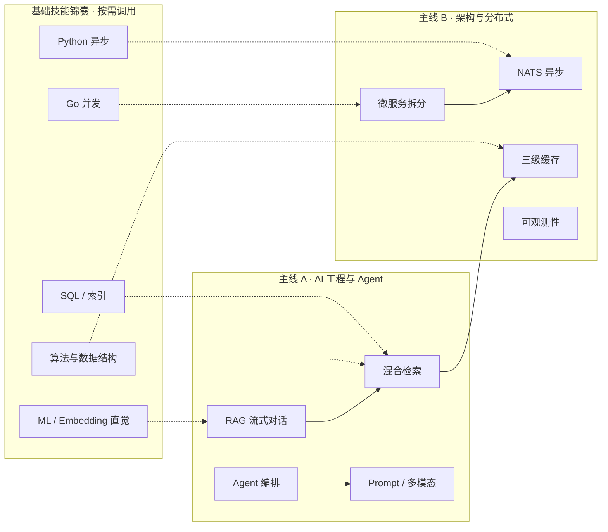

# GrayDraft 驱动学习路径 · AI Agent / AI 应用开发

> **目标岗位**：**AI Agent 工程师 / AI 应用开发工程师**  
> **学习载体**：以 [GrayDraft](../../) 项目为主线，边做边学  
> **核心理念**：地基不单独「啃书」，而是在实现 AI 应用时**按需调用、当场强化**；每块基础知识都以**可使用的技能**形式呈现。  
> **可选加分**：垂直领域 Demo（如 AI for Science / 药物研发）放在 **§C**，主线 A/B 完成后再做。

---

## 一、学习原则

### 1.1 三条原则

| 原则 | 说明 |
|------|------|
| **项目驱动** | 不先学完再动手；每学一个概念，必须在 GrayDraft 里找到对应代码或补一个小功能 |
| **技能化基础** | 算法、语言、ML 理论不列「待读书单」，而是写成「遇到 X 场景 → 用 Y 技能 → 在 Z 文件练」 |
| **主线优先** | 时间分配：**AI 工程与 Agent（50%）→ 架构与分布式（30%）→ 按需补基础（20%）** |

### 1.2 与岗位三层的映射

```
岗位需求                    你的学习主线（GrayDraft）
─────────────────────────────────────────────────────
AI Agent / 大模型应用（核心） →  主线 A：RAG / Agent / LLM 工程
工程与架构（支撑）          →  主线 B：微服务 / 缓存 / 消息队列 / 可观测
垂直领域（可选加分）        →  主线 C：领域 Demo 迁移（药物研发等，面试加分）
```

### 1.3 推荐首读文档（GrayDraft 内）

| 顺序 | 文档 | 用途 |
|------|------|------|
| 1 | [系统逻辑总览](../../architecture/系统逻辑总览.md) | 建立全局心智模型 |
| 2 | [Agent v2 对话与 SSE](../02-pipeline/03-agent-v2-sse.md) · [检索与 RAG 对话](../../features/retrieval-and-chat.md) | Agent Runtime + 检索主链路 |
| 3 | [智能快速导入](../../features/smart-import.md) | 智能导入与领域工作流 |
| 4 | [BFF 是什么？](../04-architecture/05-bff.md) → [GrayDraft BFF 代理能力详解](../04-architecture/06-bff-proxy-capabilities.md) | 产品层如何桥接 Core v2 |
| 5 | [roadmap](../../roadmap.md) | 选进阶练习（P1–P3 backlog） |
| 6 | [development](../../development.md) | 本地跑通环境 |

---

## 二、技能地图总览



---

## 三、主线 A：AI 工程与 Agent 开发（优先专攻）

> **建议周期**：8–12 周（可并行主线 B 的部分模块）  
> **验收标准**：能独立讲清 GrayDraft 从「入库 → 检索 → 流式对话」全链路，并完成至少 2 项 roadmap 进阶任务。

---

### A1 · Agent v2 对话与 RAG（第 1–2 周）

**学习目标**：理解 Agent Runtime 如何把 RAG 封装进 Loop（Tool + Memory + SSE），而不只是「调一个 chat API」。

| 维度 | 内容 |
|------|------|
| **GrayDraft 锚点** | `internal/core/service/agent/` · `docs/api/agent-v2.md` · `POST /api/v2/agent-runs` |
| **关联服务** | `knowledge_tool.go`（检索）· `planner.go` · `internal/gateway/`（LLM） |
| **学习文档** | [Agent v2 对话与 SSE](../02-pipeline/03-agent-v2-sse.md) · [AI Loop 机制](../01-foundations/02-agent-loop.md) |

**动手任务**

- [ ] `make dev-up` 跑通全栈，用 [agent-v2.md](../../api/agent-v2.md) 或 `deploy/scripts/smoke-agent-v2.sh` 创建 Run 并消费 SSE
- [ ] 对比 Core 原生事件（`answer.delta`）与 BFF 映射后（`chunk`）的差异
- [ ] 阅读 `planner.go`：教育工具如何选择词法、语义、相邻章节和实体扩展
- [ ] **小练习**：构造 `chat_mode=hybrid` vs `kb_only` 的 prompt 前缀，记录分级与拒答差异

**按需调用的基础技能**

| 技能 | 何时用 | 在 GrayDraft 中的实例 | 强化方式 |
|------|--------|---------------------|----------|
| **事件溯源** | Run 状态、断线续传 | `agent_run_events` + `after_seq` | 断线后用 `after_seq=N` 重连 SSE |
| **流式 I/O** | SSE 推送 | v2 events/stream | 用 curl `-N` 打印每个 `type` 和 `seq` |
| **Prompt 结构** | policy / prompt 注入 | BFF 注入 `top_k` / `chat_mode` | 读 [BFF 代理能力详解](../04-architecture/06-bff-proxy-capabilities.md) |

**验收**：能向他人解释「Agent v2 与旧 chat/stream 的分层差异，以及 BFF 为何仍暴露 meta/chunk/done」。

---

### A2 · 混合检索引擎（第 3–4 周）

**学习目标**：掌握现代 RAG 检索栈：向量 + 全文 + 融合 + 重排 + 缓存。

| 维度 | 内容 |
|------|------|
| **GrayDraft 锚点** | `internal/core/service/retriever/hybrid.go` · `docs/api/retrieval.md` · `docs/architecture/semantic-driven-retrieval-scheme.md` |
| **Worker 重排** | `internal/worker/` rerank 相关模块 |

**动手任务**

- [ ] 调用 `POST /api/v1/retrieval/search`，固定 query，调整 `top_k`，对比返回 chunk 的 `score`
- [ ] 追踪一次检索：分类器 → L1 缓存 → pgvector 查询 → RRF → L1 rerank → L2 rerank
- [ ] 阅读 **Query4D 瀑布退避**（5 级从严到宽），理解为何需要「搜不到时放宽条件」
- [ ] **小练习**：为某 `kb_type` 入库 5 篇测试文档，设计 3 条 query（事实型 / 概念型 / 专有名词），记录召回差异

**按需调用的基础技能**

| 技能 | 何时用 | 在 GrayDraft 中的实例 | 强化方式 |
|------|--------|---------------------|----------|
| **哈希表** | O(1) 去重、缓存查找 | Ristretto L1、`content_hash` 文档去重 | 实现一个迷你 LRU：key=query hash，value=检索结果 |
| **堆 / Top-K** | 重排取前 K 条 | L1 pool 50 → top 15 → L2 top 5 | 用 Python 对 100 个 float score 手写 `heapq.nlargest(5)` |
| **余弦相似度** | 向量检索、语义缓存 | pgvector、Redis 语义缓存（≥0.92） | 用 NumPy 算两个 8 维向量的 cosine，理解 embedding 检索本质 |
| **倒排 / 全文** | 关键词召回 | PostgreSQL `ILIKE` 全文路 | 写 SQL：`WHERE content ILIKE '%靶点%'` 并加 `EXPLAIN ANALYZE` |
| **图（直觉）** | 多路召回融合 | RRF 融合三路分数 | 理解 RRF 不要求分数同量纲——这是工程上的巧妙之处 |

**验收**：能画出混合检索流水线，并说出「为何需要 RRF 而不是直接相加分数」。

---

### A3 · AI Agent 编排（第 5–6 周）

**学习目标**：Agent = Loop + Memory + Tool；在 GrayDraft 里对应 **Agent Runtime v2** + Smart Import + Blueprint。

| 维度 | 内容 |
|------|------|
| **GrayDraft 锚点** | `internal/core/service/agent/` · `smartimport/` · `taxonomyevolve/blueprint.go` |
| **文档** | [Agent 流程方案](../../architecture/Agent流程技术实现方案.md) · [AI工具调用 (Tool Use)](../01-foundations/03-tool-use.md) |
| **Agent 日志** | `pkg/gocommon/observability/agentlog/` · `docs/testing/agent-logging-scheme.md` |

**动手任务**

- [ ] 走通 Smart Import：`POST /api/v1/ugc/smart-import`，观察拆分、置信度门槛（0.55）、422 拒绝逻辑
- [ ] 阅读 Blueprint Agent：工作区背景 → LLM 生成 4D taxonomy → 版本 bump
- [ ] 追踪 `trace_id` 从 import 到 chat 的全链路（Agent 可靠性方案）
- [ ] **进阶练习（对接 roadmap P1-6）**：在 Console 加一条「检索链路可视化」的草图或 PR

**按需调用的基础技能**

| 技能 | 何时用 | 在 GrayDraft 中的实例 | 强化方式 |
|------|--------|---------------------|----------|
| **树 / 层级结构** | 文档拆分、taxonomy | 骨架扫描 `ScanSkeleton`、4D 蓝图 domain/scene/style | 把一篇长文按标题层级拆成树，再 flatten 成 chunks |
| **队列** | 异步任务、流水线 | UGC → NATS → Worker pipeline stages | 用 `asyncio.Queue` 模拟 ingest 三阶段 |
| **状态机** | 任务生命周期 | `ugc_ingest_tasks`：pending → completed / failed | 画 smart-import 状态转移图 |
| **JSON Schema 思维** | LLM 结构化输出 | Blueprint、Query4D、拆分 2.0 的 `line_range` | 写一个 Pydantic model，让 LLM 输出必须符合字段 |

**验收**：能解释「智能导入」与「普通 UGC 入库」的区别，以及 Agent 在哪些步骤介入。

---

### A4 · Prompt Engineering 与多模态（第 7–8 周）

**学习目标**：掌握垂直领域 RAG 的 Prompt 策略与多模态预处理。

| 维度 | 内容 |
|------|------|
| **GrayDraft 锚点** | `internal/core/service/multimodal/` · `docs/features/multimodal.md` |
| **Query 理解** | Query4D：`ExtractQuery4D` → `AlignQuery4D` |

**动手任务**

- [ ] 测试多模态导入：带图片附件的 smart-import，观察 VL 分流（OCR vs VLM）
- [ ] 理解 pHash 近重复复用（汉明距离 ≤6）——这是**降本**的真实工程手段
- [ ] 修改工作区 Prompt override，测试同一 query 在不同工作区下的回答差异
- [ ] **小练习**：设计 3 条 Few-shot 示例，改善某冷门 kb 的召回（记录在实验笔记里）

**按需调用的基础技能**

| 技能 | 何时用 | 在 GrayDraft 中的实例 | 强化方式 |
|------|--------|---------------------|----------|
| **位运算 / 哈希** | 感知哈希 | pHash 近重复检测 | 了解 pHash 原理即可，重点看命中后跳过 VL 调用的成本节省 |
| **二分 / 搜索** | 阈值调参 | `rerank_skip_min_score: 0.78`、语义缓存 0.92 | 用脚本二分搜索「缓存命中率 vs 准确率」的平衡阈值 |
| **Embedding 直觉** | 语义相似 | 1024 维 `text-embedding-v4` | 对 5 个同义词算相似度（可用 Gateway embed API） |

**验收**：能说明多模态链路中「哪些步骤最费钱、如何用缓存砍掉」。

---

### A5 · 模型路由与 LLM 工程化（第 9–10 周）

**学习目标**：生产环境不绑定单一模型；路由、熔断、限流、微批是必备技能。

| 维度 | 内容 |
|------|------|
| **GrayDraft 锚点** | `internal/gateway/` · `docs/api/gateway.md` · `docs/api/models.md` |
| **Embedding 微批** | `batching.go` · Worker `embed_batcher.py` |

**动手任务**

- [ ] 配置切换 fast / pro 档 LLM（`llm_override: vendor:model`），对比延迟与质量
- [ ] 观察 Gateway 熔断：模拟 Provider 超时，看降级行为
- [ ] 阅读 embed 微批逻辑，理解「为何要 batch 而不是逐条请求」
- [ ] **进阶（roadmap P2-8）**：调研「答案缓存语义命中」方案，写一页设计笔记

**按需调用的基础技能**

| 技能 | 何时用 | 在 GrayDraft 中的实例 | 强化方式 |
|------|--------|---------------------|----------|
| **滑动窗口 / 批处理** | 微批 Embedding | `batching.go` | 实现：收集 100ms 内的请求再一次性 embed |
| **信号量 / 限流** | 保护下游 API | Gateway 并发控制 | Go `semaphore` 或 Python `asyncio.Semaphore` 限 10 并发 |
| **指数退避** | 重试策略 | NATS / HTTP 重试 | 写一个带 jitter 的重试装饰器 |

**验收**：能设计「新接一个开源 LLM」需要改 Gateway 的哪些配置与代码。

---

## 四、主线 B：架构、分布式与领域应用（深入专攻）

> **建议周期**：与主线 A 交叉进行，第 4 周起并行；整体 12–20 周  
> **验收标准**：能独立部署、排障一条完整入库链路；完成 1 项分布式/运维向进阶；整理可演示的 Agent / RAG 作品集。

---

### B1 · 微服务与数据流（第 4–6 周，与 A2/A3 并行）

**GrayDraft 锚点**：`docs/architecture/系统逻辑总览.md` · 各服务 `cmd/` 入口 · `protos/`

| 服务 | 职责 | 你要能回答的问题 |
|------|------|------------------|
| Core | 编排、API | 检索失败时谁负责降级？ |
| Worker | 重计算 | 为何用 Python 而不是 Go？ |
| Gateway | 模型 IO | 为何独立出去？ |
| Console / Ops | 运维 | JWT 保护哪些路由？ |

**动手任务**

- [ ] 单独启动 Core（`development.md`），只连 Postgres，调 retrieval API
- [ ] 停掉 Worker，观察 UGC 异步任务堆积与 DLQ 行为
- [ ] 读 `protos/core/v1/retrieval.proto`，理解 gRPC 契约存在的意义
- [ ] 画一张「同步调用 vs NATS 异步」的对比表

**按需技能**：**Go interface 抽象**（`LLMProvider` 式扩展）、**依赖注入**（service 层组装 repo）

---

### B2 · 消息队列与异步流水线（第 6–8 周）

**GrayDraft 锚点**：`docs/api/jetstream.md` · `docs/api/ugc.md` · `docs/api/dlq.md` · Worker `nats_consumer.py`

**动手任务**

- [ ] 追踪：`POST /ugc/notify` → JetStream → Worker Pull Consumer → `index_ready=true`
- [ ] 人为制造失败，观察 DLQ → Admin replay
- [ ] 阅读 `ugc/sync_fallback`：NATS 挂了时 HTTP 直调 Worker 的降级路径
- [ ] **进阶（roadmap P0-2）**：阅读 `docs/deploy/runbooks/nats-ha.md`，写 NATS 3 节点部署要点摘要

**按需技能**

| 技能 | 场景 | 练习 |
|------|------|------|
| **链表 / 队列** | 消费者 ack、pending 消息 | 理解 at-least-once 与幂等入库 |
| **幂等性** | `content_hash` 去重 | 同一文档重复 import 不应产生重复 chunk |
| **分布式锁（直觉）** | 单消费者分区 | 为何 Pull Consumer 要 ack 超时 |

---

### B3 · 存储、缓存与 PostgreSQL（第 7–9 周）

**GrayDraft 锚点**：`deploy/migrations/` · `kb_chunks` LIST 分区 · `docs/api/cache.md`

**动手任务**

- [ ] 执行 `EXPLAIN ANALYZE` 看 pgvector 查询计划
- [ ] 理解 `kb_catalog_version` + `semantic_4d_fingerprint` 如何失效 L2 缓存
- [ ] 对比：精确缓存命中 vs 语义缓存命中（cosine ≥ 0.92）的日志
- [ ] 阅读冷热分层：`cold` 文档默认不参与检索

**按需技能**

| 技能 | 场景 | 练习 |
|------|------|------|
| **B+ 树（直觉）** | PG 索引 | 解释为何 `kb_type` 上做 LIST 分区 |
| **排序算法** | Rerank | 100 条结果 partial sort 取 top-5 |
| **事务 ACID** | 文档+chunks 原子写入 | 读 Worker 入库事务边界 |
| **Redis 数据结构** | ZSET / String | 语义缓存存什么格式？TTL 多少？ |

---

### B4 · 可观测性与 RAGOps（第 9–11 周）

**GrayDraft 锚点**：`docs/api/ragops.md` · Prometheus 指标 · `internal/ops/` · `docs/testing/agent-reliability-golden-cases.md`

**动手任务**

- [ ] `make dev-up` 带 `--profile monitoring`，打开 Grafana `graydraft-rag.json`
- [ ] 找到指标：`graydraft_retrieval_*`、`graydraft_chat_waterfall_total`
- [ ] 模拟点踩 → strike → heal job（rechunk/demote）闭环
- [ ] 维护一份「黄金用例」：`tests/` 或自建的 10 条 query + 期望行为

**按需技能**：**百分位数 P95/P99**（性能优化文档）、**日志结构化**（`trace_id` 串联）

---

### C · 可选加分：垂直领域 Demo 迁移（第 12 周起，非必修）

> **定位**：面试**加分项**，不是学习主线。建议先完成 A1–A5、B1–B4，再选一个垂直场景做 1–2 周小 Demo。  
> 下列以 **AI for Science / 药物研发** 为例；也可换成法务、客服、教程资料等任意垂直知识库。

**目标**：用一份真实的教程、论文或接口资料把这条链路走通，确认它能服务具体材料，而不只停留在通用问答。

**迁移映射（药物研发示例）**

| GrayDraft 能力 | 垂直场景示例 |
|--------------|--------------|
| `kb_type` / 工作区 | 靶点库 / 化合物库 / 文献库 |
| Smart Import | PubMed 摘要、专利段落批量入库 |
| 混合检索 + Query4D | 专业术语 query 理解（如「EGFR 抑制剂」） |
| 多模态 | 分子结构图、实验图谱 OCR/VLM |
| Agent Skill（参考 GrayDraft） | 查外部 API、设提醒、总结文档 |
| RAGOps | 点踩后修正错误回答 |

**阶段任务（可选）**

- [ ] **M1**：新建领域 `kb_type`，导入 20 篇样例文档
- [ ] **M2**：调优 10 条黄金 query
- [ ] **M3**：写 2–3 个 Agent Tool（可用脚本模拟 API）
- [ ] **M4**：录制 3 分钟 Demo 或写 README

**按需领域学习**（用到再学，不前置）

| 主题 | 触发场景 | 资源 |
|------|----------|------|
| 化学信息学 | 做药物研发 Demo 且涉及分子 | RDKit 官方教程 1–2 章 |
| 药物研发流程 | 设计 Demo 叙事 | 一篇「AI for Drug Discovery」综述 |
| 领域术语 | Prompt / 拆分调优 | 对应领域公开文档 |

---

## 五、基础技能锦囊（融入式，不单独成阶段）

> 原则：**不在 GrayDraft 里用到的基础，先标为「待触发」；触发了再用 1–2 小时突击 + 立刻写代码。**

### 5.1 算法与数据结构 → 使用场景索引

| 技能 | 掌握标准（能用起来） | GrayDraft 触发点 | 15 分钟练习 |
|------|----------------------|----------------|-------------|
| 哈希表 | 设计 cache key、去重 | `content_hash`、答案缓存 | 两字符串判重 |
| 堆 / Top-K | 重排取前 K | Rerank L1/L2 | `heapq.nlargest` |
| 队列 | 异步流水线 | NATS、ingest stages | `asyncio.Queue` 三阶段 |
| 树 | 文档层级拆分 | 骨架扫描、taxonomy | Markdown 标题转树 |
| 图（直觉） | 多路融合 | RRF | 手写 3 路 RRF 公式 |
| 排序 | 部分排序优化 | top_k 检索 | 只对前 50 条精排 |
| 二分 | 阈值调参 | 缓存相似度阈值 | 搜索最优 F1 阈值 |
| 字符串 | 分块、锚点 | semantic chunker | 按段落滑窗分块 |
| 并查集（了解） | 实体合并 | taxonomy 合并（进阶） | 读 Blueprint 合并逻辑即可 |

### 5.2 Python 技能 → 使用场景索引

| 技能 | 掌握标准 | GrayDraft 触发点 | 练习 |
|------|----------|----------------|------|
| asyncio | 写异步 HTTP / DB | Worker pipeline | `asyncpg` 查 `kb_chunks` |
| FastAPI | 路由、依赖注入 | `internal/worker/api/` | 加一个 `/health/detail` |
| Pydantic | 请求校验 | ingest 请求体 | 定义 `SmartImportRequest` |
| 类型标注 | 可读可维护 | 全 Worker 代码 | 给一个函数补全 type hints |

### 5.3 Golang 技能 → 使用场景索引

| 技能 | 掌握标准 | GrayDraft 触发点 | 练习 |
|------|----------|----------------|------|
| goroutine + channel | 并发检索 | hybrid retriever 并行路 | 两路 ILIKE + vector 并行 |
| context | 超时取消 | HTTP handler | 给 LLM 调用加 30s timeout |
| interface | 可替换实现 | Gateway Provider | 加一个 mock embedder |
| errgroup | 并发错误收集 | 检索并行 | `errgroup` 并行两查询 |

### 5.4 ML / 深度学习 → 使用场景索引

| 技能 | 掌握标准 | GrayDraft 触发点 | 练习 |
|------|----------|----------------|------|
| Embedding 直觉 | 理解向量语义搜索 | pgvector 检索 | 5 个词 embed + cosine |
| 损失函数（了解） | 知道训练目标 | 未来微调 LoRA | 读一篇 LoRA 博客即可 |
| PyTorch 张量（按需） | 能读推理代码 | 本地 vLLM profile | `make dev-up-gpu` 试一次 |
| 评估指标 | 评 RAG 质量 | RAGOps、golden cases | 算 Precision@5 |

### 5.5 工程基础 → 使用场景索引

| 技能 | GrayDraft 触发点 | 练习 |
|------|----------------|------|
| Docker Compose | `make dev-up` | 只启 postgres+redis，手动启 Core |
| SQL 调优 | 检索慢查询 | `EXPLAIN ANALYZE` |
| HTTP/SSE | Chat 流式 | curl -N 消费 SSE |
| JWT | Console 登录 | 读 Admin 中间件 |
| Prometheus | Grafana 大盘 | 找到 chat 延迟 histogram |

---

## 六、12 周学习节奏（参考）

| 周次 | 主线 A | 主线 B | 基础技能（按需） |
|------|--------|--------|------------------|
| 1 | A1 RAG 对话跑通 | 读系统总览 | SSE、哈希 cache key |
| 2 | A1 答案缓存 | B1 单服务启动 | 流式 I/O |
| 3 | A2 混合检索 | B1 服务职责 | 余弦相似度、Top-K |
| 4 | A2 Query4D 瀑布 | B2 UGC 异步 | RRF、哈希表 |
| 5 | A3 Smart Import | B2 DLQ | 队列、状态机 |
| 6 | A3 Blueprint Agent | B3 PG 分区 | 树、SQL EXPLAIN |
| 7 | A4 多模态 | B3 三级缓存 | pHash 直觉 |
| 8 | A4 Prompt 调优 | B4 Prometheus | 阈值二分搜索 |
| 9 | A5 Gateway 路由 | B4 RAGOps | 信号量、微批 |
| 10 | A5 模型降级 | B1 gRPC 契约 | 指数退避 |
| 11 | 串联全链路答辩 | B4 RAGOps | — |
| 12 | roadmap 进阶 + 作品集整理 | C 可选领域 Demo | 按需 |

---

## 七、进阶练习库（来自 GrayDraft Roadmap）

完成主线后，按兴趣选做——**每一项都是简历 bullet**。

| 优先级 | 任务 | 代码/文档入口 | 练到的能力 |
|--------|------|---------------|------------|
| P1 | Agent 测试台增强 | `docs/roadmap.md` §P1-6 | 全链路可视化 |
| P1 | 向量/分块管理 | roadmap P1-5 | Admin API、PG |
| P2 | 答案缓存语义命中 | roadmap P2-8 | Embedding + Redis |
| P2 | Worker/Gateway 指标 | roadmap P2-7 | Prometheus |
| P3 | 分类模型化 | roadmap P3-10 | 小模型训练入门 |
| P3 | RAGAS 批量回归 | roadmap P3-11 | RAG 评估 |
| P0 | NATS 高可用 | `docs/deploy/runbooks/nats-ha.md` | 分布式运维 |

---

## 八、学习记录模板（建议每周填写）

复制到个人笔记或本文件底部使用。

```markdown
## 第 __ 周学习记录

### 本周目标
- 

### 完成的 GrayDraft 任务
- [ ] 

### 新触发的基础技能
| 技能 | 触发场景 | 练习产出 |
|------|----------|----------|
| | | |

### 遇到的问题与解决
- 

### 下周计划
- 
```

---

## 九、自测清单（面试前）

### AI 工程与 Agent

- [ ] 能白板画出：用户 query → 检索 → Prompt → LLM 流式 → citations
- [ ] 能解释 hybrid / kb_only、检索降级、答案缓存失效条件
- [ ] 能解释 Smart Import 中 LLM 介入的步骤与置信度门槛
- [ ] 能说出 3 种降本手段（缓存、跳过重排、多模态 pHash）

### 架构与分布式

- [ ] 能解释 Core / Worker / Gateway 拆分原因
- [ ] 能解释 NATS 异步 vs sync_fallback
- [ ] 能解释 `index_ready` 与 LIST 分区的设计
- [ ] 能演示 DLQ replay 或 Grafana 看板

### 领域迁移（可选加分）

- [ ] 有垂直领域 Demo 或清晰的迁移方案（药物研发 / 其他行业均可）
- [ ] 能讨论：通用 RAG 平台 vs 垂直知识库的工程差异

---

## 十、推荐资源（仅作查阅，不前置学习）

| 类型 | 资源 | 何时查阅 |
|------|------|----------|
| RAG | GrayDraft `docs/features/retrieval-and-chat.md` | 主线 A2 |
| Agent | Andrew Ng Agent 短课程 / LangGraph 文档 | 主线 A3 遇到概念缺口时 |
| 算法 | LeetCode 热题 100（按本章索引选题） | 技能锦囊触发时 |
| ML 直觉 | 吴恩达 ML 第 1–3 周 | 需要理解 embedding 训练时 |
| PyTorch | 李沐《动手学深度学习》第 2–3 章 | 做 P3 分类模型化前 |
| 领域 | 「AI for Drug Discovery」综述 1 篇 | 做 §C 药物研发 Demo 时 |
| 化学信息学 | RDKit Getting Started | §C Demo 涉及分子结构时 |

---

## 附录：与简历项目的交叉引用

| 简历项目 | 本学习路径中的位置 |
|----------|-------------------|
| GrayDraft 混合检索 | 主线 A2 + B3 |
| GrayDraft Agent Runtime v2 | 主线 A1 + A3 |
| GrayDraft 流式 RAG（经 Agent） | 主线 A1 |
| Smart Import / Blueprint | 主线 A3 |
| 多模态 4.0 | 主线 A4 |
| GrayDraft BFF | [BFF 代理能力详解](../04-architecture/06-bff-proxy-capabilities.md) · A1/A2/A3/A4 |
| NATS / 微服务 | 主线 B1、B2 |
| RAGOps | 主线 B4 |
| GrayDraft Agent 14 Skill | 主线 A3 工具调用设计参考 |
| GrayDraft GrayDraft 集成 | A1 端到端闭环的「上游产品」视角 |

完整简历模板见 [简历模板](../07-career/04-resume.md)。
面试通识与高频考点见 [学习路径 2 · 面试与通用能力](../07-career/01-interview-roadmap.md)。

---

*文档版本：v1.3 · Agent v2 重构同步；路径 2 为面试通识补充*
