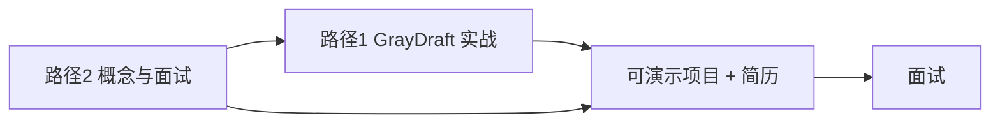

# 学习路径 2 · AI Agent 面试与通用能力

> **基线日期**：2026-10-28  
> **目标**：系统掌握 AI Agent 应用开发的**通用概念与面试考点**，与项目无关也能讲清楚原理。  
> **与路径 1 的关系**：[学习路径 1](../05-practice/learning-roadmap-ai-agent.md) 以 **GrayDraft 代码**为主线动手；本路径补全**行业通识、框架对比、面试话术**，并在每节标注「GrayDraft 里对应什么」。

---

## 两条路径如何配合

| | **路径 1**（项目驱动） | **路径 2**（本文件） |
|---|------------------------|----------------------|
| 重心 | 在 GrayDraft 里实现、读代码、做练习 | Agent 架构、RAG/Memory/Tool 通识、面试题 |
| 周期 | 8–12 周主线 A/B | 4–8 周概念 + 刷题，可与路径 1 并行 |
| 产出 | 能改代码、能部署、能画系统图 | 能白板讲原理、能对比方案、能答高频题 |
| 推荐顺序 | 先跑通 `make dev-up` | 每周用路径 2 的一章对照路径 1 的 A1–A4 |



---

## 一、AI Agent 核心架构

### 1.1 标准定义（面试开场白）

**Agent = LLM + 规划（Planning）+ 记忆（Memory）+ 工具使用（Tool Use）**

与传统「单次 Prompt → 单次回答」不同，Agent 的核心循环是：

```
observe → think → act → observe → …
```

模型根据环境反馈**动态调整**下一步，而不是固定流水线。

### 1.2 三层分工

| 层级 | 职责 | 典型技术 |
|------|------|----------|
| **决策层** | 意图识别、任务拆解、规划、选工具 | ReAct、Plan-and-Execute、Router |
| **执行层** | 调 API、查知识库、写库、发消息 | Function Calling、MCP、RAG、HTTP |
| **记忆与状态层** | 多轮上下文、历史结果、中间变量 | 上下文窗口、向量库、Session Store |

### 1.3 Agent vs Workflow vs Chatbot（必考对比）

| | Chatbot | Workflow | Agent |
|---|---------|----------|-------|
| 控制流 | 固定多轮 | **预定义 DAG** | **运行时自主决策** |
| 工具 | 通常无 | 固定节点调用 | 按需选择、可失败重试 |
| 典型产品 | 客服 FAQ | Dify 工作流、n8n | Cursor Agent、Research Agent |
| 工程难点 | Prompt 质量 | 编排与幂等 | 规划稳定性、幻觉、成本控制 |

### 1.4 GrayDraft 在 Agent 谱系中的位置

GrayDraft 已从「纯 RAG 中台」演进为 **Agent Runtime + 知识治理中台**：

| Agent 模块 | GrayDraft 对应 | 代码 / 文档锚点 |
|------------|--------------|-----------------|
| **Loop / Runtime** | JetStream 异步 Run、Planner、预算、Shadow/Canary | `service/agent/runtime.go` · [agent-v2.md](../../api/agent-v2.md) |
| 执行层 · 知识检索 | `knowledge.semantic` → 混合检索 + 4D 瀑布 + rerank | `knowledge_tool.go` · [检索链路](../02-pipeline/02-retrieval.md) |
| 执行层 · 生成 | `answer.delta` SSE · AnswerGate | [SSE-RAG对话](../02-pipeline/03-agent-v2-sse.md) |
| 记忆 · 短期/长期 | Redis 会话 + `memory_items` pgvector | [AI记忆机制 (Memory)](../01-foundations/04-memory.md) |
| 工具 · 治理 | Tool Registry、R2 审批、沙箱 Runner | [AI工具调用 (Tool Use)](../01-foundations/03-tool-use.md) |
| 决策层 · 领域工作流 | Smart Import、Query4D、检索分级 | `smartimport/` · `confidence/gate.go` |
| 工具 · 产品封装 | BFF 五项代理、GrayDraft 14 Skill | [bff-proxy-capabilities](../04-architecture/06-bff-proxy-capabilities.md) |

**面试话术**：「GrayDraft Core 现已具备生产级 Agent Loop（v2 Run API）；Smart Import / 混合检索 / 语义进化是知识治理子系统；完整业务 Agent 在 GrayDraft 产品层组装 Skill 与用户上下文。」

---

## 二、核心概念详解

### 2.1 RAG（检索增强生成）

**作用**：用外挂知识库解决模型**知识截止、幻觉、领域适配**；在 Agent 里，**长期记忆很大程度上通过 RAG 实现**。

#### 标准全流程（面试必背）

```
分块 Chunking → 向量化 Embedding → 检索 Retrieve → 重排序 Re-rank → 组装 Prompt → 生成 Generate
```

| 阶段 | 面试要点 | GrayDraft 实现 |
|------|----------|--------------|
| 分块 | 按语义/标题/表格；overlap；chunk size 权衡 | Worker `chunk_text`；Smart Import 多段拆分 |
| 向量化 | 维度、归一化、双语模型 | Gateway Embedding 1024 维；`embedding_structured` 第三路 |
| 检索 | 向量 / 全文 / 混合；top_k | 全文 `search_text` + pgvector + RRF |
| 重排序 | 交叉编码器 vs bi-encoder | Worker L1/L2 rerank |
| 生成 | 引用约束、流式、降级 | Agent v2 SSE；`kb_only` / `hybrid`；检索分级 |

#### 主流向量库（对比题）

| 产品 | 特点 | 与 GrayDraft 对比 |
|------|------|------------------|
| Pinecone | 全托管、运维少 | 自托管 pgvector + LIST 分区 |
| Chroma / FAISS | 轻量、嵌入式 | 适合 Demo；生产多用 PG/Milvus |
| Milvus | 分布式、大规模 | 同赛道；GrayDraft 选 PG 一体化 |

#### Agentic RAG

让 Agent **自主决定**何时检索、检索几次、如何改写 query——不是固定「先检索再答一次」。

- GrayDraft 侧：Query4D、瀑布退避、classifier 调权、`retrieval/diagnose` 可视为「检索策略可观测」的第一步。
- 通用侧：LangGraph 里用 conditional edge 在「再检索 / 直接答 / 调工具」间分支。

**路径 1 练习**：主线 A1 + A2 · [学习路径 §A1/A2](../05-practice/learning-roadmap-ai-agent.md#三主线-aai-工程与-agent-开发优先专攻)

---

### 2.2 记忆系统（Memory）

面试几乎必考：**短期 vs 长期如何设计、存什么、怎么检索**。

#### 分类表

| 类型 | 作用 | 技术实现 | GrayDraft / 产品侧 |
|------|------|----------|------------------|
| **短期记忆** | 当前会话连贯 | 上下文窗口、滑动窗口、摘要压缩 | `session_id`；BFF 多轮由前端组 history |
| **长期记忆** | 跨会话偏好与事实 | 向量库 + RAG；用户画像表 | **知识库即长期记忆**；`context_profile` 工作区背景 |
| **情节记忆** | 谁何时做了什么 | 实体 + 时间戳 + 图数据库 | `extensions`、文档元数据；`GetKnowledgeGraph` |
| **工作记忆** | 当前任务中间变量 | Agent state、scratchpad | Smart Import `items[]` 预览；检索 `retrieval_trace` |

#### 面试标准答法（模板）

1. **短期**：最近 N 轮原文或摘要进 context；超长则 **summary + 最近 K 轮**。
2. **长期**：结构化（DB）+ 非结构化（向量）；写入前 **去重 / 过期策略**。
3. **检索记忆**：与 query 一起做 embedding；注意 **权限与租户隔离**（GrayDraft：`tenant_id` + `storage_partition`）。

#### 常见问题

| 问题 | 答法要点 |
|------|----------|
| 短期和长期如何配合？ | 长期 RAG 召回片段 + 短期对话 history 一起进 Prompt；注意 token 预算 |
| 如何避免记忆污染？ | 置信度门槛、feedback 降权、版本号失效缓存（`kb_catalog_version`） |
| 多用户隔离？ | 分区 / namespace；GrayDraft PaaS 见 [tenants.md](../../api/tenants.md) |

---

### 2.3 工具调用（Tool Use / Function Calling）

**作用**：让 LLM 输出**结构化调用意图**，由运行时执行 API 并把结果塞回上下文。

#### 原理（面试白板）

1. 向模型注册 tools schema（name、description、parameters JSON Schema）。
2. 模型在 generation 中产出 `tool_calls`（或 `<tool>` 文本协议）。
3. 宿主执行函数，将 `tool_result` 作为新 message 继续对话。
4. 循环直到模型输出最终自然语言或达到步数上限。

#### 与 GrayDraft 的关系

| 层级 | 示例 |
|------|------|
| Core | 不暴露通用 tool loop；提供 **固定 HTTP 能力**（检索、入库、对话） |
| BFF | 把产品操作映射为 Core API（五项代理） |
| GrayDraft | **14 Skill Agent**：多工具编排，经 BFF 调 GrayDraft Agent v2 |

**路径 1 参考**：学习路径附录 · GrayDraft 14 Skill · 主线 A3

#### ReAct / Plan-and-Execute（框架题）

| 模式 | 思路 | 一句话 |
|------|------|--------|
| **ReAct** | Thought → Action → Observation 交替 | 适合步数少、需解释性的任务 |
| **Plan-and-Execute** | 先出计划再逐步执行 | 适合长任务、可并行子任务 |
| **GrayDraft Smart Import** | 规则 + LLM 拆分 + 置信度门控 | **领域工作流**，非通用 ReAct |

---

### 2.4 MCP 与 Skills

#### MCP（Model Context Protocol）

- **是什么**：Anthropic 等推动的**协议**，统一「模型如何发现、调用外部工具与数据源」。
- **关注点**：传输层、权限、tool schema、server 生命周期。
- **面试句**：MCP 解决 **「接什么、怎么调」** 的标准化。

#### Skills（Anthropic 2025 开放标准）

- **是什么**：**能力包**——把领域知识、流程、脚本封装成模块，Agent **按需加载**。
- **关注点**：教模型 **「完整做完一类工作」**（指令 + 脚本 + 资源）。
- **面试句**：Skills 解决 **「这类活怎么做」** 的可复用封装。

| 对比 | MCP | Skills |
|------|-----|--------|
| 层次 | 协议 / 接口 | 内容 /  playbook |
| 类比 | USB 接口 | 安装好的专业软件包 |
| 目录结构 | MCP Server 配置 | `SKILL.md` + `scripts/` + `resources/` |

**Skills 标准目录**：

```
skill-name/
├── SKILL.md      # 必填：name、description、使用说明
├── reference.md  # 可选：参考资料
├── scripts/      # 可选：python / shell / js
└── resources/    # 可选：模板、配置
```

**与 Cursor / 本仓库**：Cursor 用户 Skill 见 `~/.cursor/skills-cursor/`；写 GrayDraft 文档时可对照「SKILL.md = 流程说明 + 约束」的组织方式。

#### GrayDraft 映射（帮助记忆）

| 概念 | 近似物 |
|------|--------|
| MCP Server | Core HTTP API + Gateway |
| Tool | `retrieval/search`、`ugc/smart-import`、`/api/v2/agent-runs` |
| Skill | [bff-proxy-capabilities](../04-architecture/06-bff-proxy-capabilities.md) 五项代理 + GrayDraft Skill 模块 |
| Skill 元数据 | `SKILL.md` frontmatter ≈ API 文档 + `docs/features/*` |

---

### 2.5 关于「龙虾」🦞

AI Agent 领域**没有**标准术语「龙虾」。面试准备请以官方名称为准，常见误记：

| 可能指 | 说明 |
|--------|------|
| **LangChain** | 主流 LLM 应用框架；Chains、Agents、Tools |
| **LangGraph** | 基于图的状态机 Agent；多步、多智能体 |
| **某开源项目昵称** | 以仓库 README 为准 |
| **谐音/口误** | 听到不确定时反问：「您指的是 LangChain 还是 LangGraph？」 |

**学习建议**：路径 2 阶段 3 用 LangGraph 写一个 50 行 ReAct Demo；路径 1 用 GrayDraft 讲 **生产级 RAG**，两者互补。

---

### 2.6 多智能体协作（面试加分）

| 模式 | 说明 | 例子 |
|------|------|------|
| 主从 | Supervisor 派活给 Worker | 研究助手 + 检索员 + 写作员 |
| 对等 | 多 Agent 消息总线协商 | AutoGen 风格 |
| 流水线 | 固定 handoff | 导入 Agent → 质检 Agent → 发布 |

GrayDraft 自身是 **单服务编排**；多 Agent 出现在 **GrayDraft 产品 + GrayDraft Skill** 层。面试可讲：「中台专注 RAG 质量，多 Agent 在 BFF/业务服组装。」

---

## 三、四阶段学习路线

可与 [学习路径 1 十二周节奏](../05-practice/learning-roadmap-ai-agent.md#八十二周学习节奏建议) **并行**：路径 2 偏概念周，路径 1 偏代码周。

### 阶段 1：基础入门（1–2 周）

| 任务 | 通用 | GrayDraft 对照 |
|------|------|--------------|
| 区分 Agent / Workflow / Chatbot | 读本章 §1.3 | 画 [系统逻辑总览 §0](../../architecture/系统逻辑总览.md) |
| 最小 Agent 循环 | Python 50–150 行：calculator + mock search | 对比：Chat 是固定 RAG 管线而非 tool loop |
| Prompt 模式 | CoT、ReAct 各写 1 个例子 | 读 `chat/prompt.go` 分级 Prompt |

**验收**：能不看资料说出 Agent 四要素和 observe-think-act 循环。

---

### 阶段 2：核心能力（2–4 周）

| 任务 | 通用 | GrayDraft 对照 |
|------|------|--------------|
| 工具调用 | OpenAI tools API 或 LangChain agent | BFF ①④ 如何「代替」前端拼请求 |
| RAG 全链路 | 自建 Chroma + 20 篇文档 | `make dev-up` + A1/A2 任务清单 |
| 记忆 | 短期 history + 长期向量各存一处 | `context_profile` + 答案缓存 Key 设计 |
| 检索调试 | 改 chunk size 看 recall | `retrieval/diagnose` + `gate_reason` |

**验收**：白板画出 RAG 六步；说出 GrayDraft 重排在哪一层。

---

### 阶段 3：框架与工程化（2–3 周）

| 任务 | 通用 | GrayDraft 对照 |
|------|------|--------------|
| LangChain / LangGraph | 官方 Quickstart + 1 个 ReAct | 对比：为何生产用 Go 编排 + Python Worker |
| MCP | 读 spec；跑一个 filesystem MCP server | Core = 一组「粗粒度 tools」 |
| Skills | 写一个 `SKILL.md`（如「如何排障 GrayDraft 无检索」） | 对齐 `docs/architecture/agent-import-chat-reliability.md` |
| 可观测 | trace、metrics、日志关联 | `X-Trace-Id`、Prometheus、`retrieval_trace` |

**验收**：说清 MCP vs Skills；演示 LangGraph 或 GrayDraft curl SSE 任一即可。

---

### 阶段 4：面试冲刺（1–2 周）

| 任务 | 说明 |
|------|------|
| 刷题 | Agent 基础、ReAct、RAG、记忆、工具、多智能体、MCP/Skills（见 §四） |
| 项目故事 | 各准备 3 分钟版：GrayDraft RAG、Smart Import、BFF 五项 |
| 反问环节 | 团队 Agent 架构偏 Workflow 还是自主 Agent？RAG 自研还是 vendor？ |

**推荐节奏**：**理解概念 → 手写最小实现 → 框架 Demo → GrayDraft 深挖 → 刷题**

---

## 四、面试高频考点速查

| # | 考点 | 30 秒答法 | GrayDraft 加分句 |
|---|------|-----------|----------------|
| 1 | Agent 架构 | LLM+规划+记忆+工具；observe-think-act | 我做的是执行层 RAG 中台 |
| 2 | RAG 细节 | chunk→embed→retrieve→rerank→generate | 混合检索+RRF+双阶段 rerank+分级门控 |
| 3 | 记忆 | 短期 context；长期向量+结构化 | 知识库=长期记忆；catalog 版本失效 |
| 4 | Function Calling | schema→tool_calls→execute→observe | 产品在 BFF/GrayDraft 编排 tools |
| 5 | ReAct | Thought-Action-Obs 循环 | Smart Import 是领域 workflow 非 ReAct |
| 6 | Plan-and-Execute | 先 plan 再逐步执行 | UGC 异步流水线类似工程化 plan |
| 7 | MCP vs Skills | 协议 vs 能力包 | Core API≈tools；BFF≈产品 skill 层 |
| 8 | 多智能体 | 主从/对等/流水线 | 中台单编排，多 Agent 在上游 |
| 9 | RAG 坏case | 无结果、串缓存、幻觉 | [可靠性治理](../../architecture/agent-import-chat-reliability.md) |
| 10 | 流式输出 | SSE/token 流；首 token 延迟 | `retrieval_grade→thinking→meta→chunk→done` |

### 自测清单（路径 2 专用）

**概念**

- [ ] 能默写 Agent 四要素与核心循环
- [ ] 能画 RAG 全流程并标出 rerank 位置
- [ ] 能对比短期/长期记忆各 2 种实现
- [ ] 能解释 Function Calling 四步
- [ ] 能对比 MCP、Skills、普通 REST API

**结合 GrayDraft**

- [ ] 能说明 GrayDraft 在 Agent 三层里占哪几块
- [ ] 能讲检索分级 A/B/C/D 与 hybrid/kb_only 路由
- [ ] 能讲 BFF 五项代理各自解决什么产品问题
- [ ] 能讲 `index_ready`、缓存版本、DLQ 各解决什么工程问题

完整项目向自测见 [学习路径 1 §九](../05-practice/learning-roadmap-ai-agent.md#九自测清单面试前)。

---

## 五、推荐学习资源

### 5.1 外部资源（通识与刷题）

| 资源 | 内容 | 建议阶段 |
|------|------|----------|
| [ai-agents-from-zero](https://github.com/)（GitHub 搜同名） | 教程 + 源码 + 题库 | 阶段 1–2 |
| [ai-agent-interview-guide](https://github.com/)（GitHub 搜同名） | 200+ 面试题 + 项目 | 阶段 4 |
| AgentGuide / Datawhale Agent-Learning-Hub | 2026 路线与资料汇总 | 全程查阅 |
| LangChain / LangGraph 官方文档 | 框架与 ReAct | 阶段 3 |
| Anthropic MCP 文档 | 协议与 server 示例 | 阶段 3 |
| Andrew Ng Agent 短课 | 概念扫盲 | 阶段 1 |

> 链接以 GitHub / 官网搜索为准，避免死链；优先选 **近 12 个月** 更新仓库。

### 5.2 GrayDraft 资源（项目深挖）

| 资源 | 对应路径 2 章节 |
|------|-----------------|
| [系统逻辑总览 §0](../../architecture/系统逻辑总览.md) | §1 架构、BFF 五项 |
| [学习路径 1](../05-practice/learning-roadmap-ai-agent.md) | 全程实战 |
| [bff-proxy-capabilities](../04-architecture/06-bff-proxy-capabilities.md) | §2.4 工具与 Skills |
| [agent-import-chat-reliability](../../architecture/agent-import-chat-reliability.md) | §2.1 RAG 坏 case |
| [简历模板](04-resume.md) | 阶段 4 项目表述 |

---

## 六、路径 1 ↔ 路径 2 章节对照

| 路径 2 | 路径 1 主线 | 面试时合并讲 |
|--------|-------------|--------------|
| §2.1 RAG | A1 + A2 | 「原理 + GrayDraft 混合检索实现」 |
| §2.2 Memory | A1 + 工作区背景 | 「长期记忆=知识库；短期=会话」 |
| §2.3 Tool Use | A3 + BFF | 「BFF 封装 tools；GrayDraft 多 Skill」 |
| §2.4 MCP/Skills | A3 + A4 | 「协议 vs 能力包；五项代理」 |
| §1 Agent 架构 | A1–A4 + B1 | 「中台在 Agent 栈中的位置」 |
| §2.6 多智能体 | A3 选修 | 「上游编排 vs 中台 RAG」 |

---

## 七、每周学习记录模板（可选）

```markdown
## 第 __ 周（路径 2）

### 本周概念目标
- [ ] 章节：§__

### 通用练习
- [ ] 最小 Agent / LangGraph Demo
- [ ] 面试题 __ 道

### GrayDraft 对照
- [ ] 路径 1 章节：A__ / B__
- [ ] 代码文件：

### 能讲给别人的一句话


### 下周
- 
```

---

## 相关文档

- [学习路径 1 · GrayDraft 项目驱动](../05-practice/learning-roadmap-ai-agent.md)
- [学习目录 README](../README.md)
- [简历 · AI Agent / 应用开发](04-resume.md)
- [BFF 代理能力详解](../04-architecture/06-bff-proxy-capabilities.md)

---

*文档版本：v1.0 · 路径 2 通识 + 面试；路径 1 项目实战；二者并行效果最佳*
