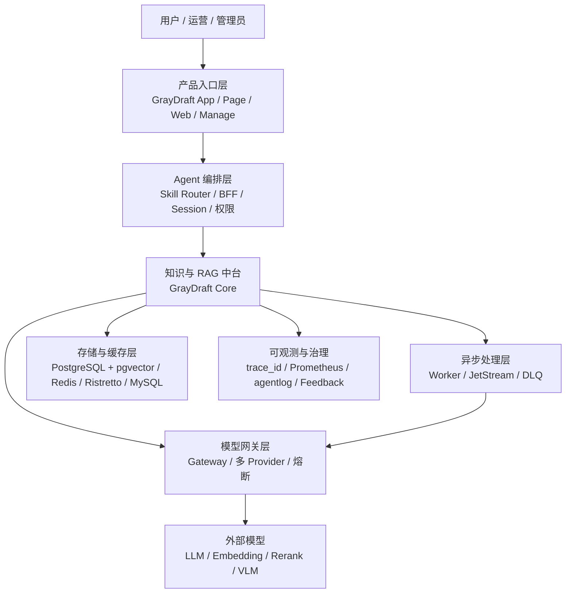
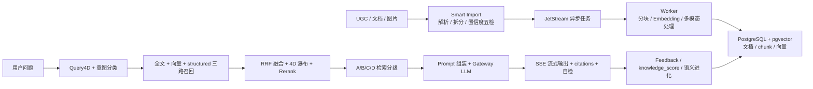
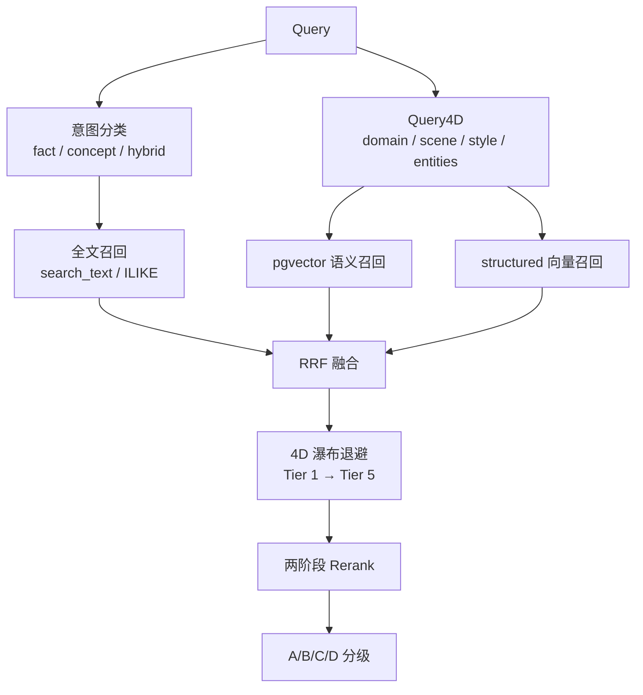
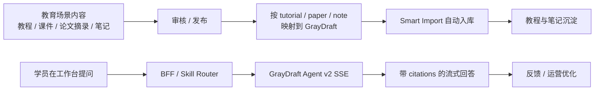
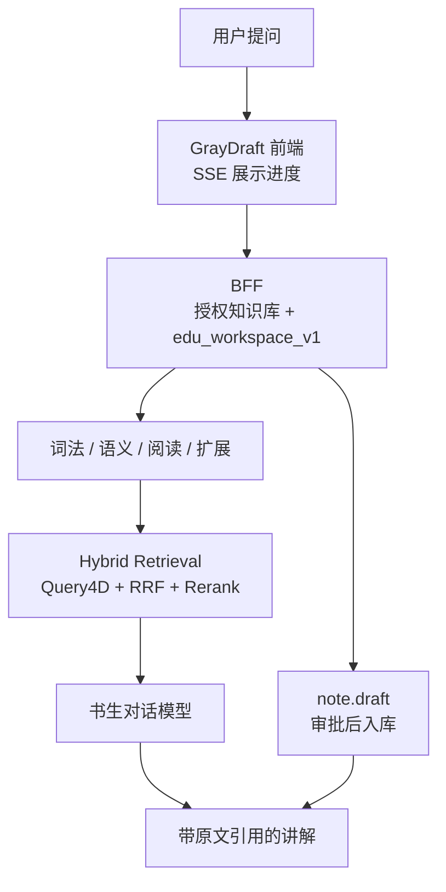

# AI Agent 面试全局视角

> **定位**：把简历里的 GrayDraft / GrayDraft 项目经历，与 `docs/learning` 中的 Agent、RAG、检索、网关、缓存、SSE、BFF、运维内容串成一套可面试表达的全局知识框架。  
> **目标岗位**：AI Agent 应用研发工程师 / AI 应用开发工程师 / RAG 平台工程师。  
> **核心人设**：不是只会调 Prompt，也不是模型训练研究员，而是能把 **Agent + RAG + Tool Use + Memory + 工程可靠性** 落到业务闭环里的应用工程师。

---

## 0. 一句话总纲

> 我做的 AI Agent 方向，本质是把大模型能力从「单次问答」工程化成「可检索、可调用工具、可记忆、可观测、可降级」的业务系统。GrayDraft 承担 Agent 的知识与 RAG 执行层，GrayDraft 承担业务场景、Skill 编排与用户入口，两者组合形成「内容生产 → 智能入库 → 知识沉淀 → Agent 问答 → 反馈治理」的闭环。

面试中要反复强调三点：

1. **Agent 不是一个单点功能**：它由 Planner / Tool Use / Memory / RAG / Guardrails / Observability 组成。
2. **GrayDraft 的价值在中台层**：提供高质量长期知识、检索治理、SSE RAG、语义进化、模型网关与异步入库。
3. **GrayDraft 的价值在教育场景**：把教程、课件页和论文摘录接成「感知 → 决策 → 带引用讲解 → 笔记沉淀」。

---

## 1. 面试开场：30 秒 / 2 分钟版本

### 1.1 30 秒版本

> 我主要做 AI Agent 应用工程化。GrayDraft 是一个资料工作台：导入教程、论文、课件和截图，按材料多轮取证，给出带引用的讲解，并把结论沉淀成还能再查的笔记。

### 1.2 2 分钟版本

> 我做的方向是 AI Agent 应用研发，项目分两层：底层是 GrayDraft，定位为面向 Agent 场景的 RAG 与知识治理中台；上层是 GrayDraft，定位为教育场景和 AI 智能化平台。  
> 在 GrayDraft 里，我设计了 5 服务 Monorepo：Core、Worker、Gateway、Console、Ops。Core 提供检索、对话、入库 API；Worker 负责异步解析、分块、向量化和多模态处理；Gateway 做多 Provider 模型路由、流式代理、熔断和重试；Console 和 Ops 负责可视化和运维。  
> 技术上，我重点做了混合检索和 Agent 化入库：查询侧有 Query4D 四维语义提取、全文 + pgvector + structured 向量三路召回、RRF 融合、两阶段 Rerank、4D 瀑布退避、A/B/C/D 检索分级；入库侧有 Smart Import，包括规则 + LLM 拆分、content_hash 去重、pHash 近重复复用、质量门禁和置信度五检。对话侧提供 SSE 流式 RAG、hybrid / kb_only 路由、答案缓存、答案自检和 citations。  
> 在 GrayDraft 里，授权分区是 `tutorial`、`paper` 和 `note`。导入后由 `edu_workspace_v1` 选择工具，回答引用原文，笔记审批后再入库。  
> 所以如果面试 AI Agent，我会把自己定位成「能把 Agent 从 Demo 做到生产系统的人」：不仅知道 ReAct、Memory、Tool Use，还能处理检索质量、异步解耦、缓存、降级、可观测、成本和安全这些工程问题。

---

## 2. 全局架构：从用户问题到模型输出

### 2.1 五层架构图

### 2.2 每一层面试怎么讲

| 层级 | 作用 | 项目落点 | 面试关键词 |
|------|------|----------|------------|
| 产品入口层 | 承接学员提问和资料导入 | GrayDraft 学习工作台 | SSE 展示工具过程、引用和笔记 |
| Agent 编排层 | 决定调用哪个能力、如何拼上下文 | GrayDraft BFF 五代理、GrayDraft 14 Skill | Tool Use、Router、权限、状态 |
| 知识与 RAG 中台 | 提供长期知识、检索和生成 | GrayDraft Core | RAG、Hybrid Retrieval、Gate、Citations |
| 异步处理层 | 把耗时入库拆成可重放任务 | NATS JetStream、Worker、DLQ | 异步解耦、幂等、失败重放 |
| 模型网关层 | 屏蔽模型差异并统一治理 | Gateway 多 Provider 路由 | 熔断、重试、流式代理、成本控制 |
| 存储缓存层 | 支撑文档、向量、会话、缓存 | pgvector、Redis、Ristretto、MySQL | 向量库、语义缓存、版本失效 |
| 可观测治理层 | 让 Agent 可排障、可评估、可迭代 | trace_id、Prometheus、Feedback、RAGOps | 质量闭环、监控、降级 |

---

## 3. Agent 通用概念与项目映射

### 3.1 Agent = LLM + Planning + Memory + Tool Use

| 通用模块 | 面试定义 | GrayDraft / GrayDraft 映射 | 说明 |
|----------|----------|--------------------------|------|
| LLM | 负责理解、推理、生成 | Gateway 调用 ChatModel / RouterModel | 模型不是系统全部，只是认知核心 |
| Planning | 任务拆解、选择下一步 | Query4D、Smart Import 拆分、Skill Router | GrayDraft 更偏领域工作流，不是完全自主 Agent |
| Memory | 短期上下文 + 长期知识 | session_id、答案缓存、向量库、文档库 | RAG 是长期记忆的重要实现方式 |
| Tool Use | 调用外部 API / 搜索 / 数据库 | BFF 五代理、GrayDraft 14 Skill、GrayDraft HTTP API | Tool 要有 schema、权限、错误处理 |
| Agent Loop | observe → think → act → observe | Core Agent Runtime v2；产品层 Skill 编排 | Core 已具备 Loop，GrayDraft 组装业务 Skill |
| Guardrails | 安全、权限、置信度、降级 | A/B/C/D 检索分级、kb_only、CORS、Token | 生产系统必须限制模型行为 |
| Observability | 日志、trace、指标、反馈 | agentlog、trace_id、Prometheus、Feedback | 面试要强调「可解释、可排障」 |

### 3.2 Agent / Workflow / RAG / Chatbot 的区别

| 类型 | 控制流 | 知识来源 | 工具能力 | 适合场景 | 项目对应 |
|------|--------|----------|----------|----------|----------|
| Chatbot | 多轮对话，通常无复杂动作 | 模型自身或 FAQ | 弱 | 客服、闲聊 | 普通社区问答 |
| RAG | 固定检索 → 生成流水线 | 外部知识库 | 通常固定 | 知识问答、企业文档 | GrayDraft Agent v2 + knowledge.semantic |
| Workflow | 预定义 DAG | 业务系统 + 模型 | 固定节点 | 审核、入库、审批流 | Smart Import 流水线 |
| Agent | 运行时自主决策 | 模型 + 记忆 + 工具 | 动态选择 | 复杂任务、多步执行 | GrayDraft Skill 编排 + GrayDraft 执行层 |

**关键话术**：

> GrayDraft Core 现已具备 Agent Runtime v2（Run + Loop + Memory + Tool）；同时提供 RAG 与知识治理中台能力。完整业务 Agent 在 GrayDraft / GrayDraft 产品层组装 Skill 与用户上下文。

---

## 4. GrayDraft 项目主线：四条链路讲清楚

### 4.1 端到端总链路

### 4.2 入库链路：Smart Import 怎么讲

**面试问题**：你们的知识库如何保证导入质量？

**推荐回答**：

> 我们没有把文档直接切块入库，而是做了 Smart Import 预处理。它先做结构解析和内容识别，再通过规则 + LLM 做标题推断、拆分和 kb_type 分析；随后执行质量门禁和置信度五检，包括结构骨架、实体密度、重复噪声、标题匹配、实体溯源等。低置信内容不会直接入库，而是返回预览和 Warning / Reject，让用户或上层系统确认。提交后通过 NATS JetStream 异步进入 Worker，Worker 再做分块、Embedding、pHash 复用、多模态处理和 pgvector 写入。这样做的目的，是把「垃圾进，垃圾出」的问题挡在入库阶段。

**可展开点**：

| 机制 | 解决的问题 | 面试价值 |
|------|------------|----------|
| content_hash 去重 | 重复文档反复入库 | 幂等、节省成本 |
| pHash 近重复复用 | 图片 / 多模态重复调用 VLM | 降本 |
| 置信度五检 | 低质量内容污染知识库 | 可解释质量门禁 |
| JetStream + DLQ | 入库耗时、失败不可恢复 | 异步解耦、失败重放 |
| DB Schema 持续迭代 | 文档、chunk、taxonomy 演化 | 工程可维护性 |

### 4.3 检索链路：为什么不是简单向量检索

**面试问题**：RAG 检索为什么要混合检索？

**推荐回答**：

> 单纯向量检索擅长语义相似，但对专名、版本号、参数名、模型名这类精确实体不稳定；单纯全文检索又容易漏掉同义表达。所以我在 GrayDraft 里做的是混合检索：先意图分类和 Query4D 提取 domain / scene / style / entities，再并行走全文召回、pgvector 语义召回和 structured 向量第三路，之后用 RRF 融合，因为 RRF 不要求不同召回路的分数同量纲。融合后再做 4D 瀑布退避和两阶段 Rerank，既保证 recall，也保证最终 evidence 的精度。

**检索链路白板**：

**可展开算法**：

| 算法 / 机制 | 一句话 | 面试重点 |
|-------------|--------|----------|
| Query4D | 从 query 提取 domain / scene / style / entities | 让检索从「纯相似」变成「结构化语义约束」 |
| 4D 瀑布退避 | 从严格过滤逐级放宽，最后软加分 | 解决过滤过严导致零召回 |
| RRF 融合 | 多路 rank 融合，不依赖分数同量纲 | 混合检索常见工程解法 |
| 两阶段 Rerank | 先轻量筛，再重排精排 | 质量和成本平衡 |
| A/B/C/D 分级 | 根据 evidence 质量决定注入强度和降级 | 降低幻觉，增强可解释性 |
| Calibrator | 按 kb_type 分布校准阈值 | 不同工作区质量分布不同，不能全局硬编码 |

### 4.4 对话链路：SSE RAG 怎么讲

**面试问题**：你们怎么做流式 RAG？

**推荐回答**：

> 流式 RAG 不是直接把模型 SSE 转给前端。我会先在 Core 里完成缓存检查、检索、分级门控和 Prompt 组装，再通过 Gateway 调用 LLM 流式接口。对前端输出时，我们定义了 retrieval_grade、thinking、meta、chunk、done、error 等事件；如果答案缓存命中，可以直接回放 meta、chunk、done；如果 Gateway 不可用，则走 search_only_fallback，把检索证据整理成可用答案。这样前端体验是实时的，后端也保留了检索 trace、citations、answer_confidence 等可观测字段。

**SSE 面试要点**：

| 主题 | 需要讲到 |
|------|----------|
| 事件设计 | 不只 chunk，还要 meta / done / error / retrieval_grade |
| 缓存回放 | 命中答案缓存时不必重新调用模型 |
| 路由模式 | hybrid 可降级通用 LLM，kb_only 更强调知识库依据 |
| 可靠性 | Gateway 超时走 fallback，前端仍能拿到结果 |
| 用户体验 | 边生成边展示，适合长回答和 Agent 进度反馈 |

### 4.5 语义进化链路：为什么能越用越好

**面试问题**：知识库如何持续优化，而不是一次性构建？

**推荐回答**：

> 我们把知识库看成会演化的语义系统。GrayDraft 通过 Blueprint Agent 按工作区背景和样本文档生成 domain / scene / style 等 taxonomy；后续新内容导入时会通过 Embedding Aligner 将自由文本标签对齐到标准标签。如果 taxonomy 版本变化，不会同步阻塞主链路，而是做影子回填，让 Worker 批量更新存量 chunk 的 4D 标签。再结合用户搜索命中、引用、点赞/点踩和时间衰减形成 knowledge_score，用于低质内容降级。这相当于把 RAG 从静态索引做成了可治理的长期记忆系统。

---

## 5. GrayDraft 项目主线：业务 Agent 怎么落地

### 5.1 业务闭环

### 5.2 面试怎么讲 GrayDraft 的 Agent 价值

> GrayDraft 不是单独做一个聊天框。学员的问题落在某份教程、某个参数、某张课件或某页论文上。工作台先确认授权知识库，再由 `edu_workspace_v1` 选择词法、语义、相邻章节或实体边。回答必须引用原文，笔记经审批后才能再被检索。

### 5.3 14 Skill 的表达框架

不需要逐个背诵所有 Skill，面试按类型讲：

| Skill 类型 | 示例 | 技术重点 |
|------------|------|----------|
| 上下文 | 学员与授权分区 | Session、`X-Authorized-KBs` |
| 资料查询 | 教程、课件、论文摘录、笔记 | 教育检索工具 |
| 交易与任务 | 订单、任务、支付相关查询 | 权限隔离、敏感信息保护 |
| 外部信息 | 天气、提醒管理 | 外部 API、时间任务 |
| 知识问答 | GrayDraft RAG / citations | 检索质量、流式输出 |

**关键话术**：

> Skill 不是简单函数列表，而是业务能力包。每个 Skill 都要定义触发条件、参数 schema、权限边界、失败降级和返回给模型的 observation 格式。

---

## 6. 面试高频题：推荐答法

### 6.1 什么是 AI Agent？

**答法**：

> AI Agent 是以 LLM 为认知核心，结合规划、记忆和工具调用，能够根据环境反馈循环决策并执行任务的系统。它和普通 Chatbot 的区别在于，Chatbot 主要生成文本，Agent 需要选择工具、观察结果、调整下一步。工程上我会把 Agent 拆成决策层、执行层、记忆层和治理层；GrayDraft 主要做执行层里的 RAG 与知识治理，GrayDraft 做业务层的 Skill 编排。

### 6.2 RAG 和 Agent 是什么关系？

**答法**：

> RAG 是 Agent 的一种关键工具和长期记忆实现。Agent 在执行任务时，经常需要从外部知识库读取事实，RAG 提供检索、证据、引用和生成约束。但 RAG 不等于 Agent，因为 RAG 通常是固定的 retrieve → generate 流水线，而 Agent 还包含任务规划、工具选择、状态管理和多步循环。我的项目里 GrayDraft 是高质量 RAG 中台，GrayDraft 在上层把它作为一个 Skill 组合到 Agent 中。

### 6.3 怎么降低幻觉？

**答法结构**：

1. **入库前治理**：Smart Import 质量门禁，避免低质量内容进入知识库。
2. **检索中治理**：混合检索 + RRF + Rerank，提高 evidence 质量。
3. **检索后门控**：A/B/C/D 分级，低质量证据减少注入或降级。
4. **Prompt 约束**：要求基于引用回答，不足时说明不知道。
5. **答案自检**：输出 answer_confidence，检测答案与证据一致性。
6. **反馈闭环**：用户点踩、引用、搜索命中影响 knowledge_score。

### 6.4 怎么做成本和延迟优化？

| 优化点 | 具体做法 | 效果 |
|--------|----------|------|
| L1 / L2 缓存 | Ristretto 进程内 + Redis 跨进程 | 降低重复检索和模型调用 |
| 答案缓存 | 相同问题直接 SSE 回放 | 降低生成成本 |
| 语义缓存 | 相似 query 命中历史结果 | 提高命中率 |
| Embedding 微批 | Worker 批量向量化 | 降低请求次数和限流风险 |
| pHash 复用 | 近重复图片跳过 VLM | 多模态降本 |
| 两阶段 Rerank | 轻量 L1 先筛，再 L2 精排 | 平衡质量和成本 |
| Gateway 路由 | fast / pro 模型分层 | 按场景选择成本 |
| SSE | 首 token 更快，用户感知延迟低 | 改善体验 |

### 6.5 Gateway 为什么要单独做？

**答法**：

> 如果 Core / Worker 直接调用不同模型厂商，业务代码会被模型协议、鉴权、限流、重试、流式格式污染。Gateway 单独抽一层，可以统一 Chat、Embedding、Rerank、VLM 的调用协议，做多 Provider 路由、超时、重试、熔断、流式代理和审计。这样业务层只关心「我要聊天 / 向量化 / 重排」，不关心底层是哪个供应商。

### 6.6 为什么用 SSE，而不是 WebSocket？

**答法**：

> 对 LLM 生成这种服务端单向持续输出，SSE 更简单：基于 HTTP，天然支持流式文本、反向代理友好、前端 EventSource 接入成本低。WebSocket 更适合双向高频交互，比如实时协作或双向协作。GrayDraft 的 RAG 对话主要是请求后服务端持续返回 chunk，所以用 SSE；GrayDraft 的实时列表、社区状态同步这类场景更适合 WebSocket。

### 6.7 为什么用 JetStream / DLQ？

**答法**：

> 入库链路包含解析、拆分、Embedding、多模态识别、数据库写入，耗时长且容易受到模型网关限流影响。如果同步处理，接口会超时，也不方便失败恢复。JetStream 把入库拆成异步任务，Worker 消费；失败任务进入 DLQ，可以查看原因、修复后重放。这样系统具备削峰、重试、幂等和可运维能力。

### 6.8 Tool Use 怎么保证安全？

**答法**：

> Tool Use 的风险在于模型可能选错工具、传错参数或越权调用。所以我会做五层控制：第一，工具 schema 明确参数类型和描述；第二，Router 只暴露当前用户有权限的工具；第三，工具执行前做服务端鉴权和参数校验；第四，对敏感工具做二次确认或只返回脱敏结果；第五，工具失败时返回结构化 observation，而不是把异常栈直接暴露给模型。

### 6.9 Memory 怎么设计？

**答法**：

> 我会把 Memory 分成短期、长期和业务状态三类。短期记忆是当前 session 的多轮上下文；长期记忆主要是文档库 + 向量库，也就是 RAG；业务状态是订单、任务、用户身份这类结构化数据。GrayDraft 主要负责长期知识记忆，通过文档、chunk、pgvector、taxonomy 和缓存提供稳定检索；GrayDraft 负责 session、用户身份和业务状态，再通过 Skill 调用对应数据。

### 6.10 遇到模型不可用怎么办？

**答法**：

> 先分调用类型处理。Embedding 不可用时，入库任务可以重试或进入 DLQ；Rerank 不可用时，可以降级到词法重排；Chat LLM 不可用时，RAG 对话可以走 search_only_fallback，把检索到的证据整理给用户；多 Provider 失败时 Gateway 做熔断和切换。关键是不要让模型不可用导致整个业务不可用，而是按能力分级降级。

---

## 7. 系统设计题模板

### 7.1 题目：设计一个带出处的资料工作台

**需求**：学员可以询问教程里的概念、参数和课件页，也可以把结论写成可再检索的笔记。

### 7.2 推荐架构

### 7.3 答题步骤

1. **识别上下文**：当前学员、授权的 `tutorial` / `paper` / `note`。
2. **规划**：词法、语义、相邻章节或实体边。
3. **权限**：只检索 `X-Authorized-KBs`。
4. **作答或拒答**：引用必须落到原文；证据不足就拒答。
5. **笔记**：`note.draft` 审批后入库。
6. **输出**：SSE 返回工具过程和带引用的讲解。

### 7.4 面试官追问与回答方向

| 追问 | 回答方向 |
|------|----------|
| 怎么处理问错资料库？ | 授权分区绑定 + 实体校验 + 必要时澄清 |
| 如何保证答案有依据？ | citations、A/B/C/D 分级、kb_only 模式、答案自检 |
| 如何避免工具误调用？ | Tool schema、权限过滤、RouterModel、二次确认 |
| 如何做多端一致？ | BFF 聚合能力，前端共享 SSE 协议和 Skill 返回格式 |
| 如何支持运营更新知识？ | 文章审核后 Smart Import 自动入库，低质量内容 Warning/Reject |
| 如何做监控？ | trace_id 贯穿 BFF → Core → Gateway，Prometheus 观测延迟、错误、缓存命中 |

---

## 8. 项目亮点提炼：简历点怎么展开

### 8.1 GrayDraft — Agent 知识库中台

| 简历点 | 面试展开 |
|--------|----------|
| 5 服务 Monorepo | Core / Worker / Gateway / Console / Ops 分层，职责清晰，便于部署和扩展 |
| Go ↔ Python 跨语言编排 | Go 做 API 和业务控制，Python 做模型周边和算法处理，通过 JetStream 解耦 |
| 混合检索 | 全文 + pgvector + structured 向量，RRF 融合，解决单一路召回短板 |
| Query4D / 4D 瀑布 | 把垂直领域语义结构化，兼顾精确过滤和召回兜底 |
| A/B/C/D 分级门控 | evidence 质量决定回答策略，降低幻觉 |
| Smart Import | 入库前质量治理，避免知识污染 |
| Gateway | 多 Provider 路由、熔断、流式代理，屏蔽模型差异 |
| SSE RAG | 面向用户体验的流式生成，同时保留 meta / citations / confidence |
| RAGOps / Feedback | 从一次性 RAG 走向可治理、可迭代的知识系统 |

### 8.2 GrayDraft — 教育场景 + AI 智能化平台

| 简历点 | 面试展开 |
|--------|----------|
| 学习工作台 | 导入教程、课件和论文摘录，发起带引用的提问 |
| BFF 五代理 | SmartImport、RetrievalSearch、文档 CRUD、Agent v2 对话、Prompt 分层 |
| 教育五工具 | 词法、语义、相邻章节、实体边、笔记 |
| SSE | 展示工具过程和流式讲解 |
| 笔记闭环 | 审批后的笔记进入 `note`，下一问可以再检索 |

---

## 9. STAR 故事库

### 9.1 检索质量问题

- **S**：用户问具体教程资料或实体名时，单纯向量检索可能召回语义相似但实体不匹配的 chunk。
- **T**：需要提升专名、场景、风格等垂直语义下的 evidence 精度，同时不能牺牲召回。
- **A**：设计 Query4D 提取 domain / scene / style / entities；检索时先严格过滤，再通过 4D 瀑布逐级放宽；多路召回后用 RRF 融合和 Rerank；最后用 A/B/C/D 分级决定 Prompt 注入强度。
- **R**：检索链路从单一路向量相似升级为可解释混合检索，能在零召回和错召回之间取得平衡，并给后续 citations 和 answer_confidence 提供依据。

### 9.2 入库稳定性问题

- **S**：UGC / 多模态内容直接入库会遇到重复、低质量、结构混乱、模型调用失败等问题。
- **T**：需要让入库过程可控、可解释、可重试。
- **A**：引入 Smart Import 预览、content_hash 去重、pHash 近重复复用、置信度五检；提交后通过 JetStream 进入 Worker，失败进入 DLQ；前端展示导入进度和结果。
- **R**：避免低质量内容污染知识库，同时把耗时模型处理从同步接口中解耦出来，系统具备失败恢复能力。

### 9.3 模型供应商不稳定问题

- **S**：LLM / Embedding / Rerank 依赖外部 Provider，可能超时、限流或不可用。
- **T**：需要让业务系统不被单一模型供应商绑死。
- **A**：抽象 Gateway，统一模型调用协议；实现多 Provider 路由、超时重试、熔断；Rerank 不可用降级词法排序，Chat 不可用降级 search_only_fallback。
- **R**：业务层代码不关心具体 Provider，模型故障时核心检索和问答链路仍有可用降级结果。

### 9.4 业务 Agent 落地问题

- **S**：单纯聊天无法保证教程、参数和课件页的回答有原文依据。
- **T**：需要把 AI 问答和社区业务数据结合。
- **A**：在 GrayDraft 产品层设计 Skill Router 和 教育五工具；概念和参数问题走 `tutorial`，论文页走 `paper`，笔记走 `note`。
- **R**：Agent 从「问答 Demo」变成能服务真实社区业务的智能助手。

---

## 10. 自研 / 接入边界怎么说

面试中要主动说清楚边界，避免被认为把模型能力说成自研。

| 类别 | 项目中如何定位 | 是否自研 |
|------|----------------|----------|
| LLM 流式生成 | Gateway 外调 Provider | 接入 |
| Embedding 模型 | Gateway / Worker 调用外部模型 | 接入 |
| Rerank 模型 | Gateway 调第三方 reranker | 接入 |
| pgvector 余弦检索 | PostgreSQL 扩展能力 | 标准组件 |
| RRF | 经典融合算法，项目中做加权和工程组合 | 标准 + 改良 |
| Query4D | 四维语义标签提取与检索约束 | 自研编排 |
| 4D 瀑布退避 | 严格过滤到软加分的召回策略 | 自研编排 |
| A/B/C/D 检索分级 | evidence 质量分级和路由策略 | 自研规则 |
| 置信度五检 | Smart Import 可解释门禁 | 自研规则 |
| Blueprint 语义进化 | 工作区 taxonomy 自动发现和回填 | 自研编排 |

**推荐话术**：

> 我不会说 LLM、Embedding、Rerank 模型本身是自研；项目的自研价值在于把这些标准能力组合成可解释、可降级、可观测的 Agent 知识治理系统，包括 Query4D、4D 瀑布、分级门控、Smart Import 五检和语义进化。

---

## 11. 技术栈速记表

| 方向 | 技术 | 面试要点 |
|------|------|----------|
| 后端 | Go / Gin | API、服务分层、并发、上下文取消、优雅关停 |
| AI 服务 | Python / FastAPI / Worker | 模型周边、Embedding、Rerank、多模态处理 |
| 数据库 | PostgreSQL + pgvector / MySQL | 文档、chunk、向量、业务数据分层 |
| 缓存 | Ristretto / Redis | L1 / L2 缓存、语义缓存、答案缓存 |
| 消息队列 | NATS JetStream | 异步入库、DLQ、重放、削峰 |
| 前端 | Vue 3 / Vite | SSE 展示、进度反馈、多端 UI |
| 模型网关 | Gateway | 多 Provider、熔断、流式代理 |
| 可观测 | Prometheus / trace_id / agentlog | 延迟、错误、缓存命中、链路追踪 |
| 部署 | Docker / Nginx | 多服务部署、环境变量、反向代理 |

---

## 12. 反问面试官的问题

可以按岗位侧重点选择：

1. 你们当前的 Agent 更偏通用助手，还是垂直业务流程自动化？
2. 你们现在 RAG 的主要瓶颈是召回质量、幻觉、延迟，还是知识更新？
3. Tool Use 是否已经接入真实业务系统？权限和审计怎么做？
4. Memory 是只做上下文窗口，还是有向量长期记忆和用户画像？
5. 模型供应商是否多 Provider？有没有网关、熔断、降级策略？
6. Agent 质量评估用人工反馈、离线评测集，还是线上指标？
7. 团队更需要我补强平台工程、检索算法、业务 Agent，还是前端交互体验？

---

## 13. 面试前最后检查清单

### 13.1 必须能画

- [ ] Agent 四要素：LLM / Planning / Memory / Tool Use。
- [ ] GrayDraft 五层架构：Core / Worker / Gateway / Console / Ops。
- [ ] RAG 全流程：Chunk → Embed → Retrieve → Rerank → Prompt → Generate。
- [ ] 混合检索链路：Query4D → 多路召回 → RRF → 4D 瀑布 → Rerank → Gate。
- [ ] GrayDraft 闭环：导入资料 → 检索取证 → 带引用讲解 → 笔记再入库。

### 13.2 必须能讲

- [ ] Agent、Workflow、RAG、Chatbot 的区别。
- [ ] RAG 如何降低幻觉，以及为什么不能完全消除幻觉。
- [ ] Tool Use 的 schema、权限、执行、observation、降级。
- [ ] Memory 的短期 / 长期 / 业务状态拆分。
- [ ] Gateway 的意义：统一模型协议、多 Provider、熔断、流式代理。
- [ ] JetStream + DLQ 的工程价值。
- [ ] SSE 为什么适合 LLM 流式输出。
- [ ] 自研算法和外部模型接入的边界。

### 13.3 必须避免

- [ ] 不要说「模型是我训练的」，除非确实训练 / 微调过。
- [ ] 不要把 GrayDraft 说成完全自主 Agent 框架；它更准确是 Agent RAG 与知识治理中台。
- [ ] 不要只讲 Prompt，要讲检索、缓存、降级、观测、权限和成本。
- [ ] 不要只讲概念，要落到代码路径、API、数据表、队列、SSE 事件。
- [ ] 不要把工具调用等同于函数调用；Tool 还包括权限、schema、错误语义和可观测。

---

## 14. 推荐阅读路径

| 目的 | 文档 |
|------|------|
| Agent 通用概念 | [学习路径 2 · AI Agent 面试与通用能力](01-interview-roadmap.md) |
| Agent 机制全景 | [AI Agent 核心机制全景图](../01-foundations/01-ai-agent-overview.md) |
| Agent Loop | [AI Loop 机制](../01-foundations/02-agent-loop.md) |
| Tool Use | [AI 工具调用](../01-foundations/03-tool-use.md) |
| Memory | [AI 记忆机制](../01-foundations/04-memory.md) |
| GrayDraft 算法全景 | [GrayDraft-AI算法与作用总览](../03-algorithms/README.md) |
| 自研算法深挖 | [GrayDraft-自研AI算法深度学习](../03-algorithms/02-custom-algorithms.md) |
| 标准与改良算法 | [GrayDraft-标准与改良AI算法深度学习](../03-algorithms/01-standard-and-improved.md) |
| 检索链路 | [检索链路](../02-pipeline/02-retrieval.md) |
| SSE RAG | [SSE RAG 对话](../02-pipeline/03-agent-v2-sse.md) |
| 模型网关 | [Gateway 模型网关](../04-architecture/04-model-gateway.md) |
| 缓存体系 | [缓存体系](../04-architecture/03-cache.md) |
| BFF 代理 | [GrayDraft BFF 代理能力详解](../04-architecture/06-bff-proxy-capabilities.md) |
| 可观测 | [可观测性](../04-architecture/07-observability.md) |
| 部署运维 | [部署运维](../04-architecture/08-deployment-ops.md) |

---

## 15. 最终记忆口诀

> **一层产品，二层编排，三层知识，四层模型，五层治理。**  
> 产品层讲 GrayDraft，编排层讲 Skill / BFF，知识层讲 GrayDraft RAG，模型层讲 Gateway，治理层讲缓存、降级、观测、反馈。  
> 面试时先讲业务闭环，再讲架构分层，最后讲检索、入库、SSE、Tool、Memory 的工程细节。
